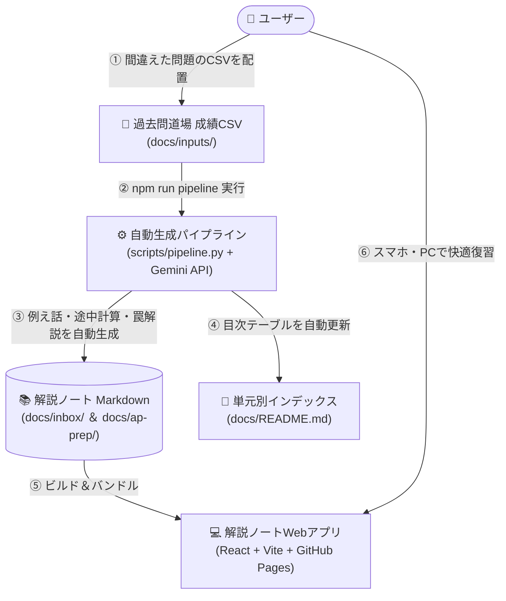

# 📚 応用情報技術者試験（AP）直感攻略ノート

> 🌐 **Webアプリ公開URL（GitHub Pages）**:  
> 👉 **[https://h4npen.github.io/AP-MindMap-Anki/](https://h4npen.github.io/AP-MindMap-Anki/)**  
> *(PC・スマホ・iPadからインストール不要で即座に学習可能！ホーム画面への追加推奨)*

過去問道場で間違えた問題をもとに、文系出身者向けに**「日常のたとえ話」「計算式の途中展開」「引っ掛けの罠」**を徹底解説した自習用解説ノートWebアプリケーションです。通勤バスやスキマ時間でサクッと読めるモバイルファースト構成を採用しています。

- 👉 **[応用情報技術者試験 直感攻略ノート一覧（単元別目次・作成ルール）はこちら](./docs/README.md)**

---

## 🌐 システム構成と自動生成パイプライン

過去問道場の成績CSVや問題リストから、解説ノートの作成・目次更新・ビルド・GitHub Pages公開までをワンストップで自動化する構成になっています。



---

## ⚡ 主な特徴・機能

### 1. 📘 文系・非エンジニア向けの「直感攻略解説ノート」
各ノートは以下の統一フォーマットで作成され、丸暗記ではなく「なぜそうなるのか（Why）」をストーリーで腹落ちさせます。
1. **ネタバレ防止の折りたたみ正解**: 問題文の直下では `<details>` タグで正解を隠し、自力で考えてからタップして答え合わせができるクイズ体験を担保。
2. **一枚でわかる要約チャート・合言葉**: Mermaid図や早見表、3ステップ解法で思考の手順を視覚化。
3. **日常のたとえ話**: 専門用語を「パン屋」「ホテル」「銀行」「宅配便」などの身近なシチュエーションに翻訳。
4. **選択肢のひっかけポイント ＆ 途中計算パズル**: なぜ他の選択肢が誤りなのか、小数の割り算や2進数変換などの途中式を省略せず筆算レベルで解説。

### 2. 📱 通勤・スキマ時間に最適化されたノートビューア（アクティブリコール対応）
- **解説ブラインド（白紙テスト）＆ 抜き打ち5問クイズモード**: ノートを開いた際、最初は「問題文と選択肢」だけを表示し、解説をブラインド保護。頭の中で「日常のたとえ話」と「他選択肢が×の理由」を思い出してから4択ボタンで回答・解説アンロックできます。また、一覧画面から「要復習・読了からランダム5問テスト」をワンタップで開始できます。
- **🗂️ 頻出・必須単語帳（赤シート一覧表 ＆ 1語1答フラッシュカード）**: これまでの全問題から「⭐ノートの主役用語」だけでなく**「🔀選択肢で登場したひっかけ・対比の関連用語」**まで自動抽出（約300語）。アプリ上で赤シート風に答えを隠してタップでめくる一覧表と、1語1答フラッシュカードの両方で高速暗記できます。
- **3段階の定着度管理（🔴要復習 / 🟡あやふや・読了 / 🟢瞬殺できる）**: 単なる「読んだだけ」と「見ずに理由まで3秒で即答できる（瞬殺）」を明確に区別して記録・フィルタリング可能（既存の読了データは自動で `🟡あやふや・読了` に引き継がれます）。
- **フォルダ・単元・全文検索**: 未読・学習中の `inbox` と定着済みの `ap-prep`、シラバス中分類、および全文キーワードから目的のノートを瞬時に絞り込み可能。

---

## 🚀 使い方・コマンド一覧

### 1. 間違えた問題から解説ノートを自動生成する
`docs/inputs/` フォルダに過去問道場の成績CSVを置き、以下のワンコマンドを実行するだけで、解説ノート作成・目次更新・ビルド・GitHub Pages公開まで全自動で完了します。

```bash
# 過去問道場の成績CSVから解説ノートを自動生成＆Push
npm run pipeline docs/inputs/reportXXXXXXXX.csv

# （Pushせずに内容だけ確認したい場合）
python scripts/pipeline.py docs/inputs/reportXXXXXXXX.csv --no-push
```

### 2. ローカル開発・ビルド・印刷エクスポート

```bash
# ローカル開発サーバーの起動
npm run dev

# 本番用ビルド
npm run build

# 印刷・PDF化用HTMLの一括出力（通常解説ノート print_*.html・別冊問題集 workbook_*.html・暗記単語帳 glossary_*.html を出力）
npm run export-print

# 印刷履歴を更新せず、別冊の「赤ペン3秒テスト問題集（workbook_*.html）」のみを一括作成
npm run export-workbook

# 印刷履歴を更新せず、別冊の「二つ折り暗記単語帳（glossary_*.html）」のみを一括作成
npm run export-glossary

# オフライン単一HTMLアプリの出力
npm run export-offline
```
