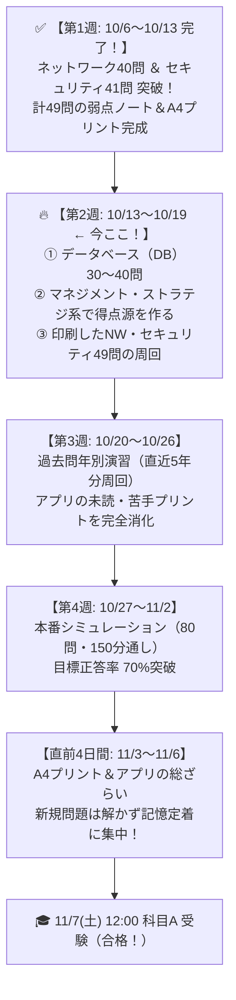

# 🎯 応用情報技術者（AP）科目A 4週間合格ロードマップ（10/13 最新進捗版）

> **受験日**: 科目A 2026年11月7日(土) 12:00（福岡・香椎駅前テストセンター）  
> **残り日数**: **あと 25日**（2026年10月13日 現在）  
> **合格基準**: 80問中 48問以上正解（得点率 60%以上）  
> **現在のストック数**: **計 75問**（ネットワーク30問・セキュリティ25問・DB/PM/法務ほか20問）  

---

## 🏆 これまでの学習達成状況（進捗トラッカー）

| 日付 | 実施内容 | 演習数 | 弱点ノート作成 | 印刷ステータス | 状態 |
| :--- | :--- | :---: | :---: | :---: | :---: |
| **10/5(月)** | 初回実力診断（各分野横断演習） | 35問 | 22問作成 | A4印刷済 | ✅ **完了** |
| **10/7(水)** | **ネットワーク分野 集中演習** | 40問 | 27問作成 | A4印刷済 | ✅ **完了** |
| **10/13(火)** | **セキュリティ分野 集中演習** | 41問 | **22問作成** | **A4差分印刷済** | ✅ **完了** |
| **次回目標** | **データベース ＆ マネジメント・ストラテジ系** | 各30〜40問 | 随時追加 | 差分印刷予定 | 🔥 **進行中** |

---

## 📅 受験日程 ＆ 会場情報

| 試験区分 | 受験日時 | 会場 | 住所・連絡先 |
| :--- | :--- | :--- | :--- |
| **科目A（150分）** | **2026年11月7日(土) 12:00** | 香椎駅前アポロパソコンスクールテストセンター | 福岡市東区香椎駅前1-8-14 エポックビル 5階 TEL: 092-674-1633 |
| **科目B（150分）** | **2026年12月6日(日) 12:00** | 香椎駅前アポロパソコンスクールテストセンター | （同上） |

---

## 🗺️ 全体ロードマップ（現在地：第2週突入！）

---

## 🎯 週別詳細アクションプラン

### ✅ 【第1週】10/6(火) 〜 10/13(火)：テクノロジ2大巨頭（NW・セキュリティ）制覇！【達成】
* **達成済み成果**:
  - [x] **ネットワーク分野 40問完走**：サブネット計算、ARP、NAT/NAPT、ルーティングなど27問をノート化＆印刷完了。
  - [x] **セキュリティ分野 41問完走**：CIA、リスクベース認証、3Dセキュア2.0、SBOM、CVE、水飲み場型攻撃など22問をノート化＆印刷完了。
  - 👉 **科目Aだけでなく、12月の「科目B（必須のセキュリティ＋選択のNW）」の土台が一気に固まりました！**

---

### 🔥 【第2週】10/13(火) 〜 10/19(月)：DB攻略 ＆ マネジメント・ストラテジ系で稼ぐ！【今週のメイン】
* **目標**: テクノロジの残り重要分野「データベース」を押さえつつ、暗記コスパ最強の「マネジメント・ストラテジ系」で一気に合格点（60%）への貯金を作る。
* **今週やること**:
  1. **データベース（DB）分野（30〜40問）**:
     - [ ] 正規化（第1〜第3正規形）、SQL文、トランザクション（ACID特性・ロック制御）、E-R図。
  2. **マネジメント系（30〜40問）★コスパ最強の得点源**:
     - [ ] プロジェクトマネジメント（EVM、アローダイアグラム、ファンクションポイント法）
     - [ ] サービスマネジメント ＆ システム監査（SLA、ITIL、システム監査人の独立性）
  3. **ストラテジ系（30〜40問）★文系の強い味方**:
     - [ ] 企業と法務（著作権、請負・派遣、不正競争防止法、損益分岐点や財務会計パズル）
  4. **A4プリント＆アプリのスキマ復習**:
     - [ ] 手元に印刷した「ネットワーク（27問）」「セキュリティ（22問）」のA4用紙をパラパラめくり、正解を隠して即答できるかチェック！

---

### 【第3週】10/20(火) 〜 10/26(月)：基礎理論・システム構成要素 ＆ 年別（回別）過去問演習
* **目標**: 分野別から「ランダム・回別出題」に切り替え、**過去問道場での初見正答率70%** を目指す。
* **やること**:
  1. **システム構成要素・ソフトウェア・ハードウェア（30〜40問）**:
     - [ ] 稼働率計算（直列・並列・MTBF/MTTR）、OSのタスク管理・メモリ管理。
  2. **回別演習スタート**:
     - [ ] 直近4〜6期分（令和4年〜令和6年）を、1日40問ペースで解く。
  3. **アプリの未読ノート全消化**:
     - [ ] アプリのすべてのノートを「読了済」にし、A4プリントで間違えた問題に蛍光ペンで印をつける。

---

### 【第4週】10/27(火) 〜 11/2(月)：本番想定（通し演習）＆ 弱点撲滅
* **目標**: 150分で80問を解くペース配分を体得し、マークミス・時間配分の不安をなくす。
* **やること**:
  1. **本番シミュレーション**: 週末に1回、**80問通し（制限時間150分）** で解く。
     - 目安：1問あたり約1.5分（約120分で解き終わり、30分見直し）。
  2. **合格ライン確認**: 初見回で **70〜75%以上** 取れれば科目Aは安全圏。
  3. **苦手ジャンルのピンポイント補強**: アプリ内の苦手分野ノートとA4プリントを集中周回。

---

### 【直前4日間】11/3(火祝) 〜 11/6(金)：総ざらい ＆ コンディション調整
* **目標**: 新しいことには手を出さず、**「間違えたことのある問題（ストックしたプリント・ノート）」を100%確実に正解**できるようにする。
* **やること**:
  1. **新規問題の演習をストップ**: 新しい難問で自信をなくすのを避ける。
  2. **A4プリント束 ＆ アプリの全ノート総ざらい**: これまでにストックした解説ノートを最初から最後まで流し読み。
  3. **生活リズムの調整**: 試験は **12:00開始** なので、11:00頃に頭が一番冴えるよう起床時間や昼食のタイミングを合わせる。

---

## ⏱️ 1日の推奨学習ルーティン（紙プリント ＆ Webアプリ ハイブリッド）

| 時間帯 | 目安時間 | 学習内容 | 使うツール |
| :--- | :---: | :--- | :--- |
| **朝・昼休み** | 15〜20分 | 印刷したA4プリント（NW・セキュリティ）を5〜10枚めくって復習 | **A4印刷プリント** |
| **移動中・スキマ** | 20〜30分 | スマホで解説ノート確認・チェックボタン更新 | **本アプリ（GitHub Pages）** |
| **夜（メイン）** | 45〜60分 | 過去問道場で次の分野を40問解く → CSV投入で新ノート＆印刷生成 | **PC（過去問道場 ＋ 自動パイプライン）** |
| **合計** | **約1.5〜2時間** | （無理なく毎日継続できるペース！） | |
