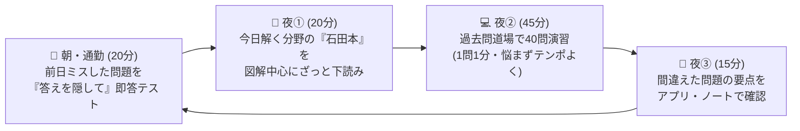

# 🎯 応用情報技術者（AP）科目A 20日間逆転合格ロードマップ（10/16 改訂版）

> **受験目標日**: 科目A **2026年11月5日(木)**（※会場予約日 11/5〜11/7）  
> **残り日数**: **あと 20日**（2026年10月16日 現在）  
> **合格基準**: 80問中 **48問以上正解（60.0%）**  
> **現在の演習累計**: 116問（初回35問＋NW 40問＋セキュリティ41問）／ 弱点ノート75本  

---

## 🚨 現状診断：今のスケジュール・ペースで合格できるか？

結論から言うと、**「これまでのペース（11日間で116問・解説を読んで終わり）」のままでは合格ライン（48問）に届きません**。今日から以下の**3つの軌道修正**を行えば、残り20日で十分逆転合格できます。

### なぜ今のままだと危ないのか？（3つの課題）
1. **演習量の不足**: 科目Aは過去問からの再出題が約5〜6割を占めます。最低でも**累計600〜700問**に触れる必要がありますが、現在116問（目標の約18%）です。
2. **「テキストで全体像（幹）を掴む前」に問題を解いている**: 基礎の仕組み（公開鍵やOSI参照モデルなど）を知らずに解くため、初見で6割以上間違え、解説ノートを読んで理解するだけで脳のメモリを使い果たし、翌日には抜けてしまいます。
3. **コスパ最強の「ストラテジ系（20問）」「マネジメント系（10問）」が手つかず**: テクノロジ系だけで6割取るのは至難の業です。**全体の37.5%（30問）を占めるマネジメント・ストラテジ系を先に固めて22〜24問稼ぐ**のが最短合格の鉄則です。

---

## 🎯 合格点（48問 / 80問）をもぎ取る配点戦略

| 分野 | 本番出題数 | 目標正解数（目標率） | 残り20日の戦い方 |
| :--- | :---: | :---: | :--- |
| **ストラテジ系**（企業・法務・経営） | 20問 | **15問（75%）** | **【最優先の得点源】** 日本語の用語暗記中心。1週間集中すれば一番伸びる！ |
| **マネジメント系**（PM・SM・監査） | 10問 | **7問（70%）** | **【コスパ最強】** 範囲が最も狭く、パターン問題ばかり。確実に7割取る！ |
| **セキュリティ・NW** | 約15問 | **10問（67%）** | すでに81問演習済み。テキストで基礎の幹を固めて解き直せば得点源になる！ |
| **DB・構成要素・開発・基礎理論ほか** | 約35問 | **18問（51%）** | DB・稼働率・OS・開発手法の頻出問題だけ拾う。**重い数学や複雑なアルゴリズム計算は思い切って捨てる！** |
| **合計** | **80問** | **50問（62.5%）** | **合格ライン（48問）を突破！** |

---

## 🧠 「翌日には忘れている」を防ぐベストな学習法（1日90〜120分）

解説を「読んでなるほど」で終わらせず、**「20分テキスト下読み → 40問演習 → 翌朝思い出すテスト」**の3ステップに固定します。

1. **ノートは「読む」のではなく「クイズ」として使う**:
   - アプリを開くときは、問題文だけ見て**「正解はどれか」「なぜ他の3つがバツか」を頭の中で言ってから** `
`（正解）を開きます。
2. **1問に3分以上悩まない**:
   - 科目Aの知識問題は「知っていれば30秒、知らなければ10分考えても出ない」問題が大半です。1分考えて分からなければすぐ解答を見て、テンポよく回転数を上げてください。

---

## 📅 10/16(金) 〜 11/5(木) 毎日学習スケジュール（20日間）

### 【Phase 1】10/16(金) 〜 10/20(火)：基礎の穴埋め（セキュ・NW・DB）＋ 復習定着（5日間）
> これまで解いたNW・セキュリティの「基礎のグラつき」を石田本で固めつつ、テクノロジ最後の柱「データベース」を攻略します。

| 日付 | 朝・通勤（20分） | 夜①：石田本下読み（20分） | 夜②：過去問道場（50分） |
| :--- | :--- | :--- | :--- |
| **10/16(金)** | セキュリティ弱点ノート前半（11問）をクイズ復習 | **第11章 セキュリティ**（公開鍵・署名・PKI・SSLの図解） | 道場で「先週間違えたセキュリティ22問」を解き直し＋新規15問 |
| **10/17(土)** | セキュリティ弱点ノート後半（11問）をクイズ復習 | **第10章 ネットワーク**（OSI 7階層・IP/MAC・ARP・NAPT） | 道場で「先週間違えたNW 27問」を解き直し＋新規15問 |
| **10/18(日)** | NW・セキュリティで2回間違えた問題のみ総復習 | **第9章 データベース**（3層スキーマ・正規化・E-R図） | **データベース分野 40問**（前半：設計・正規化・トランザクション） |
| **10/19(月)** | 前日のDBミス問をクイズ復習 | **第9章 データベース**（SQL・ACID特性・排他制御） | **データベース分野 40問**（後半：SQL・ロック・障害回復） |
| **10/20(火)** | DBミス問総復習 | **第8章 コンピュータシステム**（稼働率MTBF・OSタスク管理・メモリ） | **システム構成要素・OS分野 40問** |

---

### 【Phase 2】10/21(水) 〜 10/26(月)：得点源の「マネジメント・ストラテジ・開発」を一気に稼ぐ（6日間）
> ここで合格点（60%）への貯金を一気に作ります！

| 日付 | 朝・通勤（20分） | 夜①：石田本下読み（20分） | 夜②：過去問道場（50分） |
| :--- | :--- | :--- | :--- |
| **10/21(水)** | システム構成・OSのミス問復習 | **第1章 情報システム開発**（開発モデル・テスト・レビュー） | **システム開発技術・開発管理 40問** |
| **10/22(木)** | 開発技術のミス問復習 | **第2章 プロジェクトマネジメント**（PMBOK・EVM・アロー図） | **プロジェクトマネジメント 40問** |
| **10/23(金)** | PMのミス問復習 | **第3章 サービスマネジメント ＆ 第4章 システム監査** | **サービスマネジメント・システム監査 40問** |
| **10/24(土)** | SM・監査のミス問復習 | **第5章 ストラテジ①**（システム企画・経営戦略・SWOT・PPM） | **システム企画・経営戦略 50問** |
| **10/25(日)** | 経営戦略のミス問復習 | **第5章 ストラテジ②**（技術戦略・ビジネスインダストリ・企業活動） | **ビジネスインダストリ・企業活動（会計・損益分岐点） 50問** |
| **10/26(月)** | 企業活動のミス問復習 | **第5章 ストラテジ③**（法務：著作権・派遣と請負・個人情報保護法） | **法務 40問** |

---

### 【Phase 3】10/27(火) 〜 11/2(月)：年度別（回別）通し演習 ＆ 弱点ループ（7日間）
> 分野別から「本番と同じ80問の構成（回別）」に切り替え、全体の時間配分と再出題パターンを仕上げます。

| 日付 | 朝・通勤（20分） | 夜（70〜90分）：回別過去問演習 ＆ 見直し |
| :--- | :--- | :--- |
| **10/27(火)** | 法務・ストラテジのミス問復習 | **令和6年 秋期 午前（問1〜問40：テクノロジ前半）**＋ミス問復習 |
| **10/28(水)** | 前日のミス問を即答テスト | **令和6年 秋期 午前（問41〜問80：セキュ・PM・ストラテジ）**＋ミス問復習 |
| **10/29(木)** | 前日のミス問を即答テスト | **令和6年 春期 午前（問1〜問40）**＋ミス問復習 |
| **10/30(金)** | 前日のミス問を即答テスト | **令和6年 春期 午前（問41〜問80）**＋ミス問復習 |
| **10/31(土)** | 週間ミス問総ざらい | **【本番模試①】令和5年 秋期 午前（全80問通し・120分目標）**＋弱点補強 |
| **11/1(日)** | 模試①のミス問解き直し | **【本番模試②】令和5年 春期 午前（全80問通し・目標正答率65%以上）**＋弱点補強 |
| **11/2(月)** | 模試②のミス問解き直し | **令和4年 秋期 午前（問25〜問80：DB・NW・セキュ・PM・ストラテジ重点）** |

---

### 【Phase 4】11/3(火祝) 〜 11/5(木)：直前総仕上げ（3日間）
* **11/3(火祝)**: 過去問道場の「ミスした問題」およびアプリのノート・A4プリントを全件テスト形式で総ざらい（目標：既出問題の正答率95%）。
* **11/4(水)**: 暗記系（法務・経営戦略・セキュリティ用語・OSI参照モデル・暗号と署名）の最終確認。夜は早めに就寝。
* **11/5(木)〜**: **🎓 科目A 本番受験！**（分かる問題からテンポよく解き、計算が重い問題は後回しにして確実に48問以上を確保する！）
