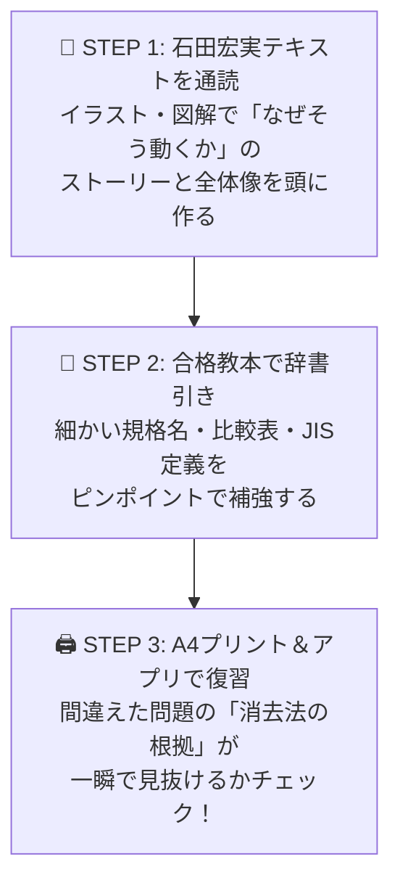

# 弱点分析に基づく「重点テキスト基礎学習ガイド」（合格教本 ＆ 石田宏実本 対応）

> **想定読者**: 過去問演習（NW 40問・セキュリティ 41問）を終え、手持ちのテキストで基礎の土台を固めたい受験者  
> **対象テキスト**:  
> 1. 📘 **『この１冊で合格！ 石田宏実の応用情報技術者 テキスト＆問題集』**（KADOKAWA）  
> 2. 📗 **『令和07年【春期】【秋期】応用情報技術者 合格教本』**（技術評論社）  
> **所要時間**: 5分（ガイド確認）  
> **対象過去問**: 累計75問の誤答・未回答データ分析  

---

## 0. 一枚で：これまでの誤答傾向とテキスト2冊の最強連携術！

これまでストックした解説ノート75問（うち**ネットワーク25問・セキュリティ29問**）を分析すると、失点の原因は以下の**3つの混同**に集約されます。

1. **「OSIのどの階層で、誰が何をしているのか」の混同**（ルータ、L2スイッチ、ARP、TCP/UDPなど）
2. **「暗号・認証の役割分担」の混同**（共通鍵・公開鍵・デジタル署名・CA証明書の使い分け）
3. **「アルファベット3〜4文字の重要用語・攻撃手法」の混同**（CVE、SBOM、CC、C&Cサーバ、オープンリレーなど）

---

## 1. 重点的に基礎から読むべき【4大コア単元】

### 🌐 重点①：OSI基本参照モデル と 各層の機器・プロトコル
* **これまで間違えた代表問題**:
  * リピータ（第1層：物理層）
  * L2スイッチ / ブリッジ（第2層：データリンク層）
  * ルータ越え通信のIPとMACの変化（第3層：ネットワーク層）
  * TCPとUDPの違い（第4層：トランスポート層）
  * ARP（要求＝ブロードキャスト、応答＝ユニキャスト）
  * DHCPDISCOVER（送信元 `0.0.0.0` → 宛先 `255.255.255.255`）

* **なぜ基礎から読むべきか**:
  「IPアドレスを見るのは第3層（ルータ）」「MACアドレスを見るのは第2層（L2スイッチ）」「ポート番号を見るのは第4層（TCP/UDP）」という**階層ごとの境界線**が頭に入ると、ネットワーク問題の半分は消去法で即答できるようになります。

* **📖 テキストの該当箇所**:
  | テキスト | 章・節タイトル | ページ目安・読むべきポイント |
  | :--- | :--- | :--- |
  | **📘 石田宏実本** | **第10章 ネットワーク** ・OSI基本参照モデルとTCP/IP ・LAN間接続装置 ・TCPとUDP | **p.480〜前半** パケットがカプセル化されてバケツリレーされる図解を重点確認。「宛先IPは最後まで変わらず、宛先MACだけルータごとに書き換わる」仕組みを腹落ちさせる。 |
  | **📗 合格教本** | **第7章 ネットワーク** ・7.1 通信プロトコルの標準化 ・7.2 ネットワーク接続装置と関連技術 ・7.5 トランスポート層のプロトコル | **p.420〜付近** 「OSI 7階層と各層の装置・プロトコル対応表」を重点チェック。TCPの3ウェイハンドシェイクとUDPの比較表を確認。 |

---

### 🌐 重点②：IPアドレス計算（CIDR・サブネット）とルーティング・名前解決
* **これまで間違えた代表問題**:
  * サブネット・ブロードキャストアドレス計算（`/20`、`/28`の降順割り当て）
  * プライベートIPアドレスの範囲（クラスA/B/C）
  * ルーティングのロンゲストマッチ（最長一致）
  * DNS逆引き（PTRレコード）、IPv6の省略表記ルール（`::`は1回だけ）
  * WAN交換方式（フレームリレー、ATM 53バイト固定長セル、PPP）

* **なぜ基礎から読むべきか**:
  `/20` や `/28` といったプレフィックス表記（CIDR）を見た瞬間に「ブロックのサイズ（16個区切り等）」がイメージできれば、計算問題は確実な得点源に変わります。

* **📖 テキストの該当箇所**:
  | テキスト | 章・節タイトル | ページ目安・読むべきポイント |
  | :--- | :--- | :--- |
  | **📘 石田宏実本** | **第10章 ネットワーク** ・IPアドレスとサブネットマスク ・ルーティング ・DNSとDHCP、NAT/NAPT | **p.500〜中盤・後半** 2進数と10進数の変換、サブネット分割の図解を確認。NAT（1対1変換）とNAPT/IPマスカレード（ポート番号を使って1対多変換）の違いを比較。 |
  | **📗 合格教本** | **第7章 ネットワーク** ・7.3 データリンク層の制御とプロトコル ・7.4 ネットワーク層のプロトコルと技術 ・7.6 アプリケーション層のプロトコル ・7.8 交換方式 / 7.9 無線LAN | **p.445〜p.510付近** プライベートIPアドレスの3クラス表、IPv6表記、ロンゲストマッチの例題、DNSレコード種別（A, MX, PTR, NS）、IEEE 802.11ac（5GHz）を確認。 |

---

### 🔒 重点③：暗号技術 と 認証・PKI（公開鍵基盤）
* **これまで間違えた代表問題**:
  * 楕円曲線暗号（ECC：公開鍵暗号、RSAより短い鍵長で同等の強度）
  * 無線LANの暗号規格（WPA2-AES / CCMP 128ビット固定）
  * HTTPS（SSL/TLSによる暗号化＋サーバ証明書、プロキシ越えのエンドツーエンド暗号化）
  * TLSクライアント認証の証明書送付順序
  * IPsec（AH＝認証のみ・暗号化なし、ESP＝暗号化＋認証）
  * リスクベース認証 ＆ 3Dセキュア 2.0、SMTP-AUTH

* **なぜ基礎から読むべきか**:
  セキュリティ分野の最大の柱です。「**共通鍵（AES）**＝高速・鍵配送が課題」「**公開鍵（RSA/ECC）**＝誰の鍵を使うか（暗号化は受信者の公開鍵、署名は送信者の秘密鍵）」の整理は、午後試験でも毎回問われます。

* **📖 テキストの該当箇所**:
  | テキスト | 章・節タイトル | ページ目安・読むべきポイント |
  | :--- | :--- | :--- |
  | **📘 石田宏実本** | **第11章 セキュリティ** ・暗号化技術（共通鍵・公開鍵・ハイブリッド） ・デジタル署名と認証局（CA/PKI） ・SSL/TLS、IPsec、無線LANセキュリティ | **p.550〜前半・中盤** 「誰の公開鍵でロックし、誰の秘密鍵で開けるのか」のイラスト図解を熟読。ハイブリッド暗号（SSL/TLS）の手順の流れをストーリーで掴む。 |
  | **📗 合格教本** | **第8章 セキュリティ** ・8.1 暗号化 ・8.2 無線LANの暗号 ・8.3 認証 ・8.4 デジタル署名とPKI ・8.5 情報セキュリティ実装技術 | **p.520〜p.570付近** AES・RSA・楕円曲線暗号（ECC）の比較、WPA2（CCMP/AES）、リスクベース認証、ファイアウォールのパケットフィルタリング（上から順にFirst Match）を確認。 |

---

### 🔒 重点④：サイバー攻撃手法・脆弱性対策 と セキュリティ管理（CIA・法規）
* **これまで間違えた代表問題**:
  * XSS対策（HTML特殊文字 `<` `>` のエスケープ・サニタイジング）
  * セッション管理（重要処理前の再認証、ログアウト時の**サーバ側**セッションID無効化）
  * ボットネットとC&Cサーバ、水飲み場型攻撃、DNSキャッシュポイズニング、メール第三者中継（オープンリレー）
  * 情報セキュリティの3大要件 **CIA**（機密性・完全性・可用性）とJIS Q 27000定義
  * 脆弱性管理（**CVE**＝脆弱性識別番号、**SBOM**＝ソフトウェア部品表）
  * 評価基準・法規（**CC / ISO 15408**＝IT製品評価基準、サイバーセキュリティ基本法と**NCO/NISC**）

* **なぜ基礎から読むべきか**:
  攻撃手法は「攻撃名 ⇔ 仕組み ⇔ 根本対策」の3点セットで覚えるだけで、迷わず正解を選べます。また、CVE・SBOM・3Dセキュア2.0は近年の新傾向として超頻出です。

* **📖 テキストの該当箇所**:
  | テキスト | 章・節タイトル | ページ目安・読むべきポイント |
  | :--- | :--- | :--- |
  | **📘 石田宏実本** | **第11章 セキュリティ** ・サイバー攻撃の手口と対策 ・Webアプリケーションの脆弱性 ・情報セキュリティマネジメント（CIA、ISMS） | **p.580〜後半** SQLインジェクション・XSS・CSRF・セッションハイジャックの「違いと対策の対応表」を重点確認。 |
  | **📗 合格教本** | **第8章 セキュリティ** ・8.6 情報セキュリティの脅威と攻撃手法 ・8.7 情報セキュリティ管理 | **p.575〜p.610付近** 各種攻撃の定義一覧表、JIS Q 27000の用語定義（機密性・真正性・責任追跡性など）、CVE/CVSS/CWEの違い、ISO/IEC 15408（CC）を確認。 |

---

## 2. 【第2週の予習】これから挑む「データベース」等の読むべき箇所

第2週（10/13〜10/19）で過去問演習に入る前に、以下の箇所を**石田宏実本で30分だけ下読み**しておくと正答率が大幅に上がります！

| 分野 | 📘 石田宏実本 | 📗 合格教本 | 重点チェックキーワード |
| :--- | :--- | :--- | :--- |
| **データベース** | **第9章 データベース** （p.420〜付近） | **第6章 データベース** （p.350〜付近） | ・3層スキーマ（外部・概念・内部） ・第1〜第3正規化の手順 ・SQL（GROUP BY / HAVING / JOIN） ・トランザクションの**ACID特性**と排他制御（ロック） |
| **マネジメント系** | **第2章〜第4章** （p.70〜p.180付近） | **第10章〜第12章** （p.660〜p.730付近） | ・PMBOK、アローダイアグラム（クリティカルパス） ・SLA / ITIL（サービスレベル管理） ・システム監査（独立性・自己監査禁止・社長承認） |
| **ストラテジ・法務** | **第5章 ストラテジ** （p.185〜p.260付近） | **第13章〜第15章** （p.735〜巻末） | ・損益分岐点計算、投資評価（PBP / ROI / NPV） ・バリューチェーン、SWOT、PPM ・労働者派遣法 vs 請負（指揮命令権）、個人情報保護法 |

---

## 🎯 自宅学習での2分アクション（定着チェック）

- [ ] **『石田宏実テキスト』の第10章（NW）・第11章（セキュリティ）に付箋を貼り、まずは図解を中心にざっと通読する！**
- [ ] **通読後にA4プリント（または本アプリのノート一覧）を見返し、「なぜ他の選択肢がバツなのか」を自分の言葉で説明できるか試す！**
