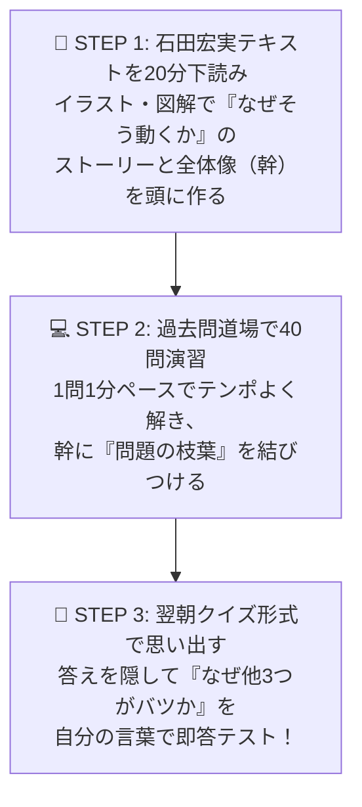

# 弱点分析に基づく「重点テキスト基礎学習ガイド」（合格教本 ＆ 石田宏実本 対応）

> **想定読者**: 過去問演習（NW 40問・セキュリティ 41問）を終え、手持ちのテキストで基礎の土台を固めたい受験者  
> **対象テキスト**:  
> 1. 📘 **『この１冊で合格！ 石田宏実の応用情報技術者 テキスト＆問題集』**（KADOKAWA）  
> 2. 📗 **『令和07年【春期】【秋期】応用情報技術者 合格教本』**（技術評論社）  
> **所要時間**: 6分（ガイド＋基礎早見シート）  
> **対象過去問**: 累計75問の誤答・未回答データ分析  

---

## 0. 一枚で：これまでの誤答傾向とテキスト2冊の最強連携術！

これまでストックした解説ノート75問（うち**ネットワーク25問・セキュリティ29問**）を分析すると、失点の原因は以下の**3つの混同**に集約されます。

1. **「暗号・認証の役割分担」の混同**（公開鍵暗号・デジタル署名・CA証明書・SSL/TLSのどれが何を守るのか）
2. **「OSIのどの階層で、誰が何をしているのか」の混同**（ルータ、L2スイッチ、ARP、TCP/UDPなど）
3. **「アルファベット3〜4文字の重要用語・攻撃手法」の混同**（CVE、SBOM、CC、C&Cサーバ、オープンリレーなど）

---

## 1. その場でスッキリ分かる！「公開鍵・署名・証明書」と「OSI 7階層」の骨格シート

テキストを開く前に、一番モヤモヤしやすい**2大基礎概念**を1枚にまとめました。

### 🔑 ① 公開鍵・デジタル署名・電子証明書の「決定版」整理表
- **大原則**: 公開鍵と秘密鍵は**ペア（2本1組）**。片方でロックしたら、もう片方でしか開けられない！

| やりたいこと（目的） | ロックする鍵（送信側） | 開ける鍵（受信側） | これで何が証明・実現できる？ |
| :--- | :--- | :--- | :--- |
| **暗号化** （盗聴されたくない！） | **受信者の 公開鍵** （誰でも使える南京錠） | **受信者の 秘密鍵** （受信者本人しか持たない鍵） | **「受信者本人しか読めない」**（機密性） |
| **デジタル署名** （本人証明＆改ざん検知） | **送信者の 秘密鍵** （本人しか押せない実印） | **送信者の 公開鍵** （誰でも確認できる印鑑照合） | **「間違いなく送信者本人が書き、途中で1文字も書き換えられていない」**（真正性・完全性） |
| **電子証明書（PKI/CA）** （その公開鍵、偽物じゃない？） | **認証局(CA)の 秘密鍵** （公証役場の実印） | **認証局(CA)の 公開鍵** （ブラウザに最初から内蔵） | **「この公開鍵は、間違いなく本物の銀行（サーバ）のものです」**（なりすまし防止） |
| **SSL/TLS（HTTPS）** （実際のWeb通信） | ① **公開鍵暗号**で「共通鍵」を安全に渡す ② 本編は高速な**共通鍵（AES）**で通信 | （ハイブリッド暗号方式） | **公開鍵は計算が遅いため、鍵の受け渡しだけ公開鍵を使い、データ通信は高速な共通鍵で行う！** |

---

### 🌐 ② OSI基本参照モデル（7階層）と「ルータ越え」の骨格表
- **大原則**: **「最終目的地（IPアドレス）は最後まで変わらないが、次の乗り継ぎ相手（MACアドレス）はルータを越えるたびに書き換わる！」**

| 階層 | 名称 | 見る宛先情報 | 代表的な装置 | 代表プロトコル・間違えた過去問テーマ |
| :---: | :--- | :--- | :--- | :--- |
| **第7〜5層** | **アプリケーション層** ほか | URL・ドメイン・メール宛先 | ゲートウェイ / L7スイッチ / プロキシ | **HTTP/HTTPS, DNS（逆引きPTR・キャッシュポイズニング）, DHCP（0.0.0.0→255.255.255.255）, SMTP-AUTH, S/MIME, SNMP** |
| **第4層** | **トランスポート層** | **ポート番号**（どのアプリか） | L4スイッチ / NAPTルータ | **TCP**（確実・3ウェイハンドシェイク・再送あり） **UDP**（高速・投げっぱなし・音声やDNS向き） |
| **第3層** | **ネットワーク層** | **IPアドレス**（最終目的地） | **ルータ / L3スイッチ** | **IP(IPv4/IPv6), ICMP, IPsec(AH/ESP), ARP（IPからMACを調べる）, NAT, ロンゲストマッチ** |
| **第2層** | **データリンク層** | **MACアドレス**（隣の機器） | **L2スイッチ / ブリッジ** | **イーサネット, 無線LAN(SSID/WPA2), PPP, フレームリレー, ATM(53バイト固定長セル)** |
| **第1層** | **物理層** | 電気信号・光・電波 | **リピータ** / ハブ | **PoE（LANケーブル給電）, V.24（モデム端子）** |

---

## 2. 重点的にテキストを読むべき【4大コア単元】（章・節ガイド）

※お持ちのテキストの目次に合わせて、該当する**章・節**を開いて確認してください。

### 🔒 重点①：暗号技術 と 認証・PKI（公開鍵基盤）
* **間違えた問題**: 楕円曲線暗号(ECC)、WPA2-AES(CCMP)、HTTPS/TLSクライアント認証、リスクベース認証/3Dセキュア2.0、IPsec(AH/ESP)、SMTP-AUTH
* **📖 テキストの該当章・節**:
  | テキスト | 読むべき章・節タイトル | 読むときの注目ポイント |
  | :--- | :--- | :--- |
  | **📘 石田宏実本** | **第11章 セキュリティ** ・暗号化技術（共通鍵・公開鍵・ハイブリッド） ・デジタル署名と認証局（CA/PKI） ・SSL/TLS、IPsec、無線LANセキュリティ | 「誰の公開鍵でロックし、誰の秘密鍵で開けるのか」のイラスト図解を熟読。ハイブリッド暗号（SSL/TLS）の手順の流れをストーリーで掴む。 |
  | **📗 合格教本** | **第8章 セキュリティ** ・8.1 暗号化 ／ 8.2 無線LANの暗号 ・8.3 認証 ／ 8.4 デジタル署名とPKI ・8.5 情報セキュリティ実装技術 | AES・RSA・楕円曲線暗号（ECC）の比較表、WPA2（CCMP/AES 128ビット）、リスクベース認証、ファイアウォールのパケットフィルタリング（First Match）を確認。 |

---

### 🌐 重点②：OSI参照モデル・IPアドレス計算・ルーティング
* **間違えた問題**: リピータ、L2スイッチ、ルータ越え通信、ARP（3問）、DHCPDISCOVER、サブネット計算（`/20`, `/28`）、プライベートIP、ロンゲストマッチ、DNS逆引き
* **📖 テキストの該当章・節**:
  | テキスト | 読むべき章・節タイトル | 読むときの注目ポイント |
  | :--- | :--- | :--- |
  | **📘 石田宏実本** | **第10章 ネットワーク** ・OSI基本参照モデルとTCP/IP ・LAN間接続装置 ／ TCPとUDP ・IPアドレスとサブネットマスク・ルーティング | パケットがカプセル化されてバケツリレーされる図解と、サブネット分割・NATとNAPT（IPマスカレード）の図解を確認。 |
  | **📗 合格教本** | **第7章 ネットワーク** ・7.1 通信プロトコルの標準化 ／ 7.2 接続装置 ・7.3 データリンク層 ／ 7.4 ネットワーク層 ・7.5 トランスポート層 ／ 7.6 アプリケーション層 | OSI 7階層と装置の対応表、プライベートIPアドレスの3クラス表、ロンゲストマッチの例題、DNSレコード種別（A, MX, PTR, NS）を確認。 |

---

### 🔒 重点③：サイバー攻撃手法・脆弱性対策 と セキュリティ管理（CIA・法規）
* **間違えた問題**: XSSサニタイジング、セッションID無効化、ボットネット(C&Cサーバ)、水飲み場型攻撃、DNSキャッシュポイズニング、メール第三者中継、CIA(3問)、CVE、SBOM、CC(ISO 15408)
* **📖 テキストの該当章・節**:
  | テキスト | 読むべき章・節タイトル | 読むときの注目ポイント |
  | :--- | :--- | :--- |
  | **📘 石田宏実本** | **第11章 セキュリティ** ・サイバー攻撃の手口と対策 ・Webアプリケーションの脆弱性 ・情報セキュリティマネジメント（CIA、ISMS） | SQLインジェクション・XSS・CSRF・セッションハイジャックの「違いと対策の対応表」を重点確認。 |
  | **📗 合格教本** | **第8章 セキュリティ** ・8.6 情報セキュリティの脅威と攻撃手法 ・8.7 情報セキュリティ管理 | 各種攻撃の定義一覧表、JIS Q 27000の用語定義（機密性・完全性・可用性・真正性など）、CVE/CVSS/CWEの違い、ISO/IEC 15408（CC）を確認。 |

---

### 🗄️ 重点④：これから挑む「データベース」「システム構成」「マネジメント・ストラテジ」
* **間違えた問題**: トランザクションACID特性、3層スキーマ、稼働率(MTBF/MTTR)、プリエンプション、SQuaRE、CMMI、SLA、システム監査、損益分岐点、派遣と請負
* **📖 テキストの該当章・節**:
  | 分野 | 📘 石田宏実本 | 📗 合格教本 | 過去問を解く前に20分下読みするポイント |
  | :--- | :--- | :--- | :--- |
  | **データベース** | **第9章 データベース** | **第6章 データベース** | 3層スキーマ（外部・概念・内部）、第1〜第3正規化の手順、SQL（GROUP BY / HAVING / JOIN）、**ACID特性**と排他制御 |
  | **コンピュータ構成** | **第8章 コンピュータシステム** | **第4章・第5章** | 直列・並列システムの稼働率計算、MTBFとMTTR、OSのタスク状態遷移（プリエンプション）、メモリ管理 |
  | **開発・マネジメント** | **第1章〜第4章** | **第9章〜第12章** | ソフトウェア品質特性(SQuaRE)、アローダイアグラム、EVM、SLA/ITIL、システム監査人の独立性（社長承認） |
  | **ストラテジ・法務** | **第5章 ストラテジ** | **第13章〜第15章** | 損益分岐点、投資評価（PBP/ROI/NPV）、バリューチェーン・SWOT・PPM、派遣法と請負（指揮命令権）、個人情報保護法 |

---

## 🎯 自宅学習での2分アクション（定着チェック）

- [ ] **上の「🔑 公開鍵・デジタル署名・電子証明書の整理表」を隠して、「暗号化は誰の何鍵？」「署名は誰の何鍵？」を声に出して言えるかテストする！**
- [ ] **新しい分野を解く日は、最初に『石田宏実テキスト』の該当章を20分だけパラパラ眺めてから過去問道場40問に入る！**
