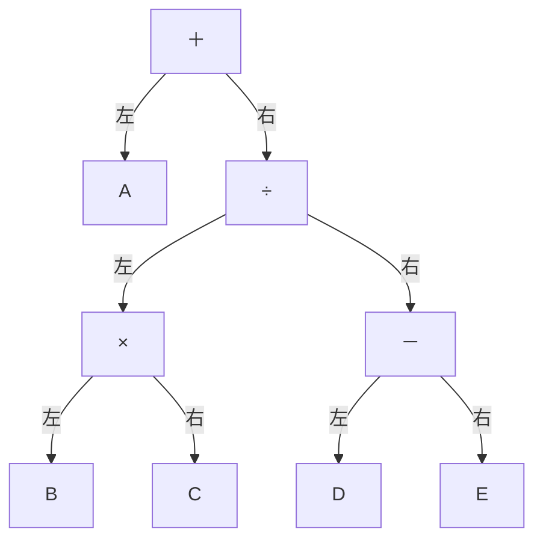
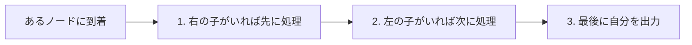

# タイトル：【荷物の積み下ろし】で覚える「2分木の後行順（右→左→自分）」

> **想定読者**: 再帰の「戻ってきたら出力」で順番を見失う文系受験者  
> **省いたもの**: 前行順・中間順の厳密な定義、計算量の議論  
> **所要時間**: 6〜8分  
> **対象過去問**: 応用情報技術者 [令和6年春期 午前問6](https://www.ap-siken.com/kakomon/06_haru/q6.html)  

---

## 【対象過去問】令和6年春期 午前問6

**【問題】**  
各ノードがもつデータを出力する再帰処理 f(ノードn) を定義した。この処理を，図の2分木の根(最上位のノード)から始めたときの出力はどれか。

〔f(ノードn)の定義〕
1. ノードnの右に子ノードrがあれば，f(ノードr)を実行
2. ノードnの左に子ノードlがあれば，f(ノードl)を実行
3. 再帰処理 f(ノードr)，f(ノードl) を未実行の子ノード，又は子ノードがなければ，ノード自身がもつデータを出力
4. 終了

⚠️ **図について**: 元の図は取得できませんが、公式解説の再帰トレースから木の形は次のように復元できます（図の右＝R、左＝L）。

- **ア**: ＋÷－ED×CBA
- **イ**: ABC×DE－÷＋
- **ウ**: E－D＋C×B＋A
- **エ**: ED－CB×÷A＋

▶ 正解を表示する

**正解: エ（ED－CB×÷A＋）**

---

## 0. 一枚で：「右へ潜る→左へ潜る→最後に自分」！

**合言葉：『右・左・自分（みぎ・ひだり・じぶん）で下から出す』**

---

## 1. なぜそうなるのか？（日常のたとえ話）

引っ越しで、部屋（ノード）の中にさらに小部屋がある建物を想像します。ルールは **「小部屋が残っているうちは自分の荷物には触らず、右の小部屋→左の小部屋の順に荷物を運び出し、全部終わってから自分の部屋の荷物を出す」**。子から先に空にして、親は最後。これが **後行順（帰りがけ順）** です。

公式解説によれば、この f は「右⇒左⇒中」の順に走査するもので、子がなくなった時点で自身のデータを出力する後行順の深さ優先探索です。一般の図は「左⇒右⇒中」で、本問はそれとは **左右が逆向き** です。

---

## 2. 選択肢のひっかけポイント ＆ 途中トレース（省略なし）

公式解説の再帰トレース：

| 手順 | 動き | 出力 |
|---|---|---|
| 1 | f(＋)：右に ÷ → f(÷) | |
| 2 | f(÷)：右に － → f(－) | |
| 3 | f(－)：右に E → f(E) | |
| 4 | f(E)：子なし | **E** |
| 5 | f(－) に戻る：左に D → f(D)：子なし | **D** |
| ここで | 先頭が「ED」と確定。これだけで正解肢が絞れる | |
| 6 | f(－)：左右実行済み | **－** |
| 7 | f(÷) に戻る：左に × → f(×)：右に C | **C** |
| 8 | f(×)：左に B | **B** |
| 9 | f(×)：左右実行済み | **×** |
| 10 | f(÷)：左右実行済み | **÷** |
| 11 | f(＋) に戻る：左に A | **A** |
| 12 | f(＋)：左右実行済み | **＋** |

出力の並び：E D － C B × ÷ A ＋ → 「ED－CB×÷A＋」

### 選択肢の判定
| 選択肢 | 判定 | 理由 |
|---|---|---|
| ア ＋÷－ED×CBA | ✕ | 先頭が「＋」。自分を最初に出す **前行順（自分→右→左）** の並び。本問は自分が最後 |
| イ ABC×DE－÷＋ | ✕ | 自分を最後に出す点は同じだが **左→右→自分** の標準的な後行順。本問は右が先なので左右が逆 |
| ウ E－D＋C×B＋A | ✕ | 先頭は E だが、途中に「＋」が2回現れるなど、このルールの出力としてあり得ない並び（木に＋は1つだけ、÷も欠落）。トレースの時点で消去できる |
| エ ED－CB×÷A＋ | ○ | 上のトレースと一致 |

**ひっかけ**: イは「後行順といえば左→右→自分」と暗記している人が選びがち。**問題文の 1.（右）が 2.（左）より先** であることを必ず確認する。ヒント：トレースの最初の2文字「ED」が決まった時点で、先頭が E の選択肢（ウ・エ）に絞れる。

---

## 🎯 次の2分アクション（定着チェック）

- [ ] **画面の一番上に戻り、正解を隠した状態で正解肢を確信を持って選べるか試してみよう！**
- [ ] 定義の1・2行目の「右が先か左が先か」を確認する癖をつける。
