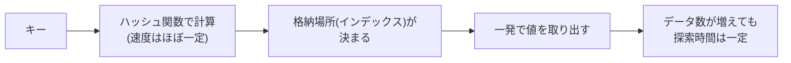

# ハッシュ表の探索時間：ロッカー番号が分かれば、何千個あっても一発で開く！

> **想定読者**: 線形探索・2分探索のグラフと混同しやすい文系受験者  
> **省いたもの**: ハッシュ値の衝突（シノニム）処理の詳細  
> **所要時間**: 5〜7分  
> **対象過去問**: 応用情報技術者 令和5年春期 午前問19  

---

## 【対象過去問】令和5年春期 問19

**【問題】**  
ハッシュ表の理論的な探索時間を示すグラフはどれか。ここで，複数のデータが同じハッシュ値になることはないものとする。

- **ア**: （グラフ。取得データでは選択肢が空のため復元不可）
- **イ**: （グラフ。同上）
- **ウ**: （グラフ。同上）
- **エ**: 「表中のデータ数が増えても探索時間が変わらない」ことを示すグラフ（公式解説より。横軸＝データ数、縦軸＝探索時間と読めるが、軸ラベルの正確な表記は未復元）

> 📝 **復元に関する注記**: 選択肢は図（グラフ）で、取得データには含まれていません。ア〜ウの具体的な形は復元できませんでした。公式解説から、正解エは「データ数に関係なく探索時間が一定（定数時間）」のグラフです。

▶ 正解を表示する

**正解: エ（データ数が増えても探索時間が変わらない＝一定のグラフ）**

---

## 0. 一枚で：『ハッシュ表＝計算して一発で場所が分かる。データが増えても時間は横ばい！』

### 🧠 脳に刻む合言葉：
> **『 ハッシュは一発！データが増えても探索時間は横ばい！ 』**

---

## 1. なぜそうなるのか？（日常のたとえ話：コインロッカー）

コインロッカーで「あなたの番号は172番」と渡されていれば、ロッカーが100個でも10,000個でも**172番へ直行**できます。他のロッカーを順に開けて探す必要がありません。

ハッシュ表では、キー（名前など）をハッシュ関数に通して「ロッカー番号」（インデックス）を計算します。公式解説のとおり、ハッシュ関数からハッシュ値を計算する速度はほぼ一定なので、表に格納されているデータ数にかかわらず探索時間はほぼ一定（定数時間）です。

対比として、先頭から順に調べる**線形探索**はデータ数に比例して時間が増える、というのが典型的な右上がりのグラフです（これは一般知識であり、本問の公式解説では触れられていません）。

---

## 2. 選択肢のひっかけポイント ＆ 判定理由

選択肢のグラフ本体が取得できていないため、形の記述ではなく**判定の基準**を示します。

- **ア・イ・ウ: ✗（グラフ形状は未復元）**  
  → 公式解説では正解は「エ」のみと明示されているため、ア〜ウは「データ数に応じて探索時間が変化する」グラフ（増加・減少・曲線など）であり、定数時間ではないので不適切と判断できます。具体的な形は復元不可。
- **エ: ○**  
  → 「データ数が増えても探索時間は変わらない」＝横ばい（定数時間）のグラフ。公式解説と一致。

> ⚠️ ひっかけの考え方：問題文の「複数のデータが同じハッシュ値になることはない」が重要。もし衝突が起きると、同じ場所に複数データが並び、追加の探索が必要になって時間が変わります。この条件で「理想状態」の探索時間を問うています。

---

## 3. 午後試験 記述対策チェックリスト（※該当する場合）

- [ ] **Q. ハッシュ表探索の探索時間がデータ数に依存しない理由を述べよ。**  
  → **「キーからハッシュ関数で格納場所を直接求めるため、データ数によらず探索時間はほぼ一定となる。」**

---

## 🎯 次の2分アクション（定着チェック）

- [ ] **画面の一番上に戻り、正解を隠した状態で正解肢を確信を持って選べるか試してみよう！**
