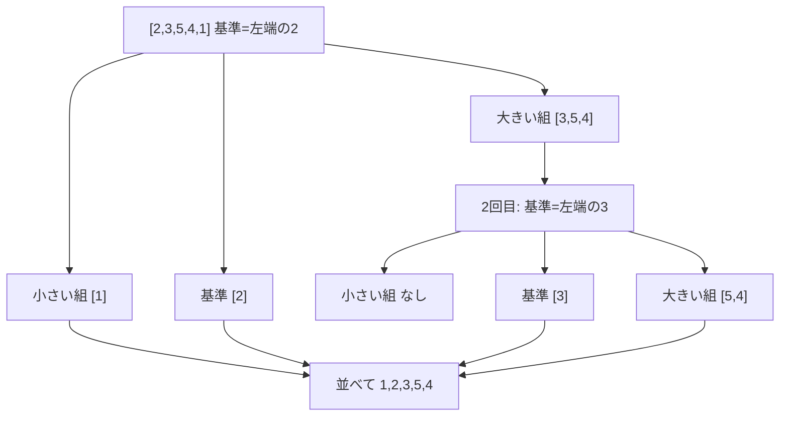

# クイックソート：クラス替えの「基準の人」で覚える「2回目の分割」

> **想定読者**: クイックソートの手順を追うと途中で迷子になる文系受験者  
> **省いたもの**: 計算量（平均 O(n log n)・最悪 O(n²)）の厳密な証明  
> **所要時間**: 6〜8分  
> **対象過去問**: 応用情報技術者 令和5年春期 問7  

---

## 【対象過去問】令和5年春期 問7

**【問題】**  
配列に格納されたデータ2，3，5，4，1に対して，クイックソートを用いて昇順に並べ替える。2回目の分割が終わった状態はどれか。ここで，分割は基準値より小さい値と大きい値のグループに分けるものとする。また，分割のたびに基準値はグループ内の配列の左端の値とし，グループ内の配列の値の順番は元の配列と同じとする。

- **ア**: 1，2，3，5，4
- **イ**: 1，2，5，4，3
- **ウ**: 2，3，1，4，5
- **エ**: 2，3，4，5，1

▶ 正解を表示する

**正解: ア（1，2，3，5，4）**

---

## 0. 一枚で：「左端が基準 → 小さい組 / 基準 / 大きい組」を2回やる！

### 🧠 脳に刻む合言葉：
> **『 左端を基準に「小さい組・基準・大きい組」。順番はそのまま、組ごとに繰り返す！ 』**

---

## 1. なぜそうなるのか？（日常のたとえ話：身長順に並ぶ学校の整列）

先生が「先頭の子（左端）を基準に、その子より低い子は左、高い子は右へ」と指示します。基準の子は**この時点で正しい位置が確定**します。次に、左組・右組それぞれで同じことを繰り返します。大きな問題を小さな問題に分けて解くので「分割統治」と呼ばれます。

### 手順（省略しません）

1. 元の配列 [2，3，5，4，1]。左端の **2** が基準。
2. **1回目の分割**  
   - 2より小さい：1  
   - 2より大きい：3，5，4（元の順番のまま）  
   - 結果：[1]，[2]，[3，5，4]
3. **2回目の分割**（各グループで左端を基準にする）  
   - [1]：1個だけなので分割不要  
   - [2]：1個だけなので分割不要  
   - [3，5，4]：左端の **3** が基準。小さい値はなし。大きい値は 5，4（順番維持）→ [3]，[5，4]  
   - 結果：[1]，[2]，[3]，[5，4]
4. 並べて書くと **1，2，3，5，4**。

※公式解説も同じ流れで「2回目分割後の配列の状態は『1，2，3，5，4』」としています。なお、[5，4] はまだ未整列で、3回目の分割で [4]，[5] になります。

---

## 2. 選択肢のひっかけポイント ＆ 判定理由

- **ア 1，2，3，5，4（正解）**: 上の手順そのもの。
- **イ 1，2，5，4，3**: 1回目で 3，5，4 の中から「3を最後に回す」並びになっている。基準値より大きい値は元の順番（3，5，4）を保つ約束なので、3が最後に動くことはない。基準を取り違えると出てくる並び。
- **ウ 2，3，1，4，5**: 基準の2が先頭のままで、小さい値1が右側にあり、「小さい値は基準の左へ」という分割の定義に反する。
- **エ 2，3，4，5，1**: ほぼ元の配列を回した並びで、小さい値1が右端に残っており、1回目の分割すら終わっていない状態。

> 😈 最大のトラップ：「1回目の分割後」の配列も並べて書くと 1，2，3，5，4 になります。「基準が確定した」回数ではなく、**グループごとに分割した回数**を数えることを忘れずに。[3，5，4] の分割まで進めて、はじめて[3]，[5，4]になることを確認しましょう。

---

## 🎯 次の2分アクション（定着チェック）

- [ ] **画面の一番上に戻り、正解を隠した状態で正解肢「ア」を確信を持って選べるか試してみよう！**
- [ ] 3回目の分割後の並び（1，2，3，4，5）を自分で書いてみよう。
