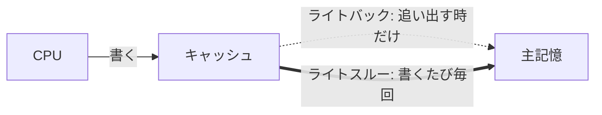

# キャッシュのライトバック：付箋メモで覚える「追い出すときに主記憶へ」

> **想定読者**: ライトスルーとライトバックの違いがごちゃ混ぜになる文系受験者  
> **省いたもの**: キャッシュ一貫性プロトコル（MESI等）の詳細  
> **所要時間**: 6〜8分  
> **対象過去問**: 応用情報技術者 平成20年秋期 問19  

---

## 【対象過去問】平成20年秋期 問19

**【問題】**  
キャッシュメモリの書込み制御方式の一つであるライトバック方式の特徴はどれか。

- **ア**: キャッシュメモリからデータを追い出すときに，主記憶を更新する必要がない。
- **イ**: キャッシュメモリのデータとそれに対応する主記憶のデータとの間で不一致が生じない。
- **ウ**: データを書き込むとき，キャッシュメモリにあるかどうかにかかわらず，主記憶に書き込む。
- **エ**: 同一番地に繰り返して書き込む場合は，主記憶へのアクセス回数が少なくて済む。

▶ 正解を表示する

**正解: エ（同一番地に繰り返して書き込む場合は，主記憶へのアクセス回数が少なくて済む。）**

---

## 0. 一枚で：「バック＝あとで戻す」「スルー＝その場で通す」！

| 方式 | 主記憶に書くタイミング | 主記憶アクセス | キャッシュと主記憶の一致 |
|---|---|---|---|
| ライトバック | キャッシュから追い出す時 | 少ない | 一致しないことがある |
| ライトスルー | 書き込むたび毎回 | 多い | 常に一致 |

### 🧠 脳に刻む合言葉：
> **『 バックは「あとで」まとめて戻す。だから速いけど、ズレる！ 』**

---

## 1. なぜそうなるのか？（日常のたとえ話：机の上の付箋と、会社の台帳）

会社の**台帳（主記憶）**は遠くの書庫にあり、書き換えに行くのは大変です。あなたの机には**付箋（キャッシュ）**があります。

- **ライトスルー**: 数字が変わるたび、付箋にも書き、書庫の台帳にも走って書きに行く。確実だが往復だらけで遅い。
- **ライトバック**: 変更は机の付箋だけに書く。付箋を捨てる（追い出す）ときに初めて、最終結果を台帳へ書く。同じ数字を10回書き換えても、台帳への書き込みは最後の1回で済む。

だから「同じ番地に何度も書く」場合はライトバックの方が主記憶アクセスが減ります。代わりに、付箋を捨てる前は台帳が古いまま、つまり**不一致が起こる**のが弱点です。

CPUが書き込む回数が10回の場合の比較（イメージ）:
- ライトスルー：主記憶への書き込み 10回
- ライトバック：主記憶への書き込み 1回（追い出し時のみ）

---

## 2. 選択肢のひっかけポイント ＆ 判定理由

- **ア ✕**: 「追い出すとき主記憶を更新する必要がない」は逆。ライトバックは**追い出すときに初めて**主記憶へ書く方式（更新が必要）。「バック＝あとで戻す」を忘れると引っかかります。
- **イ ✕**: 不一致が生じないのはライトスルー側の特徴。ライトバックでは主記憶に書き込むのが追い出し時のみなので、**常に内容が一致しているわけではない**（公式解説）。
- **ウ ✕**: 「キャッシュにあるかどうかにかかわらず主記憶に書く」「書き込みの都度主記憶にも書く」はライトスルー方式の特徴（公式解説）。
- **エ ○**: 主記憶へ書くのは追い出し時のみで、それまでCPUはキャッシュだけに書く。したがって常に両方に書くライトスルーと比べ、主記憶アクセスが少ない（公式解説）。

> 😈 ひっかけの構造：ア・イ・ウは、ライトスルーの特徴をライトバックの特徴にすり替えたもの。「どちらの方式の特徴か」を意識して読むと消去できます。

---

## 🎯 次の2分アクション（定着チェック）

- [ ] **画面の一番上に戻り、正解を隠した状態で正解肢「エ」を確信を持って選べるか試してみよう！**
- [ ] 「ライトスルーは確実だが遅い、ライトバックは速いがズレる」を声に出して言ってみよう。
