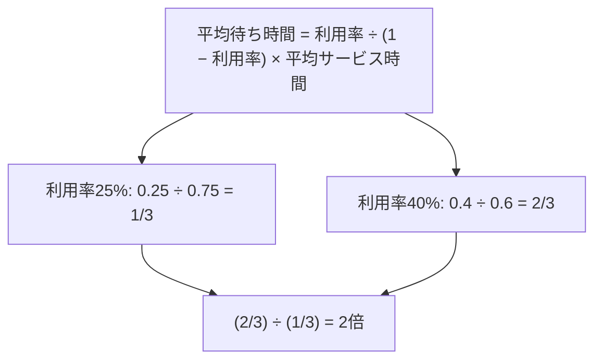

# M/M/1待ち行列：ラーメン屋の行列で覚える「利用率÷(1−利用率)」

> **想定読者**: 待ち行列の公式を見ると固まってしまう文系受験者  
> **省いたもの**: 公式の導出（ポアソン到着・指数分布サービスの数学的証明）  
> **所要時間**: 6〜8分  
> **対象過去問**: 応用情報技術者 令和4年春期 問3  

---

## 【対象過去問】令和4年春期 問3

**【問題】**  
M/M/1の待ち行列モデルにおいて，窓口の利用率が25%から40%に増えると，平均待ち時間は何倍になるか。

- **ア**: 1.25
- **イ**: 1.60
- **ウ**: 2.00
- **エ**: 3.00

▶ 正解を表示する

**正解: ウ（2.00）**

---

## 0. 一枚で：公式に入れて「割り算」するだけ！

### 🧠 脳に刻む合言葉：
> **『 待ち時間は 利用率 ÷ (1 − 利用率)。サービス時間は割り算で消える！ 』**

---

## 1. なぜそうなるのか？（日常のたとえ話：ラーメン屋のカウンター）

店員1人（M/M/1の「1」＝窓口1つ）のラーメン屋を想像してください。

- 利用率25%：店員は4分の1の時間だけ働いていて、あとは暇。お客が来てもほぼ待たずに作ってもらえる。
- 利用率40%：店員が忙しくなり、前の客がまだ食べ終わる前に次の客が来ることが増える。

利用率が100%に近づくほど「1 − 利用率」が小さくなり、割り算の結果が急激に大きくなります。つまり**忙しさが少し増えるだけで、待ち時間はそれ以上に伸びる**のがこのモデルの肝です。

公式（公式解説より）：
平均待ち時間 ＝ 利用率 ÷ (1 − 利用率) × 平均サービス時間

### 途中計算（省略しません）

1. 利用率25%（0.25）の場合  
   - 分母：1 − 0.25 ＝ 0.75  
   - 0.25 ÷ 0.75 ＝ 1/3  
   - 待ち時間 ＝ 1/3 × 平均サービス時間
2. 利用率40%（0.4）の場合  
   - 分母：1 − 0.4 ＝ 0.6  
   - 0.4 ÷ 0.6 ＝ 4/6 ＝ 2/3  
   - 待ち時間 ＝ 2/3 × 平均サービス時間
3. 比べる：(2/3) ÷ (1/3) ＝ (2/3) × 3 ＝ **2倍**  
   平均サービス時間は両方に掛かっているので、割ると消えます。

---

## 2. 選択肢のひっかけポイント ＆ 途中計算パズル

- **ア 1.25**: 利用率25%の「25」から連想した数字。計算で出る根拠はなく、「なんとなく増えた分」で選ばせる引っかけ。
- **イ 1.60**: 利用率の比 40 ÷ 25 ＝ 1.6（利用率をそのまま比べた値）。**これが最大のトラップ**。待ち時間は利用率に比例せず、分母の「1 − 利用率」の効果で増え方が大きくなります。
- **ウ 2.00（正解）**: (2/3) ÷ (1/3) ＝ 2。
- **エ 3.00**: 利用率25%の値 1/3 の逆数 3 や、2/3 を 1/3 で割る手前の「3」を取り違えた誤り。1/3 や 2/3 の分母「3」に釣られないこと。

> 利用率が1.6倍になっても、待ち時間は1.6倍ではなく2倍。「利用率の比で答えない」が鉄則です。

---

## 🎯 次の2分アクション（定着チェック）

- [ ] **画面の一番上に戻り、正解を隠した状態で正解肢「ウ」を確信を持って選べるか試してみよう！**
- [ ] 利用率50%のときの待ち時間（0.5 ÷ 0.5 ＝ 1）が、25%のときの何倍か（1 ÷ 1/3 ＝ 3倍）を自分で計算してみよう。
