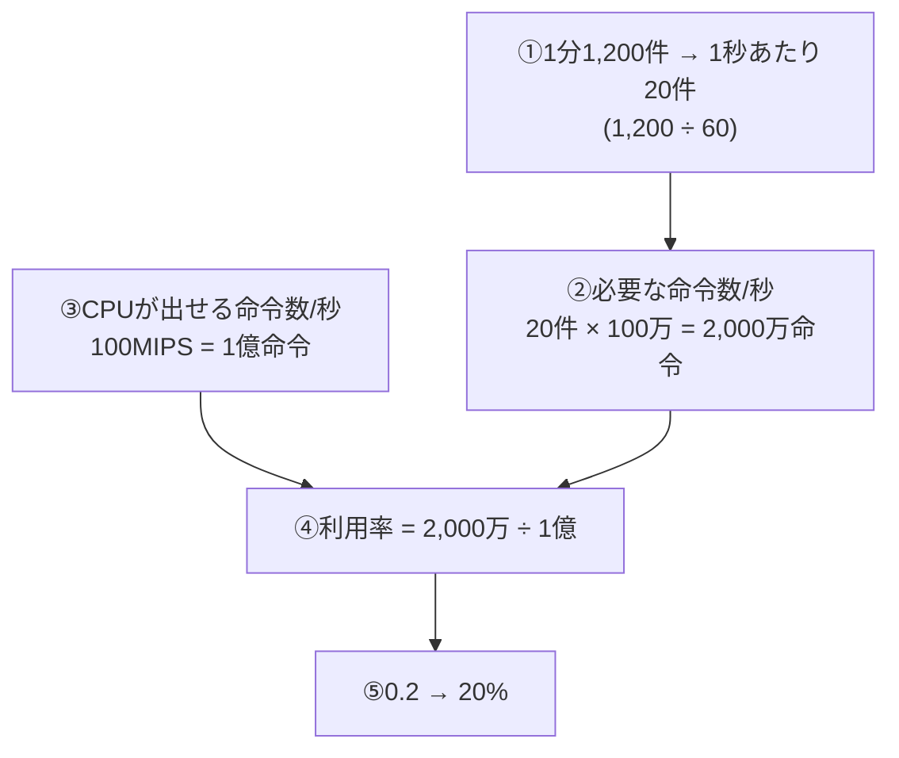

# CPU利用率とMIPS：レジの「1秒あたりの処理能力」と「来客数」で割り算する！

> **想定読者**: MIPSや「分あたり→秒あたり」の単位換算でつまずく文系受験者  
> **省いたもの**: CPIやクロック周波数などの詳細な性能指標  
> **所要時間**: 6〜8分  
> **対象過去問**: 応用情報技術者 平成28年秋期 問15  

---

## 【対象過去問】平成28年秋期 問15

**【問題】**  
オンライントランザクション処理システムにおいて，1分当たりの平均トランザクション数が1,200件であり，1件のトランザクション処理で100万命令を実行する場合，CPU性能が100MIPSのコンピュータを使用したときのCPUの平均利用率は何%か。

- **ア**: 5
- **イ**: 10
- **ウ**: 15
- **エ**: 20

▶ 正解を表示する

**正解: エ（20）**

---

## 0. 一枚で：『必要な命令数 ÷ 出せる命令数、ただし必ず「1秒」にそろえる！』

### 🧠 脳に刻む合言葉：
> **『 MIPS＝1秒に百万命令！「分」を「秒」に直してから割る！ 』**

---

## 1. なぜそうなるのか？（日常のたとえ話：ラーメン屋の厨房）

厨房の料理人が「1秒に1億個の作業」をこなせる（＝100MIPS）とします。お客さんの注文が入ると、1杯あたり100万個の作業が必要です。

利用率とは、「料理人の全力に対して、実際に何割働いているか」です。全力＝1億作業/秒、実際＝注文が生む作業量/秒。ここで**単位がバラバラ（注文は“1分あたり”、全力は“1秒あたり”）だと割り算できません**。だから先に秒にそろえます。

### 途中計算（省略なし）
1. 1分＝60秒なので、1,200件/分 ÷ 60 ＝ **20件/秒**
2. 1件100万命令なので、20 × 1,000,000 ＝ **20,000,000命令/秒（2,000万）**
3. 100MIPS ＝ 100 × 1,000,000 ＝ **100,000,000命令/秒（1億）**
4. 利用率 ＝ 20,000,000 ÷ 100,000,000 ＝ 0.2 ＝ **20%**

（MIPS＝Million Instructions Per Second。1秒間に実行できる命令数を百万単位で表した指標。）

---

## 2. 選択肢のひっかけポイント ＆ 判定理由

- **ア（5）: ✗**  
  → 「1,200件/分」を秒に直さず、あるいは割り方を誤ると出やすい小さな値。正しい計算では5%にならない。
- **イ（10）: ✗**  
  → 2,000万と1億の比を「0.1」と目分量で読み違えたパターン。2,000万÷1億＝0.2であり、10%ではない。
- **ウ（15）: ✗**  
  → 中途半端な値で、正しい計算の道筋からは出てこない。計算せず勘で選ばせるための選択肢。
- **エ（20）: ○**  
  → 20件/秒 × 100万 ＝ 2,000万命令/秒 ÷ 1億命令/秒 ＝ 20%。公式解説と一致。

> ⚠️ 最大のワナは**単位（分と秒）の混在**。もし「1,200件 × 100万 ÷ 1億」と分のまま計算すると1200％という異常値になるので、「利用率が100%を超えたら単位ミス」と検算できます。

---

## 3. 午後試験 記述対策チェックリスト（※該当する場合）

- [ ] **Q. CPU利用率を求める手順を説明せよ。**  
  → **「単位時間あたりの必要命令数を、CPUが単位時間に実行できる命令数（MIPS値）で割る。」**

---

## 🎯 次の2分アクション（定着チェック）

- [ ] **画面の一番上に戻り、正解を隠した状態で正解肢を確信を持って選べるか試してみよう！**