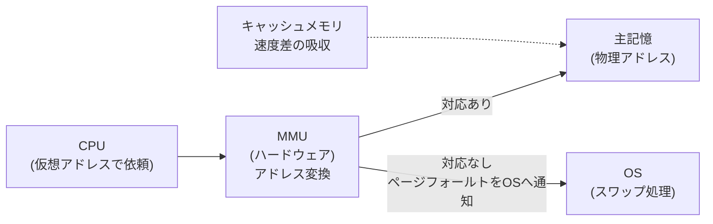

# タイトル：【マンションの管理人】で覚える「MMU（仮想アドレス→物理アドレスの変換）」

> **想定読者**: MMU・キャッシュ・OS の役割がごちゃ混ぜになる文系受験者  
> **省いたもの**: TLB のミス処理の細部、ページテーブルの多段構造  
> **所要時間**: 6〜8分  
> **対象過去問**: 応用情報技術者 [平成27年秋期 午前問10](https://www.ap-siken.com/kakomon/27_aki/q10.html)  

---

## 【対象過去問】平成27年秋期 午前問10

**【問題】**  
MMU(Memory Management Unit)の説明として，適切なものはどれか。

- **ア**: CPUからのページフォールトを受けて，物理ページのスワップを行う。
- **イ**: CPUが指定した仮想アドレスを物理アドレスに対応させる。
- **ウ**: OSの一部分であり，キャッシュ制御機能及びバス調整機能を有する。
- **エ**: 主記憶のデータの一部を保持し，CPUと主記憶の速度差を吸収する。

▶ 正解を表示する

**正解: イ（CPUが指定した仮想アドレスを物理アドレスに対応させる）**

---

## 0. 一枚で：「MMU＝住所の翻訳係」と覚えて、他の部品の仕事と切り分ける！

**合言葉：『MMU は“翻訳係”。スワップは OS、保存は キャッシュ』**

3ステップで選択肢を切る：
1. 「アドレスを変換する」→ MMU の仕事
2. 「スワップする・OSの一部」→ OS の仕事（MMU はハード）
3. 「データを一部保持して速度差を吸収」→ キャッシュメモリの仕事

---

## 1. なぜそうなるのか？（日常のたとえ話）

大きなマンションを想像してください。住人（プログラム）は「自分は101号室に住んでいる」と思い込んで郵便物を頼みます。これが **仮想（論理）アドレス** です。ところが実際の建物では、101号室は都合で別の階の別の部屋（**物理アドレス**）に割り当てられています。

そこで玄関に **管理人（MMU）** がいて、「101号室宛ね。実際は 5階の 503 だよ」と名簿（TLB やページテーブル）を引いて素早く案内します。名簿に載っていなければ（ページフォールト）、管理人は自分で部屋を片付けたりせず、**管理会社（OS）に「この部屋、倉庫から出してください」と連絡する** だけです。

公式解説によると MMU は主記憶を管理する **ハードウェア機構** で、アドレス変換機能、メモリ保護機能、キャッシュ制御機能、バス調停機能などを持ちます。アドレス変換では、仮想記憶の論理アドレスと実アドレス（物理アドレス）の対応を TLB（Translation Lookaside Buffer）で管理し、CPU のアクセス要求に応じて高速に変換します。

---

## 2. 選択肢のひっかけポイント ＆ 判定表

| 選択肢 | 判定 | 理由（公式解説に基づく） |
|---|---|---|
| ア | ✕ | MMU はページフォールトを **OS に通知する** 役割まで。スワップを実行するのは OS。「通知する」と「実行する」のすり替えが罠。 |
| イ | ○ | MMU（アドレス変換機能）の説明そのもの。 |
| ウ | ✕ | MMU は **ハードウェア部品** なので OS の一部ではない。キャッシュ制御・バス調停の機能を持つ点は事実だが、「OSの一部」で誤り。 |
| エ | ✕ | **キャッシュメモリ** の説明。主記憶の一部を保持し CPU との速度差を吸収する。 |

**心理トラップ**: ウは前半「キャッシュ制御機能・バス調整機能」が MMU の機能として実在するため、後半の「OSの一部」を見落とすと選んでしまう。**一部が正しい選択肢ほど、全体を最後まで読む**のが鉄則。

---

## 🎯 次の2分アクション（定着チェック）

- [ ] **画面の一番上に戻り、正解を隠した状態で正解肢を確信を持って選べるか試してみよう！**
- [ ] 「MMU はハード／スワップは OS／速度差吸収はキャッシュ」を声に出して言えるか確認。
