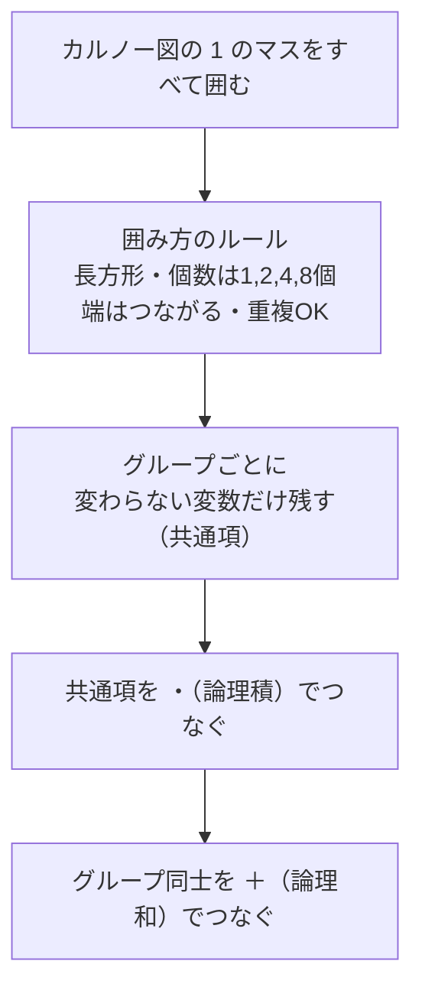

# カルノー図と論理式：マス目のお引っ越しで覚える「1をグループ化して共通項を取る」

> **想定読者**: カルノー図から論理式を作る手順が分からず、上線（否定）つきの式を見ると身構える文系受験者  
> **省いたもの**: 3変数以外の大規模な最簡化（クワイン・マクラスキー法）、ド・モルガンの法則の証明  
> **所要時間**: 6〜8分  
> **対象過去問**: 応用情報技術者 令和4年秋期 問2  

---

## 【対象過去問】令和4年秋期 問2

**【問題】**  
A，B，C，Dを論理変数とするとき，次のカルノー図と等価な論理式はどれか。ここで，・は論理積，＋は論理和，Xの上線はXの否定を表す。

> ⚠️ **復元に関する注意**: 問題のカルノー図（画像）と、選択肢中の否定を表す上線は取得データに残っていません。選択肢の変数名と項の構造だけが残っています。そのため、どの変数に否定がつくかは復元できません。

- **ア**: A・B・C・D ＋ B・D　（否定の位置は復元不可）
- **イ**: A・B・C・D ＋ B・D　（否定の位置は復元不可）
- **ウ**: A・B・D ＋ B・D　（否定の位置は復元不可）
- **エ**: A・B・D ＋ B・D　（否定の位置は復元不可）

▶ 正解を表示する

**正解: エ（A・B・D ＋ B・D の形。第1項は3変数の積、第2項は2変数の積。否定の位置は復元不可）**

---

## 0. 一枚で：『1のマスを四角で囲む → 共通項を取る → ＋でつなぐ！』

### 🧠 脳に刻む合言葉：
> **『 1を大きく囲え！囲みの中で“変わらない変数”だけ残して、囲み同士は＋でつなぐ！ 』**

---

## 1. なぜそうなるのか？（日常のたとえ話：クラス名簿のまとめ書き）

カルノー図は「条件の組合せ表」を、**隣り合うマスが1変数しか違わない**ように並べた特殊な表です。

たとえば「3年A組で男子・メガネあり」と「3年A組で男子・メガネなし」の2人を名簿に書くとき、メガネの有無は問わないので「3年A組の男子」と**まとめて書けば短く**なります。カルノー図の「囲み」はこの**まとめ書き**です。

- 囲みの中で値が**変わる変数**（例：メガネの有無）→ 式から消える
- 囲みの中で値が**変わらない変数** → 式に残る（共通項）

### 公式解説の手順（4ルール）
1. 値が1のセルをすべて長方形で囲む。
2. グループのセル数は 2のn乗個（1, 2, 4, 8, …）。
3. カルノー図の**上下左右の端は連続している**と考える。
4. 1つのセルが**複数のグループに属してもよい**。

### この問題での結果（公式解説の記述）
設問のカルノー図は**2つの長方形**ですべての1を囲めます。

| グループ | 含まれるセル（変数の組） | 共通項 | 論理積 |
|---|---|---|---|
| 赤枠 | 2セル | A, B, D（Cは変化して消える） | 3変数の積（A・B・D） |
| 青枠 | 4セル | B, D（AとCが変化して消える） | 2変数の積（B・D） |

**赤枠（2セル）**：2セルで1変数が消え、4変数のうち3変数が残る。  
**青枠（4セル）**：4セルで2変数が消え、4変数のうち2変数が残る。

つまり、「2セルで3変数の積・4セルで2変数の積」の組を探すことになります。これを＋で結ぶと「A・B・D ＋ B・D」の形になり、これが **エ** です。（否定の位置はこのデータからは復元不可）

### 途中計算の見方（個数→残る変数）
| グループのセル数 | 消える変数の数 | 残る変数の数（4変数中） |
|---|---|---|
| 1 | 0 | 4 |
| 2 | 1 | 3 |
| 4 | 2 | 2 |
| 8 | 3 | 1 |

---

## 2. 選択肢のひっかけポイント ＆ 判定理由

否定の上線が取得できないため、構造から言える範囲で書きます。

- **ア ✕**: 「A・B・C・D ＋ B・D」。第1項に**4変数すべて**が入っています。4変数すべてを含む項は**1セルだけ**を表し、囲みが2セルなら共通項は3変数になるはず。→ 公式解説の「赤枠（2セルで3変数）」と一致しません。
- **イ ✕**: アと同様に第1項が4変数の積。赤枠が1セルだけ（囲み忘れ・拡張忘れ）の答えになっている。
- **ウ ✕**: 項の構造は正解エと同じ（3変数の積＋2変数の積）ですが、**否定のつく変数の位置が正解と違う**。※具体的な位置は復元不可。ここが“一番似ている罠”です。
- **エ ◯**: 赤枠（A・B・Dの共通項）＋青枠（B・D）と一致。

> 💡 作問者の意図：選択肢は「どの変数に否定がつくか」だけが違う、見た目がそっくりな式を並べています。**囲みごとに、各変数が0固定か1固定かを丁寧に読み取り、0なら否定をつける**という手順を一つずつ踏めば、取り違えを避けられます。

> 💡 この問題を実戦で解くとき：図から ①囲みごとに「変わらない変数」を探す ②その値が1なら素の変数、0なら否定つきにする ③項を＋でつなぐ、の順で確認してください。

---

## 3. 午後試験 記述対策チェックリスト（※該当する場合）

- [ ] **Q. カルノー図で、グループに含めるセルの数と形のルールを述べよ。**  
  → **「値が1のセルを長方形で囲み、セル数は2のn乗個とし、上下左右の端は連続しているとみなす。」**

---

## 🎯 次の2分アクション（定着チェック）

- [ ] **画面の一番上に戻り、正解を隠した状態で正解肢を確信を持って選べるか試してみよう！**
