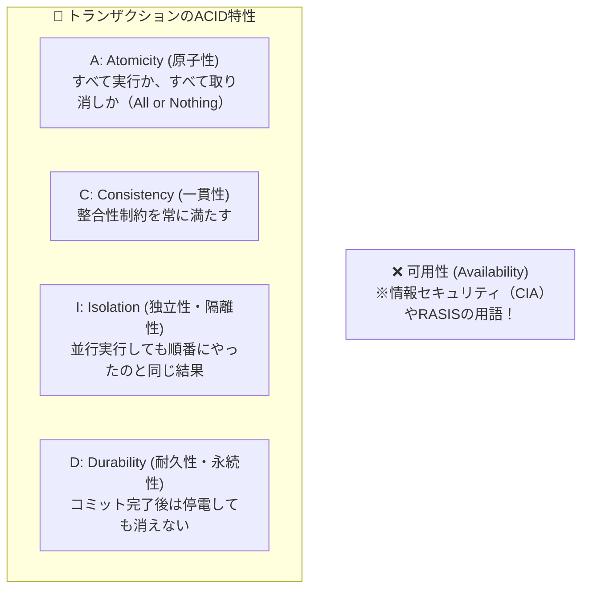

# ACID特性：含まれないのはどれ？「可用性」はCIAの仲間！

> **想定読者**: 該当分野の用語・計算でつまずいている文系受験者
> **省いたもの**: 試験本番で即戦力にならない重箱の隅のプロトコル詳細仕様
> **所要時間**: 6〜8分
> **対象過去問**: 応用情報技術者 令和4年秋期 問30

---

## 【対象過去問】令和4年秋期 問30

**【問題】**  
データベースのトランザクション処理におけるACID特性に含まれないものはどれか。

- **ア**: 原子性（Atomicity）
- **イ**: 可用性（Availability）
- **ウ**: 耐久性（Durability）
- **エ**: 独立性（Isolation）

▶ 正解を表示する

**正解: イ（可用性（Availability））**

---

## 0. 一枚で：『ACID特性の4つは「原子性・一貫性・独立性・耐久性」！「可用性」は含まれない！』

### 🧠 脳に刻む合言葉：
> **『 ACIDのAはAtomicity（原子性）！Availability（可用性）は部外者！ 』**

---

## 1. なぜそうなるのか？（日常のたとえ話：送金処理の厳格ルール（途中で失敗したら全戻し、矛盾なし、他人と混ざらない、停電でも消えない））

トランザクション処理の信頼性を保証する4大原則が **ACID（アシッド）特性** です。

- **A（Atomicity / 原子性）**: 100円送金するとき、「Aさんの残高引落」と「Bさんの残高加算」は両方成功するか、両方失敗（ロールバック）するかのどちらかしかない。
- **C（Consistency / 一貫性）**: データベースのルール（残高はマイナスにならない等）を常に保つ。
- **I（Isolation / 独立性・隔離性）**: 複数の人が同時に送金しても、混ざらずに1人ずつ順番に処理したのと同じ結果になる。
- **D（Durability / 耐久性）**: 「送金完了」と出たら、直後にデータセンターが落雷で停電してもデータは絶対に消えない。

「可用性（Availability）」は、情報セキュリティの3要素（CIA: 機密性・完全性・可用性）やRASIS（信頼性指標）に出てくる言葉で、ACIDには含まれません！

---

## 2. 選択肢のひっかけポイント ＆ 判定理由

- **頭文字「A」の引っ掛け！**  
  → ACIDの「A」を見て、「あ、Availability（可用性）だな！」と勘違いする人を狙ったド直球のトラップです。正しくは **Atomicity（原子性）** です！

---

## 3. 午後試験 記述対策チェックリスト（※該当する場合）

- [ ] **Q. トランザクションの原子性（Atomicity）を実現するためにDBMSが利用するログファイルを用いた処理を答えよ。**  
  → **「処理途中で障害が発生した際に、更新前ログを用いてロールバック（後退復帰）を行う。」**

---

## 🎯 次の2分アクション（定着チェック）

- [ ] **画面の一番上に戻り、正解を隠した状態で正解肢「イ」を確信を持って選べるか試してみよう！**
