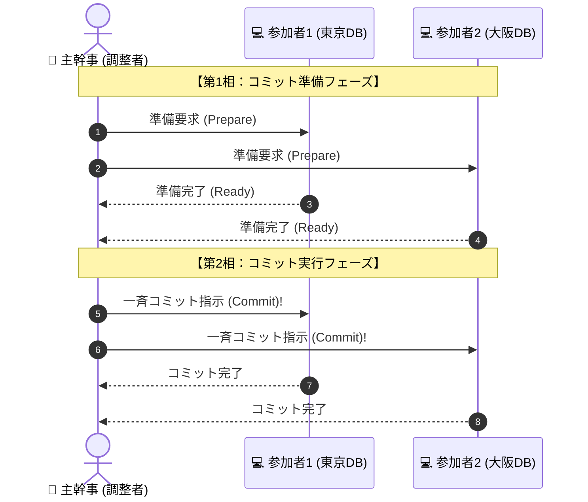

# 2相コミット：結婚式の誓い「全員準備OKなら一斉に誓います！」

> **想定読者**: 該当分野の用語・計算でつまずいている文系受験者
> **省いたもの**: 試験本番で即戦力にならない重箱の隅のプロトコル詳細仕様
> **所要時間**: 6〜8分
> **対象過去問**: 応用情報技術者 平成22年秋期 問30

---

## 【対象過去問】平成22年秋期 問30

**【問題】**  
分散データベースシステムにおいて，一連のトランザクション実行サイトに更新可能かどうかを問い合わせ，すべてのサイトから更新可能であるという返答を受け取った後にコミットを実行するプロトコルはどれか。

- **ア**: 2相コミット
- **イ**: チェックポイント
- **ウ**: 排他制御
- **エ**: ロールフォワード

▶ 正解を表示する

**正解: ア（2相コミット）**

---

## 0. 一枚で：『ネットワーク分散DBで、全サイトの更新整合性を保つのが「2相コミット」！』

### 🧠 脳に刻む合言葉：
> **『 第1相で「全員の準備完了」を確認！第2相で「一斉コミット（またはアボート）」！ 』**

---

## 1. なぜそうなるのか？（日常のたとえ話：ロケットの発射シークエンス（「全エンジン準備完了」「了解、オールグリーン、一斉点火！」））

東京のサーバと大阪のサーバにあるデータベースを同時に更新するとき、東京だけ成功して大阪がネット切断で失敗したら、データが矛盾して大惨事になります。

この分散トランザクションを「All or Nothing（原子性）」で成功させるのが **2相コミット（Two-Phase Commit Protocol）** です！

### 2つのフェーズ（相）：
1. **第1相（準備フェーズ）**:
   - 調整者（親）が参加者（子）全員に「コミットの準備はできたか？」と尋ねる。
   - 参加者はログを書き出し、準備ができたら「Ready（OK）」と返事する。
2. **第2相（コミットフェーズ）**:
   - **全員からOKが届いた場合**: 調整者は「全員コミットせよ！」と号令をかける。
   - **1人でもNGまたは無応答だった場合**: 調整者は「全員ロールバック（取り消し）せよ！」と号令をかけ、全員を元の状態に戻す。

この2段階を踏むことで、ネットワークをまたいだ分散環境でもデータの矛盾を完全に防ぎます！

---

## 2. 選択肢のひっかけポイント ＆ 判定理由

- **イ: チェックポイント** → メモリ上の更新データをディスクに書き出し、障害復旧の起点にする技術。
- **ウ: 排他制御** → ロックなどを用いてデータの同時更新を防ぐ技術。
- **エ: ロールフォワード** → 障害発生時にバックアップとログを用いて最新状態まで前進復帰させる技術。
- 「分散DBで問い合わせてからコミット」と来たら、反射的に **「2相コミット」** 一択です！

---

## 3. 午後試験 記述対策チェックリスト（※該当する場合）

- [ ] **Q. 2相コミットプロトコルの第1相で、1つの参加サイトから「コミット不可」の返答があった場合の調整者の動作を説明せよ。**  
  → **「全参加サイトに対してトランザクションの中止（ロールバック/アボート）を指示する。」**

---

## 🎯 次の2分アクション（定着チェック）

- [ ] **画面の一番上に戻り、正解を隠した状態で正解肢「ア」を確信を持って選べるか試してみよう！**
