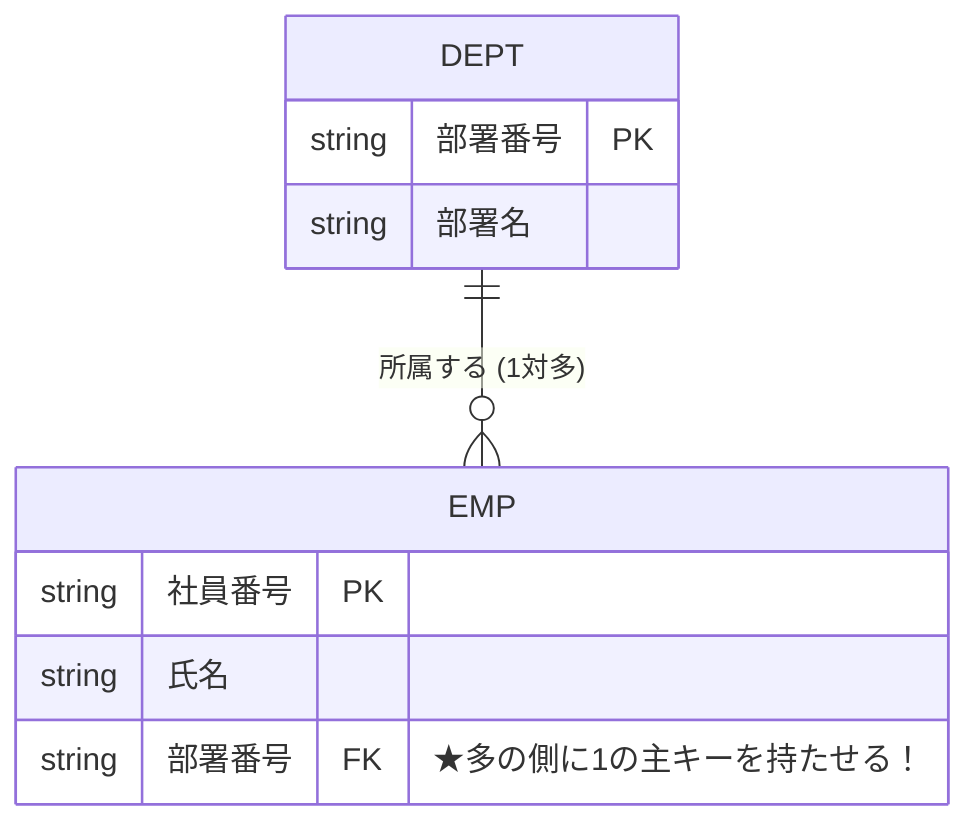

# E-R図と外部キー：1対多のテーブル同士を「名札」で結ぶ鉄則！

> **想定読者**: 該当分野の用語・計算でつまずいている文系受験者
> **省いたもの**: 試験本番で即戦力にならない重箱の隅のプロトコル詳細仕様
> **所要時間**: 6〜8分
> **対象過去問**: 応用情報技術者 平成25年春期 問28

---

## 【対象過去問】平成25年春期 問28

**【問題】**  
「社員」と「部署」の関係が 1 対 多 であるとき、リレーショナルデータベースのテーブル設計として適切なものはどれか。ここで、下線は主キーを表す。

- **ア**: 社員 (社員番号, 氏名) ／ 部署 (部署番号, 部署名, 社員番号)
- **イ**: 社員 (社員番号, 氏名, 部署番号) ／ 部署 (部署番号, 部署名)
- **ウ**: 社員 (社員番号, 氏名) ／ 部署 (部署番号, 部署名) ／ 所属 (社員番号, 部署番号)
- **エ**: 社員 (社員番号, 氏名, 部署番号) ／ 部署 (部署番号, 部署名, 社員番号)

▶ 正解を表示する

**正解: イ（社員 (社員番号, 氏名, 部署番号) ／ 部署 (部署番号, 部署名)）**

---

## 0. 一枚で：『1対多の関係では、「多」側のテーブルに「1」側の主キーを外部キーとして持たせる！』

### 🧠 脳に刻む合言葉：
> **『 1対多のリレーションシップは「多」の側に「1の主キー」を持たせる！ 』**

---

## 1. なぜそうなるのか？（日常のたとえ話：幼稚園児（多）と先生（1）。園児の名札に「担当の先生の名前」を書く（先生の名札に全員の園児名を書くのは無理））

E-R図（実体関連図）をリレーショナルデータベースのテーブルに落とし込む（論理設計）とき、絶対に守るべき鉄則があります。

### 👑 鉄則：「1 対 多」は、「多」の側に「1の主キー」を置く！
- 部署（1）と 社員（多）の関係を考えます。
- もし部署テーブルに社員番号を書こうとすると、1つの部署に何十人もの社員番号をカンマ区切りで入れなければならず、第1正規形が崩壊してしまいます。
- 一方で、**社員テーブル（多の側）に「自分が所属する部署番号」を1つだけ持たせる（外部キーにする）** のは非常に綺麗で自然です！

したがって、社員テーブルに「部署番号」を持たせた **「イ」** が正解です！

---

## 2. 選択肢のひっかけポイント ＆ 判定理由

- **ウ: 中間テーブル（所属）を作る**  
  → これは「多 対 多」の関係（例: 学生と受講講義）を分解するときの手法です。「1 対 多」で中間テーブルを作ると無駄にテーブルが増えてしまいます。
- **ア: 1の側に社員番号を持たせる**  
  → 1つの部署に複数社員が所属できない設計になってしまうため致命的エラーです。

---

## 3. 午後試験 記述対策チェックリスト（※該当する場合）

- [ ] **Q. リレーショナルデータベースにおいて「多対多」の関連をテーブル設計する際の手順を説明せよ。**  
  → **「双方の主キーを外部キーとして併せ持つ連関（中間）テーブルを新たに作成し、2つの1対多の関連に分解する。」**

---

## 🎯 次の2分アクション（定着チェック）

- [ ] **画面の一番上に戻り、正解を隠した状態で正解肢「イ」を確信を持って選べるか試してみよう！**
