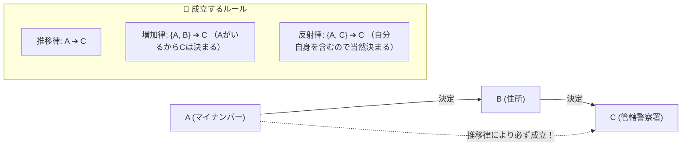

# 関数従属の導出：Aが決まればBが決まる「矢印のドミノ倒し」

> **想定読者**: 該当分野の用語・計算でつまずいている文系受験者
> **省いたもの**: 試験本番で即戦力にならない重箱の隅のプロトコル詳細仕様
> **所要時間**: 6〜8分
> **対象過去問**: 応用情報技術者 平成24年秋期 問26

---

## 【対象過去問】平成24年秋期 問26

**【問題】**  
関係R(A, B, C)において，関数従属 A→B 及び B→C が成立するとき，アームストロングの公理系によって必ず成立する関数従属の組合せはどれか。

- **ア**: {A}→{B}, {B}→{A}
- **イ**: {A}→{C}, {C}→{A}
- **ウ**: {A, B}→{C}, {A, C}→{C}, {A}→{C}
- **エ**: {B}→{A}, {C}→{B}

▶ 正解を表示する

**正解: ウ（{A, B}→{C}, {A, C}→{C}, {A}→{C}）**

---

## 0. 一枚で：『アームストロングの公理系：矢印をつなげば推移する！余分な列を足しても決定力は失われない！』

### 🧠 脳に刻む合言葉：
> **『 X→Y かつ Y→Z ならば X→Z！余分な列を足しても従属は壊れない！ 』**

---

## 1. なぜそうなるのか？（日常のたとえ話：身元確認。マイナンバー(A)で住所(B)が分かり、住所(B)で管轄警察署(C)が分かる。マイナンバーが分かれば管轄警察署(C)も即決まる！）

「関数従属 X → Y」とは、「X の値が決まれば、Y の値がただ1つに決まる」という関係です。

アームストロングの公理系（健全かつ完全な推論規則）：
1. **推移律**: A → B かつ B → C ならば、ドミノ倒しで **A → C** が成り立つ！
2. **増加律（拡大律）**: A → C が成り立つなら、左辺に余分な情報 B を付け足した **{A, B} → C** も当然成り立つ！
3. **反射律**: 集合の中にすでに C が含まれているなら、**{A, C} → C** は当たり前に成り立つ！

これらをすべて満たしている選択肢は **「ウ」** です！

---

## 2. 選択肢のひっかけポイント ＆ 判定理由

- 逆方向の矢印（B → A や C → A）は勝手に成り立ちません！
- 同姓同名があるように、住所(B)からマイナンバー(A)を1人に特定することはできないため、ア・イ・エは誤りです。

---

## 3. 午後試験 記述対策チェックリスト（※該当する場合）

- [ ] **Q. 関数従属の推移律（Transitivity）を簡潔に定義せよ。**  
  → **「X→Y かつ Y→Z が成立するとき、X→Z が成立すること。」**

---

## 🎯 次の2分アクション（定着チェック）

- [ ] **画面の一番上に戻り、正解を隠した状態で正解肢「ウ」を確信を持って選べるか試してみよう！**
