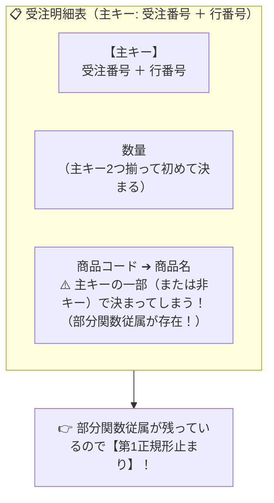

# 第2正規形：主キーの一部にぶら下がる「居候」を別居させる！

> **想定読者**: 該当分野の用語・計算でつまずいている文系受験者
> **省いたもの**: 試験本番で即戦力にならない重箱の隅のプロトコル詳細仕様
> **所要時間**: 6〜8分
> **対象過去問**: 応用情報技術者 平成29年春期 問27

---

## 【対象過去問】平成29年春期 問27

**【問題】**  
受注明細表が「受注番号」「行番号」「商品コード」「商品名」「数量」で構成され、主キーが「受注番号」と「行番号」であるとき、この表はどの正規形か。ここで、商品名は商品コードによって一意に定まるものとする。

- **ア**: 非正規形
- **イ**: 第1正規形
- **ウ**: 第2正規形
- **エ**: 第3正規形

▶ 正解を表示する

**正解: イ（第1正規形）**

---

## 0. 一枚で：『部分関数従属を排除して、主キー全体に完全関数従属させたのが「第2正規形」！』

### 🧠 脳に刻む合言葉：
> **『 複合主キーの片方にだけ従属するものを追い出せば第2正規形！ 』**

---

## 1. なぜそうなるのか？（日常のたとえ話：2人部屋の寮。2人の名前が主キーなのに、片方の連れ子が部屋に居座っている状態（第2正規化で連れ子を別部屋へ））

正規化の階段を登るルールはシンプルです。

1. **第1正規形**: 繰り返し項目がなく、1マスに1つの値（単一値）が入っている。
2. **第2正規形**: **「部分関数従属」を排除** し、主キーのすべての列が揃わないと決まらない状態（完全関数従属）にする。
3. **第3正規形**: **「推移的関数従属」を排除** し、主キー以外の列によって決まる列をなくす。

問題の表では：
- 主キーは「受注番号＋行番号」の2つの合体キーです。
- しかし、「商品名」は「商品コード」さえ分かれば決まってしまいます。
- 主キー全体に依存していない項目（部分関数従属）が同居しているため、まだ第2正規形には達しておらず、**「第1正規形」** に留まっています！

---

## 2. 選択肢のひっかけポイント ＆ 判定理由

- 「商品名が商品コードで決まる」＝部分関数従属が残っている！
- 部分関数従属が残っているということは、**「第2正規形は満たしていない（第1正規形止まり）」** というのが試験の超頻出パターンです！

---

## 3. 午後試験 記述対策チェックリスト（※該当する場合）

- [ ] **Q. 第1正規形の関係から第2正規形へ変換する手順を説明せよ。**  
  → **「複合主キーの一部に対して関数従属している属性（部分関数従属）を、別の関係として切り離す。」**

---

## 🎯 次の2分アクション（定着チェック）

- [ ] **画面の一番上に戻り、正解を隠した状態で正解肢「イ」を確信を持って選べるか試してみよう！**
