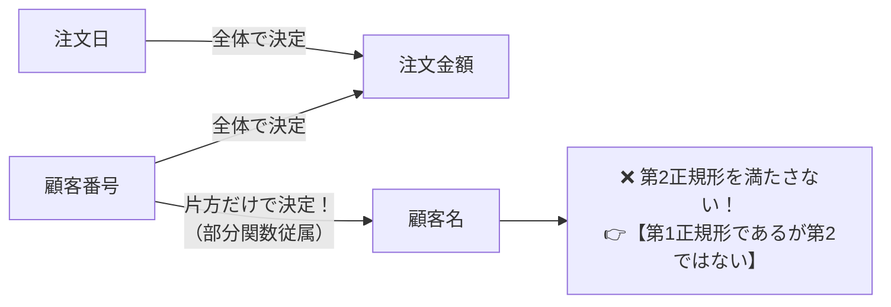

# 正規形の判定：「第1正規形だが第2正規形ではない」を見抜くツボ

> **想定読者**: 該当分野の用語・計算でつまずいている文系受験者
> **省いたもの**: 試験本番で即戦力にならない重箱の隅のプロトコル詳細仕様
> **所要時間**: 6〜8分
> **対象過去問**: 応用情報技術者 令和3年秋期 問28

---

## 【対象過去問】令和3年秋期 問28

**【問題】**  
表の主キーが {顧客番号, 注文日} であるとき、顧客名が顧客番号のみによって一意に定まる関係がある。この表の正規化に関する記述として、適切なものはどれか。

- **ア**: 第1正規形ではない。
- **イ**: 第1正規形であるが第2正規形ではない。
- **ウ**: 第2正規形であるが第3正規形ではない。
- **エ**: 第3正規形である。

▶ 正解を表示する

**正解: イ（第1正規形であるが第2正規形ではない。）**

---

## 0. 一枚で：『複合主キーの一部に従属する列がある＝第1正規形ではあるが第2正規形ではない！』

### 🧠 脳に刻む合言葉：
> **『 主キーの一部だけで決まる列が残っていれば「第1正規形止まり（第2ではない）」！ 』**

---

## 1. なぜそうなるのか？（日常のたとえ話：名札（顧客番号）とカレンダー（注文日）が揃わないと注文は特定できないのに、名札だけで顧客名が分かってしまう）

試験で最も狙われるのが、この **「第1正規形であるが第2正規形ではない」** という選択肢です。

- 主キーが `{顧客番号, 注文日}` という **2つ以上の列（複合主キー）** になっています。
- ここで、「顧客名」は「顧客番号」だけで決まります。
- つまり、主キーの一部分だけに依存しています（**部分関数従属**）。
- 第2正規形になる条件は「すべての非キー属性が主キーに完全関数従属すること（部分関数従属がないこと）」なので、この表は **第2正規形を満たしていません**。
- したがって、**「第1正規形であるが第2正規形ではない」** が正解になります！

---

## 2. 選択肢のひっかけポイント ＆ 判定理由

- 主キーが単一の列（1列だけ）なら部分関数従属は起こり得ません。
- 主キーが **複合主キー（2列以上）** であり、そのうちの1列だけで決まる列が問題文に書かれていたら、100% **「第1正規形だが第2正規形ではない」** です！

---

## 3. 午後試験 記述対策チェックリスト（※該当する場合）

- [ ] **Q. 部分関数従属が存在するテーブルで更新時異状（アノマリー）が発生する具体例を1つ挙げよ。**  
  → **「顧客名を変更する際、過去の全注文レコードを漏れなく更新しないとデータの不整合が生じる。」**

---

## 🎯 次の2分アクション（定着チェック）

- [ ] **画面の一番上に戻り、正解を隠した状態で正解肢「イ」を確信を持って選べるか試してみよう！**
