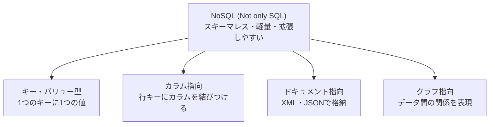

# NoSQLの種類：コインロッカーで覚える「キーバリュー型データベース」

> **想定読者**: NoSQL・DWH・メタ情報など、データベース系の用語が混ざってしまう文系受験者  
> **省いたもの**: 各NoSQL製品の実装詳細、CAP定理などの理論  
> **所要時間**: 6〜8分  
> **対象過去問**: 応用情報技術者 令和6年春期 問29  

---

## 【対象過去問】令和6年春期 問29

**【問題】**  
ビッグデータの基盤技術として利用されるNoSQLに分類されるデータベースはどれか。

- **ア**: 関係データモデルをオブジェクト指向データモデルに拡張し，操作の定義や型の継承関係の定義を可能としたデータベース
- **イ**: 経営者の意思決定を支援するために，ある主題に基づくデータを現在の情報とともに過去の情報も蓄積したデータベース
- **ウ**: 様々な形式のデータを一つのキーに対応付けて管理するキーバリュー型データベース
- **エ**: データ項目の名称，形式など，データそのものの特性を表すメタ情報を管理するデータベース

▶ 正解を表示する

**正解: ウ（様々な形式のデータを一つのキーに対応付けて管理するキーバリュー型データベース）**

---

## 0. 一枚で：『NoSQLの4タイプ「キー・カラム・ドキュメント・グラフ」を言えたら勝ち！』

### 🧠 脳に刻む合言葉：
> **『 NoSQLは4兄弟：キー・カラム・ドキュメント・グラフ！“キーに値を結ぶ”のがKVS！ 』**

3ステップ解法：
1. 選択肢の定義文から、どのDBの説明かを言い当てる（ア＝オブジェクト指向DB、イ＝DWH、エ＝データディクショナリ）。
2. 残ったものがNoSQLの4タイプのどれに当たるか確認する。
3. 「キーに値を結びつける」＝キーバリュー型＝NoSQL。

---

## 1. なぜそうなるのか？（日常のたとえ話：駅のコインロッカー）

- **RDBMS（関係データベース）** は、きっちり罫線を引いた**会計帳簿**です。列の名前も型も事前に厳密に決め、ACID特性で信頼性も高い。ただし、その分「記入の手間（処理コスト）」が重い。
- ビッグデータでは、高頻度で膨大なデータが流れ込みます。帳簿の書式を守っていたら、受付が大行列になりパフォーマンスが落ちる。
- そこで登場したのが **NoSQL**。たとえるなら**駅のコインロッカー**です。**鍵の番号（キー）**さえあれば、中身（値）はカバンでも段ボールでも自由。出し入れが速く、ロッカーを増設（スケールアウト）するのも簡単です。

公式解説では、NoSQL（Not only SQL）は、データへのアクセス方法をSQLに限定しないDBMSの総称で、関係データベース以外のDBMSという意味でも使われます。**スキーマレスで軽量**なので、参照・追加が低コストで、スケーラビリティにも優れます。

### NoSQLの4タイプ（公式解説より）

| タイプ | 格納のしかた | たとえ |
|---|---|---|
| キー・バリュー型 | 1つのキーに1つの値を結びつける | コインロッカー・辞書 |
| カラム指向 | 行キーに対し、カラム（名前と値の組）を結びつける | 名札つきの引き出し |
| ドキュメント指向 | XMLやJSONなどの構造でデータを格納 | 1人ずつのカルテ |
| グラフ指向 | グラフ理論に基づき、データ間の関係を表現 | SNSの友だち相関図 |

キーバリュー型（KVS）は、プログラミングの**連想配列**のように使えるタイプです。

---

## 2. 選択肢のひっかけポイント ＆ 判定理由

- **ア ✕: オブジェクト指向データベース**  
  → 公式解説では「オブジェクト指向データベースの説明」。「関係データモデルを拡張」と書かれているため**関係DBの仲間**と見え、NoSQLではないと判断できます。「操作の定義や型の継承」というオブジェクト指向の言葉がヒントです。
- **イ ✕: データウェアハウス（DWH）**  
  → 「ある主題に基づく」「過去の情報も蓄積」＝DWHの定義（意思決定支援）。ビッグデータという言葉に釣られがちですが、NoSQLの分類ではありません。
- **ウ ◯: キーバリュー型データベース**  
  → 「1つのキーに1つの値を結びつける」NoSQLの代表タイプ（KVS）です。
- **エ ✕: データディクショナリ／リポジトリ**  
  → 「データ項目の名称、形式など、データの特性を表すメタ情報」＝データについてのデータを管理するもの。DBの“辞書”であって、NoSQLではありません。

> 💡 作問者の意図：「DBの名前らしい説明」を4つ並べ、NoSQLの4分類（特にKVS）を知っているかを見る問題。ア〜エの説明から、それぞれ「何の説明か」を即座に言える状態にしておけば全部消せます。

---

## 3. 午後試験 記述対策チェックリスト（※該当する場合）

- [ ] **Q. ビッグデータの処理でNoSQLが向く理由を述べよ。**  
  → **「スキーマレスで軽量なため参照・追加が低コストで実行でき、スケーラビリティにも優れるため。」**

---

## 🎯 次の2分アクション（定着チェック）

- [ ] **画面の一番上に戻り、正解を隠した状態で正解肢を確信を持って選べるか試してみよう！**
