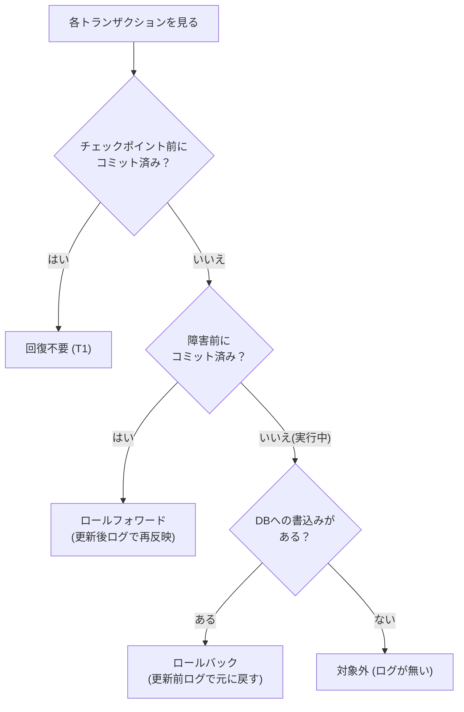

# タイトル：【ノートの清書と消しゴム】で覚える「ロールフォワード／ロールバック」

> **想定読者**: チェックポイントとコミットの前後関係で混乱する文系受験者  
> **省いたもの**: ログの具体的な書式、WAL の詳細  
> **所要時間**: 6〜8分  
> **対象過去問**: 応用情報技術者 [平成28年秋期 午前問30](https://www.ap-siken.com/kakomon/28_aki/q30.html)  

---

## 【対象過去問】平成28年秋期 午前問30

**【問題】**  
DBMSをシステム障害発生後に再立上げするとき，ロールフォワードすべきトランザクションとロールバックすべきトランザクションの組合せとして，適切なものはどれか。ここで，トランザクションの中で実行される処理内容は次のとおりとする。

> ⚠️ **復元できなかった部分**: 元問題の「タイムチャート図（T1〜T6 とチェックポイント・障害発生の位置）」と「各トランザクションの処理内容の表」、およびイ〜エの選択肢は取得データに含まれていません。以下は **公式解説の記述から復元できる事実のみ** を使っています。
>
> 公式解説から読み取れる状況：
> - T1：チェックポイント前にコミット済み
> - T2・T5：チェックポイント後〜障害発生前にコミット済み
> - T3・T4・T6：障害発生時に実行中（未コミット）。ただし T3・T4 はデータベースへの書込み処理が無い

- **ア**: ロールフォワード = T2，T5 ／ ロールバック = T6（解説より復元。取得データの選択肢欄は「イ ウ エ」と記載されており、ア〜エの本来の表記は不明）
- **イ〜エ**: 取得データでは空（復元不可）

▶ 正解を表示する

**正解: ア（ロールフォワード：T2，T5 ／ ロールバック：T6）**

---

## 0. 一枚で：「コミット済み→進める／実行中で書込みあり→戻す／書込みなし→放置」！

**合言葉：『済みは進め、途中は戻し、書かぬものは触らず』**

---

## 1. なぜそうなるのか？（日常のたとえ話）

**授業のノート** で考えます。先生の板書（メモリ上のバッファ）を、生徒は **一定間隔でまとめてノートに清書（ディスクへ反映）** します。この清書のタイミングが **チェックポイント** です。ただし「何を書いたか」のメモ（ログファイル）だけは、書いたそばから即座に手帳へ控えています。

停電（システム障害）が起きて再開すると、ノートは **最後の清書時点の状態** に戻っています。そこで手帳（ログ）を見て整えます。

- **ロールフォワード（前進復帰）**: 清書のあとに「提出済み（コミット）」になった課題は、手帳の「更新後」の記録を使ってノートに **書き足す**。
- **ロールバック（後退復帰）**: 停電時にまだ書きかけ（未コミット）だった課題は、手帳の「更新前」の記録で **消しゴムをかけて開始前に戻す**。
- **T1**: 清書より前に提出済み。ノートに確実に載っているので何もしない。

公式解説の要点：チェックポイント以前にコミットしたトランザクションはディスクへの反映が保証されます。

---

## 2. 選択肢のひっかけポイント ＆ 途中の考え方パズル

### 判定の手順（公式解説どおり）

| トランザクション | 状況 | 結論 |
|---|---|---|
| T1 | チェックポイント前にコミット | 回復不要 |
| T2 | チェックポイント後〜障害前にコミット | **ロールフォワード** |
| T5 | チェックポイント後〜障害前にコミット | **ロールフォワード** |
| T3 | 障害時に実行中、**書込み無し** | 対象外 |
| T4 | 障害時に実行中、**書込み無し** | 対象外 |
| T6 | 障害時に実行中、書込みあり | **ロールバック** |

### 最大のひっかけ
図だけを見ると「障害時に実行中の T3・T4・T6 は全部ロールバック」と答えたくなります。ところが **書込みが無いと更新前後のログ（ジャーナル）が生成されない** ので、チェックポイントの状態まで戻った後に消すべきものが存在しません。よって T3・T4 は対象外。作問者は「処理内容の表」を見落とさせるのが狙いです。

### 選択肢の判定
| 選択肢 | 判定 | 理由 |
|---|---|---|
| ア | ○ | ロールフォワード T2・T5、ロールバック T6 で解説の結論と一致 |
| イ・ウ・エ | ✕ | 選択肢の内容は取得できず個別の理由は復元不可。ただし正解がアなので、組合せは上表の結論と異なる（例：T3・T4 をロールバックに含める、T1 を対象にする等が典型的な誤り）。 |

---

## 🎯 次の2分アクション（定着チェック）

- [ ] **画面の一番上に戻り、正解を隠した状態で正解肢を確信を持って選べるか試してみよう！**
- [ ] 「コミット済み＝前進、実行中＋書込み有＝後退、書込み無＝何もしない」を言えるか確認。
