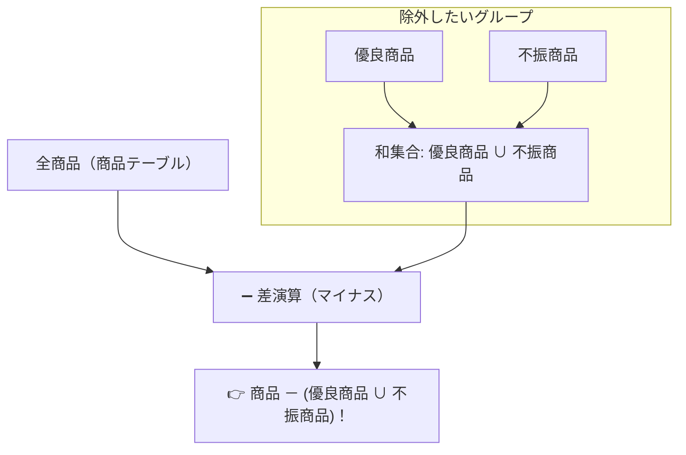

# 関係代数の演算：「差（－）」と「射影（π）」で欲しい行と列を抜き出す！

> **想定読者**: 該当分野の用語・計算でつまずいている文系受験者
> **省いたもの**: 試験本番で即戦力にならない重箱の隅のプロトコル詳細仕様
> **所要時間**: 6〜8分
> **対象過去問**: 応用情報技術者 平成25年秋期 問31

---

## 【対象過去問】平成25年秋期 問31

**【問題】**  
3つの商品表「商品」「優良商品」「不振商品」がある。関係代数演算を用いて「優良商品と不振商品の両方に含まれない商品」を求める式として、適切なものはどれか。

- **ア**: (優良商品 × 不振商品) － 商品
- **イ**: 商品 － (優良商品 ∪ 不振商品)
- **ウ**: 商品 ∩ (優良商品 － 不振商品)
- **エ**: (商品 － 優良商品) ∩ 不振商品

▶ 正解を表示する

**正解: イ（商品 － (優良商品 ∪ 不振商品)）**

---

## 0. 一枚で：『全体集合から不要な組み合わせを引き算（差演算）して求める！』

### 🧠 脳に刻む合言葉：
> **『 行の引き算は「差演算（−）」！列の切り出しは「射影（π）」！ 』**

---

## 1. なぜそうなるのか？（日常のたとえ話：全校生徒名簿から「運動部員」と「文化部員」を合体させたリストを引き算して「帰宅部」を見つける）

関係代数は、テーブル同士の足し算・引き算・掛け算です。

- **和（∪）**: 2つのテーブルを縦に合体する（OR）。
- **差（−）**: 一方のテーブルから、もう一方に含まれる行を取り除く（NOT / MINUS）。
- **積（∩）**: 両方に共通する行だけを残す（AND）。
- **射影（π）**: 指定した「列（タテ）」だけを抜き出す。
- **選択（σ）**: 条件に合う「行（ヨコ）」だけを抜き出す。

問題は「優良商品でも不振商品でもない普通の商品」を求めることです。
全体である「商品」から、「優良商品または不振商品（和集合）」をまるごと引き算（差演算）すれば完成です！
式で書くと **`商品 － (優良商品 ∪ 不振商品)`** となります！

---

## 2. 選択肢のひっかけポイント ＆ 判定理由

- 直積（×）はすべての行同士を掛け合わせる（クロス結合）演算であり、行の引き算には使えません。
- 差演算の記号「−」の意味が分かっていれば、直感的に「イ」を選べます！

---

## 3. 午後試験 記述対策チェックリスト（※該当する場合）

- [ ] **Q. 関係代数における「選択（Selection）」と「射影（Projection）」の違いを説明せよ。**  
  → **「選択は条件に合致する「行」を抽出し、射影は指定した特定の「列」を抽出する操作。」**

---

## 🎯 次の2分アクション（定着チェック）

- [ ] **画面の一番上に戻り、正解を隠した状態で正解肢「イ」を確信を持って選べるか試してみよう！**
