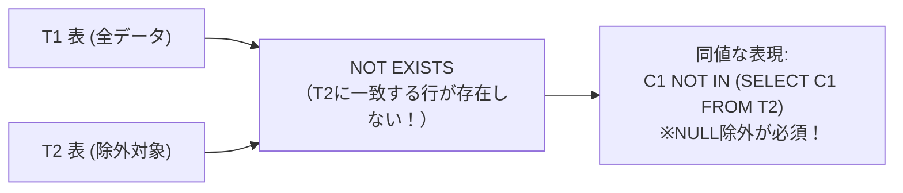

# NOT EXISTS相関副問合せ：複雑なSQLを「存在しないもの探し」で解く！

> **想定読者**: 該当分野の用語・計算でつまずいている文系受験者
> **省いたもの**: 試験本番で即戦力にならない重箱の隅のプロトコル詳細仕様
> **所要時間**: 6〜8分
> **対象過去問**: 応用情報技術者 平成19年春期 問66

---

## 【対象過去問】平成19年春期 問66

**【問題】**  
T1表とT2表に対して，次のSQL文を実行したときの結果と同じ結果が得られるSQL文はどれか。
SELECT * FROM T1 WHERE NOT EXISTS (SELECT * FROM T2 WHERE T1.C1 = T2.C1)

- **ア**: SELECT * FROM T1 WHERE C1 NOT IN (SELECT C1 FROM T2 WHERE C1 IS NOT NULL)
- **イ**: SELECT * FROM T1 WHERE C1 IN (SELECT C1 FROM T2)
- **ウ**: SELECT * FROM T1, T2 WHERE T1.C1 = T2.C1
- **エ**: SELECT * FROM T1 LEFT JOIN T2 ON T1.C1 = T2.C1

▶ 正解を表示する

**正解: ア（SELECT * FROM T1 WHERE C1 NOT IN (SELECT C1 FROM T2 WHERE C1 IS NOT NULL)）**

---

## 0. 一枚で：『NOT EXISTS(相関サブクエリ)は、右側の条件に一致する行が「1行も存在しない」行を抜き出す！』

### 🧠 脳に刻む合言葉：
> **『 NOT EXISTS は「引き算（EXCEPT/MINUS）」または「LEFT JOIN して IS NULL」！ 』**

---

## 1. なぜそうなるのか？（日常のたとえ話：出欠確認。「T1（全生徒）」の中で、「T2（出席者リスト）」に自分の名前がない（NOT EXISTS）人を探す）

`NOT EXISTS` は、相関副問合せ（外側のテーブルの行と1行ずつ比較するサブクエリ）で最もよく使われる述語です。

### 🔍 意味：
「T1表のレコードのうち、同じC1の値を持つレコードが **T2表の中に1件も存在しないもの** だけを持ってこい！」  
つまり、集合の引き算（T1 − T2）を行っています。

### ⚠️ NOT IN に書き換えるときの「NULLの罠」！
`NOT IN` は便利ですが、もしサブクエリの結果に `NULL` が1つでも混ざっていると、SQLの3値論理（UNKNOWN）によって **結果が常に空（0件）になってしまう** という有名な落とし穴があります。
そのため、`NOT IN` で同値な結果を得るためには、必ず **`WHERE C1 IS NOT NULL`** でNULLを除外しておかなければなりません！

これを正しく表現しているのが **「ア」** です！

---

## 2. 選択肢のひっかけポイント ＆ 判定理由

- `IN` や内部結合（ウ）は「一致するもの（EXISTS）」になってしまうので真逆です。
- `NOT IN` を使うときは必ず **NULL対策（IS NOT NULL）** がされている選択肢を選ぶのがデータベース試験の定石です！

---

## 3. 午後試験 記述対策チェックリスト（※該当する場合）

- [ ] **Q. NOT IN 述語のサブクエリ結果にNULL値が含まれていた場合に発生する問題と理由を説明せよ。**  
  → **「比較結果がUNKNOWNとなり、WHERE句全体の条件が真とならず結果が0件になる問題。」**

---

## 🎯 次の2分アクション（定着チェック）

- [ ] **画面の一番上に戻り、正解を隠した状態で正解肢「ア」を確信を持って選べるか試してみよう！**
