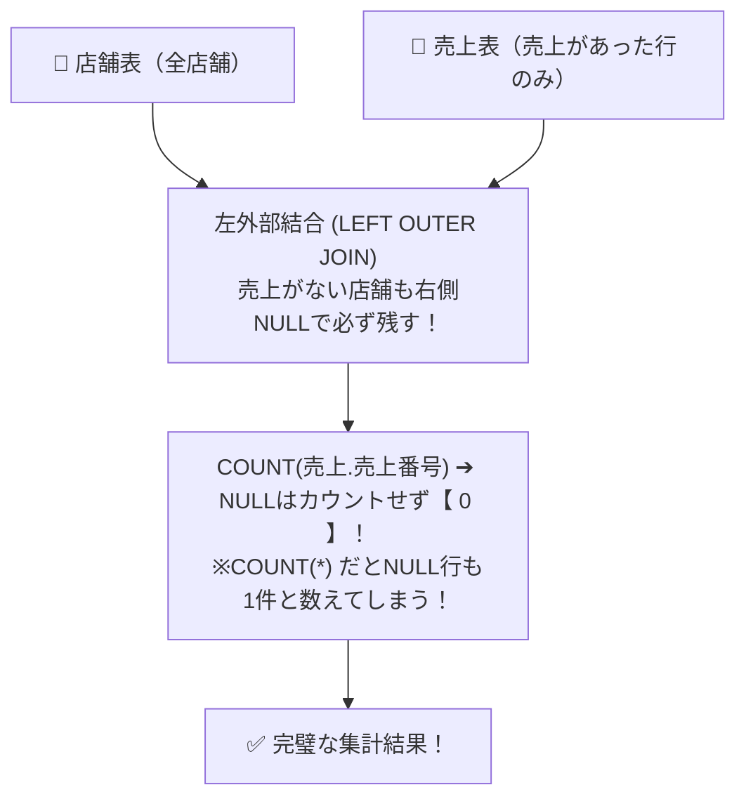

# SQL外部結合と集約：0件のデータも消さずに「全員参加」させる集計術！

> **想定読者**: 該当分野の用語・計算でつまずいている文系受験者
> **省いたもの**: 試験本番で即戦力にならない重箱の隅のプロトコル詳細仕様
> **所要時間**: 6〜8分
> **対象過去問**: 応用情報技術者 平成28年秋期 問29

---

## 【対象過去問】平成28年秋期 問29

**【問題】**  
「店舗」表と「売上」表がある。売上が1件もない店舗も含めて、すべての店舗の店舗コードと売上件数を一覧表示するSQL文として、適切なものはどれか。

- **ア**: SELECT 店舗.店舗コード, COUNT(売上.売上番号) FROM 店舗 INNER JOIN 売上 ON 店舗.店舗コード = 売上.店舗コード GROUP BY 店舗.店舗コード
- **イ**: SELECT 店舗.店舗コード, COUNT(売上.売上番号) FROM 店舗 LEFT OUTER JOIN 売上 ON 店舗.店舗コード = 売上.店舗コード GROUP BY 店舗.店舗コード
- **ウ**: SELECT 店舗.店舗コード, COUNT(*) FROM 店舗 LEFT OUTER JOIN 売上 ON 店舗.店舗コード = 売上.店舗コード GROUP BY 店舗.店舗コード
- **エ**: SELECT 店舗.店舗コード, COUNT(売上.売上番号) FROM 店舗, 売上 WHERE 店舗.店舗コード = 売上.店舗コード GROUP BY 店舗.店舗コード

▶ 正解を表示する

**正解: イ（SELECT 店舗.店舗コード, COUNT(売上.売上番号) FROM 店舗 LEFT OUTER JOIN 売上 ON 店舗.店舗コード = 売上.店舗コード GROUP BY 店舗.店舗コード）**

---

## 0. 一枚で：『売上0件の店舗もリストに残すには「LEFT OUTER JOIN」＋「COUNT(列名)」！』

### 🧠 脳に刻む合言葉：
> **『 0件のものも残したいなら LEFT OUTER JOIN！COUNT(列名)ならNULLは0カウント！ 』**

---

## 1. なぜそうなるのか？（日常のたとえ話：健康診断の受診票。未受診（売上なし）の人も名簿から削らず、「受診回数: 0回」と表示する）

「売上0件の店舗も含めて一覧表示したい」という要件は、実務でも試験でも超頻出です。

### 1. なぜ INNER JOIN（内部結合）ではダメなのか？
通常の `INNER JOIN`（アやエ）を使うと、両方のテーブルに存在する行だけが残るため、**売上が0件の店舗が丸ごと消去** されてしまいます！
基準となる店舗表をすべて残すには、**`LEFT OUTER JOIN`（左外部結合）** が必須です。

### 2. なぜ `COUNT(*)` ではなく `COUNT(列名)` なのか？
- **`COUNT(*)`**: 行そのものの個数を数えるため、売上がなくて右側が `NULL` になっている行も「1行ある」とみなして **件数1** になってしまう！
- **`COUNT(売上.売上番号)`**: 指定した列が **`NULL` 以外の行だけを数える** ため、売上がない店舗は正しく **「0件」** になる！

この2つのポイントを両方満たしているのは **「イ」** だけです！

---

## 2. 選択肢のひっかけポイント ＆ 判定理由

- **ウ: COUNT(*) を使っている！**  
  → **【超激甚トラップ！】** LEFT OUTER JOIN しているのに `COUNT(*)` にすると、売上0件の店舗が「1件」と誤集計されます！絶対に `COUNT(列名)` を選んでください。

---

## 3. 午後試験 記述対策チェックリスト（※該当する場合）

- [ ] **Q. 外部結合において COUNT(*) と COUNT(列名) の結果が異なる理由を説明せよ。**  
  → **「COUNT(*)はNULLを含む全行数を数えるのに対し、COUNT(列名)は指定列がNULLでない行のみを数えるため。」**

---

## 🎯 次の2分アクション（定着チェック）

- [ ] **画面の一番上に戻り、正解を隠した状態で正解肢「イ」を確信を持って選べるか試してみよう！**
