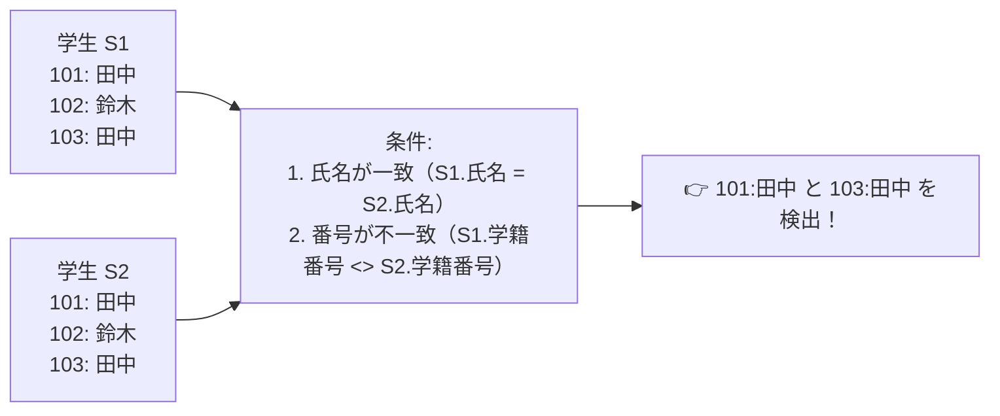

# SQL自己結合：同じ名簿同士を見比べて「重複」をあぶり出す！

> **想定読者**: 該当分野の用語・計算でつまずいている文系受験者
> **省いたもの**: 試験本番で即戦力にならない重箱の隅のプロトコル詳細仕様
> **所要時間**: 6〜8分
> **対象過去問**: 応用情報技術者 平成18年秋期 問66

---

## 【対象過去問】平成18年秋期 問66

**【問題】**  
学生テーブルから，同姓同名の学生が存在する学生の学籍番号と氏名をすべて求めるSQL文として，適切なものはどれか。ここで，学籍番号は主キーである。

- **ア**: SELECT S1.学籍番号, S1.氏名 FROM 学生 S1, 学生 S2 WHERE S1.氏名 = S2.氏名 AND S1.学籍番号 = S2.学籍番号
- **イ**: SELECT S1.学籍番号, S1.氏名 FROM 学生 S1, 学生 S2 WHERE S1.氏名 = S2.氏名 AND S1.学籍番号 <> S2.学籍番号
- **ウ**: SELECT S1.学籍番号, S1.氏名 FROM 学生 S1 WHERE S1.氏名 IN (SELECT S2.氏名 FROM 学生 S2 WHERE S1.学籍番号 = S2.学籍番号)
- **エ**: SELECT DISTINCT S1.学籍番号, S1.氏名 FROM 学生 S1, 学生 S2 WHERE S1.学籍番号 <> S2.学籍番号

▶ 正解を表示する

**正解: イ（SELECT S1.学籍番号, S1.氏名 FROM 学生 S1, 学生 S2 WHERE S1.氏名 = S2.氏名 AND S1.学籍番号 <> S2.学籍番号）**

---

## 0. 一枚で：『同姓同名を探すときは、同じ名簿を2部並べて「名前一致かつ番号違い」を抽出！』

### 🧠 脳に刻む合言葉：
> **『 同じテーブルにS1とS2と別名をつけて結合！S1.氏名 = S2.氏名 AND S1.学籍番号 <> S2.学籍番号！ 』**

---

## 1. なぜそうなるのか？（日常のたとえ話：名簿のコピーを2枚用意して、指で「名前が同じなのに別の行にいる人」を探す）

同じテーブルの中で「重複しているレコード」を探すときは、SQLの **自己結合（Self Join）** を使います。

同じ「学生」テーブルに、それぞれ `S1` と `S2` という別名（エイリアス）をつけて2つ並べます。
同姓同名とは：
1. **氏名が同じであること**: `S1.氏名 = S2.氏名`
2. **自分自身ではないこと（別人であること）**: `S1.学籍番号 <> S2.学籍番号`

この2つの条件を AND で結べば、自分以外の同姓同名がいる学生だけが完璧に抽出されます！

---

## 2. 選択肢のひっかけポイント ＆ 判定理由

- **ア: S1.学籍番号 = S2.学籍番号**  
  → **【最大の罠！】** 等号で結ぶと「自分自身」と一致してしまうため、全校生徒全員が抽出されてしまいます！
- **イ: S1.学籍番号 <> S2.学籍番号 【正解！】**  
  → 不等号（<>）で結ぶことで、「自分以外の同姓同名」に限定できます。

---

## 3. 午後試験 記述対策チェックリスト（※該当する場合）

- [ ] **Q. 自己結合において、結合条件に主キーの不一致条件（S1.key <> S2.key）が必要な理由を述べよ。**  
  → **「自分自身のレコードとの結合（自己一致）を除外するため。」**

---

## 🎯 次の2分アクション（定着チェック）

- [ ] **画面の一番上に戻り、正解を隠した状態で正解肢「イ」を確信を持って選べるか試してみよう！**
