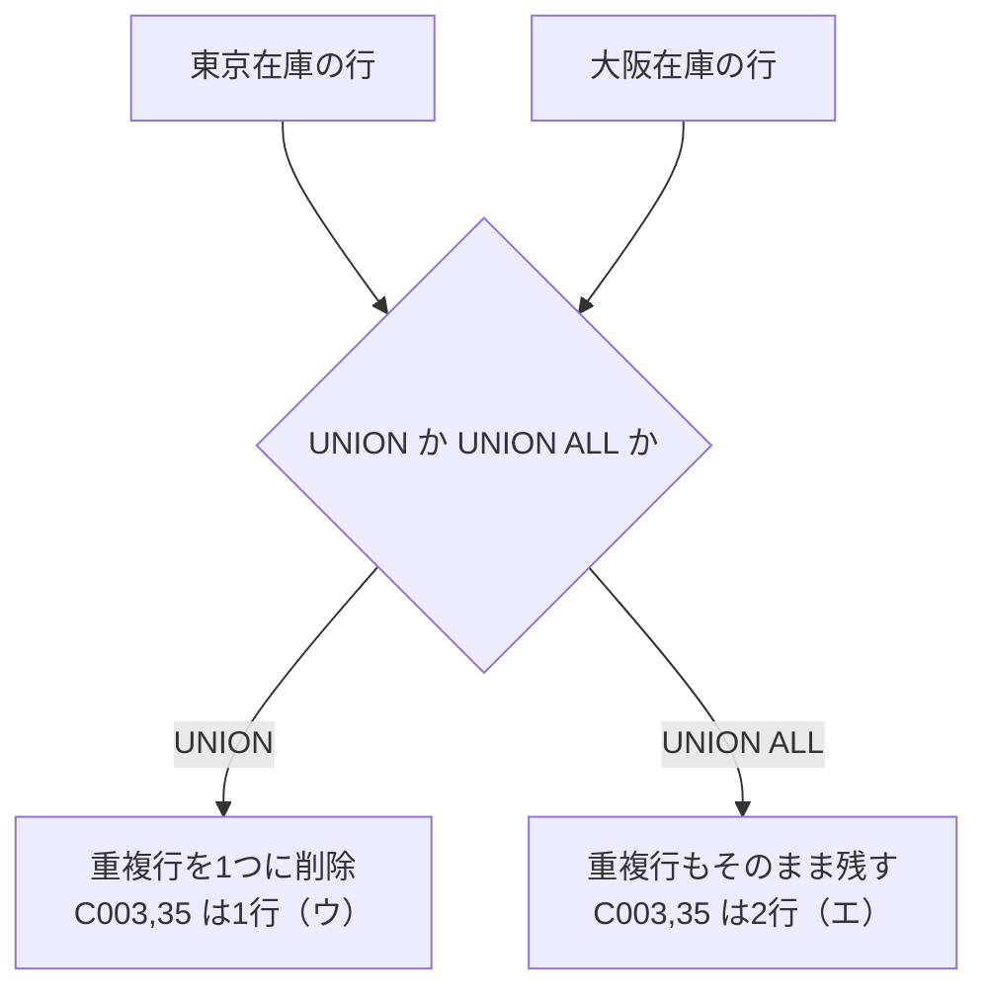

# SQLのUNIONとUNION ALL：2つの名簿を「そのままホッチキス留め」するか「ダブりを消す」か

> **想定読者**: UNIONとUNION ALLの違いがあいまいな文系受験者  
> **省いたもの**: ソート順やインデックスの内部動作  
> **所要時間**: 6〜8分  
> **対象過去問**: 応用情報技術者 令和2年秋期 午前問29  

---

## 【対象過去問】令和2年秋期 問29

**【問題】**  
"東京在庫"表と"大阪在庫"表に対して，SQL文を実行して得られる結果はどれか。ここで，実線の下線は主キーを表す。

```sql
SELECT 商品コード，在庫数 FROM 東京在庫
UNION ALL
SELECT 商品コード，在庫数 FROM 大阪在庫
```

> ⚠️ **復元に関する注記**: 原問題の2つの表（東京在庫・大阪在庫）と選択肢ア〜エの結果表は図表で、取得データには含まれていません。公式解説から分かる事実は次のとおりです。
> - 両表には共通するレコード **{商品コード: C003, 在庫数: 35}** がある
> - **エ** は「東京在庫表と大阪在庫表をそのまま統合した結果（重複行も残る）」
> - **ウ** は「UNION（ALLなし）で結合した場合の結果（重複行が1つに）」
> - ア・イの内容は復元不可

- **ア**: （図表のため復元不可）
- **イ**: （図表のため復元不可）
- **ウ**: （図表）UNIONで結合した場合の結果（C003, 35 が1行のみ）
- **エ**: （図表）東京在庫と大阪在庫をそのまま統合した結果（C003, 35 が2行）

<details>
<summary>▶ 正解を表示する</summary>

**正解: エ（両表をそのまま統合し、C003・35の重複行も残る結果）**

</details>

---

## 0. 一枚で：『ALLが付いたら、ダブりも全部残す！』



### 🧠 脳に刻む合言葉：
> **『 UNIONは重複を消す、UNION ALLは全部残す！ 』**

---

## 1. なぜそうなるのか？（日常のたとえ話：2つの出席名簿）

東京クラスと大阪クラスの名簿を1枚にまとめるとします。

- **UNION**: 「同じ名前は1人分でいいよ」と、**ダブりを消して**まとめる。ダブりを探す手間がかかる。
- **UNION ALL**: 「とにかく2枚をホッチキス留めして」と、**ダブりも含めて全部**くっつける。探す手間がなく速い。

公式解説のとおり、UNIONは和集合演算の演算子で、複数のSELECT結果を1つに統合します。通常のUNIONは**完全に同じレコードがあれば重複行を削除**しますが、UNION ALLは**重複行を含めた結果**を返します。

本問では、東京・大阪のどちらにも {C003, 35} があります。UNION ALLなので**この行が2行**残り、結果は両表をそのまま縦につなげた形（エ）になります。

---

## 2. 選択肢のひっかけポイント ＆ 判定理由

図表が復元できないため、公式解説で裏づけられる範囲で記載します。

- **エ → ○（正解）**  
  UNION ALLは重複を除かないため、両表をそのまま統合した結果になる。C003・35が2行残る。
- **ウ → ×（ひっかけ）**  
  これは**UNION（ALLなし）を使った場合**の結果。重複する {C003, 35} が1行にまとめられる。「ALL」を見落とすと選んでしまう最大の罠です。
- **ア・イ → ×**  
  図表の内容が取得できず、個別の誤り理由は復元不可。公式解説は正解エとウの説明のみです。

> 💡 **ひっかけ**: 「主キーが下線で示されている」ので、一見「重複はないはず」と思いがちです。しかし、主キーは**各表の内部**での一意性であり、**2つの表の間**では同じ値の行があっても構いません。UNIONの結果表に主キーの制約はかかりません。

---

## 3. 午後試験 記述対策チェックリスト（※該当する場合）

- [ ] **Q. UNIONとUNION ALLの違いを説明せよ。**  
  → **「UNIONは結果から重複行を除くが、UNION ALLは重複行もそのまま残す。」**

---

## 🎯 次の2分アクション（定着チェック）

- [ ] **画面の一番上に戻り、正解を隠した状態で正解肢を確信を持って選べるか試してみよう！**
- [ ] 「ALL＝全部残す」と3回唱える。
