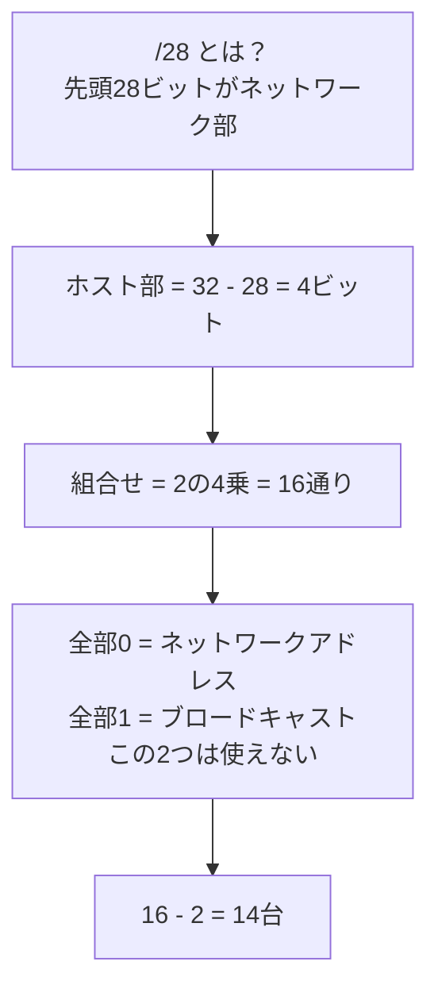

# IPv4のホスト数計算：マンションの部屋数で覚える「16－2＝14」

> **想定読者**: プレフィックス長（/28など）からホスト数を出す手順が曖昧な文系受験者  
> **省いたもの**: サブネットマスクの2進数変換の細かな理屈、CIDR集約  
> **所要時間**: 6〜8分  
> **対象過去問**: 応用情報技術者 令和4年春期 問34  

---

## 【対象過去問】令和4年春期 問34

**【問題】**  
IPv4で 192.168.30.32/28 のネットワークに接続可能なホストの最大数はどれか。

- **ア**: 14
- **イ**: 16
- **ウ**: 28
- **エ**: 30

▶ 正解を表示する

**正解: ア（14）**

---

## 0. 一枚で：『32－プレフィックス長＝ホスト部のビット数。2のn乗から「－2」！』

### 🧠 脳に刻む合言葉：
> **『 ホスト数は“2のn乗 マイナス2”！ネットワーク用とブロードキャスト用は住人になれない！ 』**

---

## 1. なぜそうなるのか？（日常のたとえ話：マンションの部屋数）

IPアドレスは32ビット。**「/28」は、先頭28ビットが“マンション名（ネットワーク部）”、残りが“部屋番号（ホスト部）”** という意味です。

- 部屋番号に使えるのは 32 − 28 ＝ **4ビット**。
- 4ビットで表せるのは 0000〜1111 の **16通り（2×2×2×2）**。
- ただし、
  - **全部0（0000）**＝ネットワークアドレス：「このマンション自体」の名前札
  - **全部1（1111）**＝ブロードキャストアドレス：「全住人に一斉放送」用の館内放送室

  の2つは、住人（ホスト）の部屋としては**予約済みで使えない**。
- よって、住める部屋は 16 − 2 ＝ **14室**。

公式解説でも、「ホストの最大数は『16－2＝14』が適切」としています。

### 途中計算（省略しない）
| 手順 | 計算 | 結果 |
|---|---|---|
| ① ホスト部のビット数 | 32 − 28 | 4ビット |
| ② ビットの組合せ数 | 2×2×2×2 | 16通り |
| ③ 予約アドレスを引く | 16 − 2 | **14台** |

### 実際のアドレスで確認（理解のための補足）
- 32は16の倍数なので、このネットワークは 192.168.30.32 から始まる16個のブロック。
- ネットワークアドレス： 192.168.30.32（ホスト部0000）
- ブロードキャスト： 192.168.30.47（ホスト部1111、32＋15）
- ホストに使える範囲： 192.168.30.33 〜 192.168.30.46 ＝ 14個

---

## 2. 選択肢のひっかけポイント ＆ 判定理由

- **ア ◯: 14**  
  → 16通り − 2（ネットワークアドレスとブロードキャスト）＝14。
- **イ ✕: 16**  
  → ホスト部4ビットの**組合せ数をそのまま答えた**ミス。「−2」を忘れた人用の罠。
- **ウ ✕: 28**  
  → 問題文の「/28」の数字を**そのまま答えにした**もの。28はネットワーク部のビット数で、ホスト数ではありません。
- **エ ✕: 30**  
  → 「2のn乗−2」の形は合っているが、**/27（ホスト部5ビット → 32−2＝30）の答え**。/28 と /27 の取り違えを狙った罠です。ホスト部は 32−28＝4ビットであって5ビットではありません。

> 💡 作問者の意図：「−2を忘れる（イ）」「プレフィックス長を答えにする（ウ）」「隣のプレフィックス長と混同する（エ）」という3つの典型ミスを並べています。

---

## 3. 午後試験 記述対策チェックリスト（※該当する場合）

- [ ] **Q. ホスト部が4ビットのネットワークで、ホストに割り当てられるアドレスが組合せ数より2つ少ない理由を述べよ。**  
  → **「ホスト部が全て0のアドレスはネットワークアドレス、全て1のアドレスはブロードキャストアドレスとして予約されているため。」**

---

## 🎯 次の2分アクション（定着チェック）

- [ ] **画面の一番上に戻り、正解を隠した状態で正解肢を確信を持って選べるか試してみよう！**
