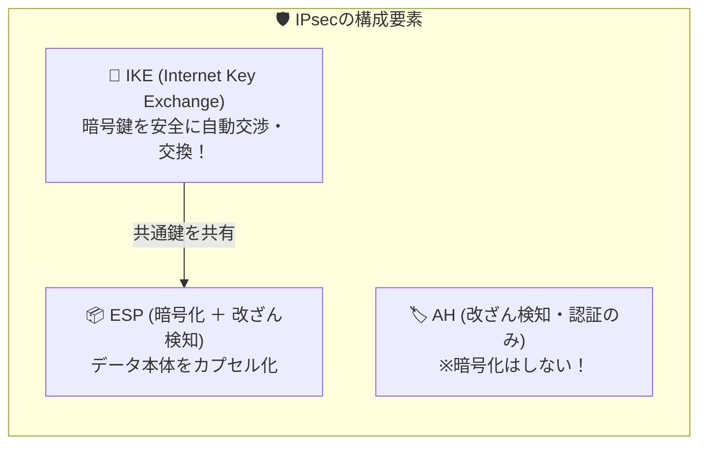

# IPsecと鍵交換：秘密の暗号鍵を安全に手渡す「IKE」の仕組み

> **想定読者**: 該当分野の用語・計算でつまずいている文系受験者
> **省いたもの**: 試験本番で即戦力にならない重箱の隅のプロトコル詳細仕様
> **所要時間**: 6〜8分
> **対象過去問**: 応用情報技術者 平成20年秋期 問58

---

## 【対象過去問】平成20年秋期 問58

**【問題】**  
IPsecに関する記述のうち，適切なものはどれか。

- **ア**: AHは，暗号化機能と改ざん防止機能を併せ持つ。
- **イ**: トンネルモードでは，元のIPパケットのデータ部だけを暗号化する。
- **ウ**: 使用する暗号鍵を自動交換するプロトコルは，IKEである。
- **エ**: トランスポートモードでは，元のIPパケットのヘッダを含めてパケット全体を暗号化する。

▶ 正解を表示する

**正解: ウ（使用する暗号鍵を自動交換するプロトコルは，IKEである。）**

---

## 0. 一枚で：『IPsecで暗号鍵を自動交換するプロトコルは「IKE」！』

### 🧠 脳に刻む合言葉：
> **『 IPsecの鍵交換はIKE！暗号の鍵（Key）をExchangeする！ 』**

---

## 1. なぜそうなるのか？（日常のたとえ話：スパイ同士の暗号通信（手紙を送る前に合鍵の受け渡しを交渉する事前ミーティング））

IPsec（Security Architecture for IP）は、ネットワーク層（レイヤ3）で通信を丸ごと暗号化・保護する強力な仕組みです。

### 🔑 鍵をどうやって安全に渡す？＝ IKE の出番！
暗号化通信をするには、送信者と受信者で「共通の鍵（暗号鍵）」を持っていなければなりません。
しかし、インターネット上で「これが合鍵だよ」と平文で送ったら盗聴されてしまいます。

そこで使われるのが **IKE（Internet Key Exchange）** です！
Diffie-Hellman鍵交換などの数学的仕組みを使い、盗聴されても安全に鍵を共有します。

### 📦 トンネルモード vs トランスポートモードの違い
- **トランスポートモード**: エンドノード間（PC同士など）。IPヘッダはそのまま残し、**「データ部（中身）」だけを暗号化** する。
- **トンネルモード**: 拠点間VPNルータ同士。**「元のIPパケット全体（ヘッダ＋データ）」を暗号化** し、外側に新しいIPヘッダをかぶせる。

---

## 2. 選択肢のひっかけポイント ＆ 判定理由

- **ア: AHは，暗号化機能と改ざん防止機能を併せ持つ。**  
  → **【ひっかけ！】** AH（Authentication Header）は「改ざん検知（認証）」のみで、**暗号化機能はありません**！暗号化できるのは **ESP** です。
- **イ: トンネルモードでは，元のIPパケットのデータ部だけを暗号化する。**  
  → **【逆！】** データ部だけ暗号化するのは「トランスポートモード」です。トンネルモードはパケット丸ごと暗号化します。
- **ウ: 使用する暗号鍵を自動交換するプロトコルは，IKEである。【正解！】**  
  → まさにその通り。IKE＝Internet Key Exchange（鍵交換）と直訳できます。
- **エ: トランスポートモードでは，元のIPパケットのヘッダを含めてパケット全体を暗号化する。**  
  → **【逆！】** パケット全体を暗号化するのは「トンネルモード」です。

---

## 3. 午後試験 記述対策チェックリスト（※該当する場合）

- [ ] **Q. IPsecにおけるIKE（Internet Key Exchange）の主な役割を説明せよ。**  
  → **「通信を行う機器同士で暗号化アルゴリズムの交渉を行い、安全に暗号鍵を自動交換する。」**

---

## 🎯 次の2分アクション（定着チェック）

- [ ] **画面の一番上に戻り、正解を隠した状態で正解肢「ウ」を確信を持って選べるか試してみよう！**
