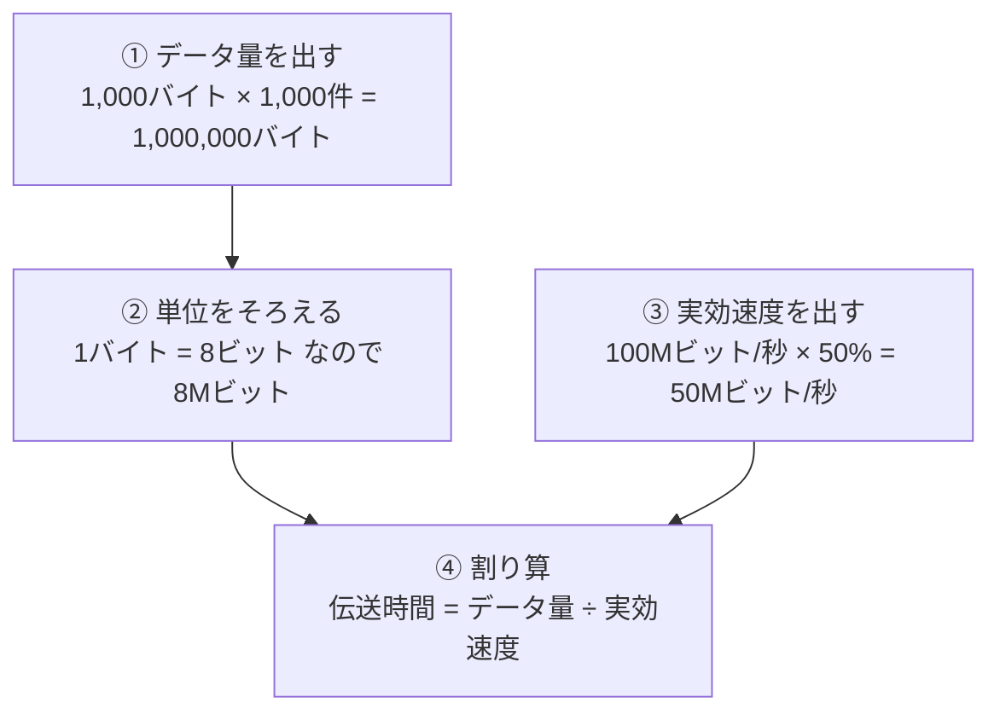

# LAN伝送時間の計算：高速道路の「渋滞率」で覚える「ビットとバイトの8倍」

> **想定読者**: bps（ビット）とバイトの換算で毎回ミスをする文系受験者  
> **省いたもの**: 伝送効率の内訳（ヘッダ・衝突・再送などの詳細）  
> **所要時間**: 6〜8分  
> **対象過去問**: 応用情報技術者 令和5年秋期 午前問31  

---

## 【対象過去問】令和5年秋期 問31

**【問題】**  
100Mビット／秒のLANを使用し，1件のレコード長が1,000バイトの電文を1,000件連続して伝送するとき，伝送時間は何秒か。ここで，LANの伝送効率は50%とする。

- **ア**: 0.02
- **イ**: 0.08
- **ウ**: 0.16
- **エ**: 1.6

▶ 正解を表示する

**正解: ウ（0.16）**

---

## 0. 一枚で：「データ量をビットにそろえる → 実効速度を出す → 割る」の3手順！

### 🧠 脳に刻む合言葉：
> **『 バイトは8ビット！速度は効率を掛けてから割る！ 』**

---

## 1. なぜそうなるのか？（日常のたとえ話：高速道路のトラック輸送）

- **回線の速度（100Mビット/秒）** ＝ 高速道路が1秒間に通せる「荷物の最大量」。
- **伝送効率50%** ＝ 渋滞や検問のせいで、実際に走れる量は理論値の半分。
- **データ量** ＝ 運びたい荷物の総量。
- **伝送時間** ＝ 荷物の総量 ÷ 実際に運べる速さ。

荷物の量は「バイト」、道路の能力は「ビット」で表されているので、**同じ単位にそろえないと比較できません**。重さをkgで、積載量をトンで言われたら、先にそろえるのと同じです。

### 途中計算（省略しません）

**手順A：ビットにそろえる（公式の別解）**

1. データ量（バイト）: 1,000 × 1,000 = 1,000,000 バイト = 1Mバイト
2. ビットに換算: 1,000,000 × 8 = 8,000,000 ビット = 8Mビット
3. 実効速度: 100Mビット/秒 × 0.5 = 50Mビット/秒
4. 伝送時間: 8M ÷ 50M = 8/50 = 0.16 秒

**手順B：バイトにそろえる（公式解説の主解法）**

1. データ量: 1Mバイト
2. 100Mビット/秒 ÷ 8 = 12.5Mバイト/秒
3. 実効速度: 12.5 × 0.5 = 6.25Mバイト/秒
4. 伝送時間: 1 ÷ 6.25 = 0.16 秒

どちらでも **0.16秒** で一致します。

---

## 2. 選択肢のひっかけポイント ＆ 判定理由

> 以下の「誤りの原因」は、数値から逆算した**考えられるミスの型**です（公式解説は正解の導出のみ記載）。

- **ア: 0.02 → ×**  
  1Mバイトを、100Mビット/秒の効率50%の速度＝「50M」で割ってしまった型（1 ÷ 50 = 0.02）。**ビットとバイトの単位を混ぜた**ミスです。
- **イ: 0.08 → ×**  
  8Mビット ÷ 100Mビット/秒 = 0.08。**伝送効率50%を掛け忘れた**型。効率を考慮すると所要時間は2倍の0.16になります。
- **ウ: 0.16 → ○**  
  8Mビット ÷ 50Mビット/秒 = 0.16秒。単位換算と効率の両方を正しく処理した唯一の答えです。
- **エ: 1.6 → ×**  
  正解0.16のちょうど10倍。**桁（M/k/1,000倍）の取り違え**に当たる大きすぎる値で、実効速度が5Mビット/秒相当になってしまいます。回線速度100Mビット/秒でこれほど遅いのは不自然だと気づけると消去できます。

> 💡 **検算のコツ**: 「効率が下がれば時間は延びる」ので、効率を無視した0.08（イ）より必ず大きい。かつ8Mビットを50Mで割るので1未満。この2つで候補はウに絞れます。

---

## 3. 午後試験 記述対策チェックリスト（※該当する場合）

- [ ] **Q. 伝送時間を求める式と、単位換算で注意すべき点は何か。**  
  → **「伝送時間＝伝送データ量÷（回線速度×伝送効率）。バイトは8ビットとして単位をそろえる。」**

---

## 🎯 次の2分アクション（定着チェック）

- [ ] **画面の一番上に戻り、正解を隠した状態で正解肢を確信を持って選べるか試してみよう！**
- [ ] 「1,000バイト×1,000件＝8Mビット」「100M×50%＝50M」の2行を紙に書いて暗唱する。
