# 多数決方式の伝送誤り率：3人中2人以上が間違える確率パズル！

> **想定読者**: 該当分野の用語・計算でつまずいている文系受験者
> **省いたもの**: 試験本番で即戦力にならない重箱の隅のプロトコル詳細仕様
> **所要時間**: 6〜8分
> **対象過去問**: 応用情報技術者 平成25年秋期 問33

---

## 【対象過去問】平成25年秋期 問33

**【問題】**  
ビット誤り率が10%の伝送路を使って1ビットデータを送る。誤り率を改善するために，送信側は元データの各ビットを3回連続して送信し，受信側は多数決で判定することにする。このときの誤り率は何%になるか。

- **ア**: 2.7
- **イ**: 2.8
- **ウ**: 3.0
- **エ**: 10.0

▶ 正解を表示する

**正解: イ（2.8）**

---

## 0. 一枚で：『3ビット多数決の誤りは「2ビット誤り」＋「3ビット誤り」の足し算で解く！』

```mermaid
flowchart TD
    Start["1ビットを3回送る（例: 0 ➔ 0 0 0）"]
    Start --> OK["✅ 正常判定（0 または 1ビット誤り）<br/>0 0 0 または 0 0 1 など ➔ 多数決で「0」"]
    Start --> NG["❌ 誤り判定（2ビット以上誤り）"]
    NG --> NG2["Case 1: ちょうど2ビット誤り<br/>3 × 0.1² × 0.9 = 0.027 (2.7%)"]
    NG --> NG3["Case 2: 3ビット全て誤り<br/>0.1³ = 0.001 (0.1%)"]
    NG2 & NG3 --> Sum["合計誤り率: 2.7% + 0.1% = 【 2.8% 】！"]
```

### 🧠 脳に刻む合言葉：
> **『 誤りは「2人ミス」＋「3人ミス」！3 × 0.1^2 × 0.9 + 0.1^3 ＝ 0.028（2.8%）！ 』**

---

## 1. なぜそうなるのか？（日常のたとえ話：3人でのじゃんけん相談（多数決で負けるのは、2人または3人が裏切ったとき））

ビット誤り率が 10%（p = 0.1）のとき、正常に届く確率は 1 - 0.1 = 0.9 です。
1ビットを3回送って「多数決」で決める場合、受信側が判定を間違ってしまうのはどんな時でしょうか？

**【判定が間違えるパターン】**
3つのうち、**2個以上が誤ったビットになってしまったとき** です！

1. **ちょうど2ビットが誤る確率**:
   3回中どの2回が誤るかの組み合わせは 3通り。  
   3 × (0.1)² × 0.9 = 3 × 0.01 × 0.9 = 0.027（2.7%）

2. **3ビットすべてが誤る確率**:
   1通り。  
   (0.1)³ = 0.001（0.1%）

3. **合計誤り率**:  
   0.027 + 0.001 = 0.028 ➔ **2.8%**！

何もしなければ10%だったエラー率が、3回送るだけで **2.8%** まで大幅に改善されます！

---

## 2. 選択肢のひっかけポイント ＆ 判定理由

- **ア: 2.7%【最大の罠！】**  
  → 「2ビット誤り（0.027）」だけ計算して安心してしまい、**「3ビット全て誤る確率（0.001）」を足し忘れる人** が続出します！作問者の罠にハマらないこと。
- **エ: 10.0%** → 改善されていないので論外です。

---

## 3. 午後試験 記述対策チェックリスト（※該当する場合）

- [ ] **Q. 多数決による誤り訂正方式において、送信データ量を3倍にするデメリットを挙げよ。**  
  → **「回線の伝送効率（スループット）が3分の1に低下する。」**

---

## 🎯 次の2分アクション（定着チェック）

- [ ] **画面の一番上に戻り、正解を隠した状態で正解肢「イ」を確信を持って選べるか試してみよう！**
