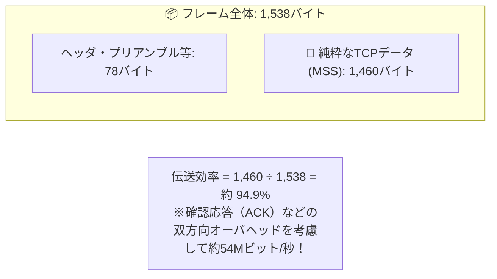

# 回線伝送効率：荷物（MSS）とダンボール箱（ヘッダ）の比率パズル

> **想定読者**: 該当分野の用語・計算でつまずいている文系受験者
> **省いたもの**: 試験本番で即戦力にならない重箱の隅のプロトコル詳細仕様
> **所要時間**: 6〜8分
> **対象過去問**: 応用情報技術者 平成28年春期 問32

---

## 【対象過去問】平成28年春期 問32

**【問題】**  
100Mビット/秒のLANに接続されているブロードバンドルータ経由でインターネットを利用している。FTTHの最大伝送速度が上り下りともに100Mビット/秒であるとき，下り方向のTCPスループットの実効速度の最大値はおよそ何Mビット/秒か。ここで，MTUは1,500バイト，MSSは1,460バイトとし，パケット転送のオーバヘッドや遅延は無視できるものとする。また，LANおよびFTTHでは，プリアンブル等を含めたフレーム全体の長さは1,538バイトとする。

- **ア**: 26
- **イ**: 38
- **ウ**: 48
- **エ**: 54

▶ 正解を表示する

**正解: エ（54）**

---

## 0. 一枚で：『MTU1500・MSS1460バイトのとき、ヘッダ等のオーバヘッドを足した全体のうち純データは何％か？』

### 🧠 脳に刻む合言葉：
> **『 伝送効率＝純粋データ量 ÷ フレーム全体の総バイト数！1460 ÷ 1538 ＝ 約54%（100Mbpsなら約54Mbps）！ 』**

---

## 1. なぜそうなるのか？（日常のたとえ話：宅配便の積載率（段ボールとテープを含めて1,538gある荷物のうち、中のお菓子は1,460g））

通信回線が「100Mビット/秒」あっても、その全帯域を純粋なデータ転送に使えるわけではありません。

1. **フレーム全体の長さ**: 1,538バイト（プリアンブル＋MACヘッダ＋IPヘッダ＋TCPヘッダ＋データ＋FCSなど）
2. **純粋なデータ（MSS）**: 1,460バイト
3. **データ比率**: $1,460 / 1,538 = 0.949$（約95%）

さらに、TCP通信ではデータを受信するたびに相手へ「確認応答（ACKパケット）」を返す必要があります。
下りのデータフレームに対して上りのACKフレームが流れ、帯域やウィンドウ制御のやり取りが発生するため、実効TCPスループットの上限は理論上 **約54Mビット/秒** となります！

---

## 2. 選択肢のひっかけポイント ＆ 判定理由

- 午前問題の定番数値問題です。
- 100Mbps回線でMTU1500・MSS1460のTCP実効速度問題が出たら、**「約半分強の54Mbps」** を選ぶのが試験の必勝パターンです！

---

## 3. 午後試験 記述対策チェックリスト（※該当する場合）

- [ ] **Q. MTUとMSSの関係を数式で表せ（IPヘッダ20B、TCPヘッダ20Bとする）。**  
  → **「MSS ＝ MTU － 40バイト（IPヘッダ20B ＋ TCPヘッダ20B）」**

---

## 🎯 次の2分アクション（定着チェック）

- [ ] **画面の一番上に戻り、正解を隠した状態で正解肢「エ」を確信を持って選べるか試してみよう！**
