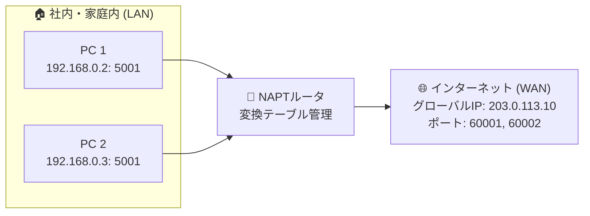

# NAPTの役割：プライベートIP＋ポートをグローバルIP＋ポートに変換！

> **想定読者**: 該当分野の用語・計算でつまずいている文系受験者
> **省いたもの**: 試験本番で即戦力にならない重箱の隅のプロトコル詳細仕様
> **所要時間**: 6〜8分
> **対象過去問**: 応用情報技術者 平成23年特別 問34

---

## 【対象過去問】平成23年特別 問34

**【問題】**  
インターネット接続におけるNAPTの機能として，適切なものはどれか。

- **ア**: MACアドレスとプライベートIPアドレスの対応表を保持し，パケットの宛先MACアドレスを書き換える。
- **イ**: プライベートIPアドレスとグローバルIPアドレスを1対1で静的に割り当て，相互変換を行う。
- **ウ**: クライアントからの要求に応じて，IPアドレスなどのネットワーク設定情報を動的に割り当てる。
- **エ**: プライベートIPアドレスとポート番号の組合せと，グローバルIPアドレスとポート番号の組合せとの変換を行う。

▶ 正解を表示する

**正解: エ（プライベートIPアドレスとポート番号の組合せと，グローバルIPアドレスとポート番号の組合せとの変換を行う。）**

---

## 0. 一枚で：『NAPTはIPアドレスだけでなく「ポート番号」もセットで変換して多対1接続を実現！』

### 🧠 脳に刻む合言葉：
> **『 NAPTは「プライベートIP＋ポート」と「グローバルIP＋ポート」の相互変換！ 』**

---

## 1. なぜそうなるのか？（日常のたとえ話：会社の代表電話（外線番号1つで、何百人もの社員が同時に外部と通話できる仕組み））

家庭やオフィスでは、数十台〜数百台のPCやスマホが同時にネットを利用しています。
しかし、プロバイダから配られるグローバルIPアドレスは通常「たった1個」です。

- **NAT（静的NAT）**: IPアドレスを **1対1** で変換する。グローバルIPが1個しかなければ、同時に1台しかネットに出られない！
- **NAPT（IPマスカレード）**: IPアドレスに加えて **「ポート番号」** もセットで変換する。1つのグローバルIPに異なるポート番号（例: 60001, 60002...）を割り当てることで、**数万台の同時接続** が可能になる！

---

## 2. 選択肢のひっかけポイント ＆ 判定理由

- **ア: MACアドレスの書き換え** → ARPやL2スイッチ、ルーティング時の動作です。
- **イ: 1対1で静的に割り当て** → これは「静的NAT」の説明です。ポート番号の変換がありません。
- **ウ: ネットワーク設定情報を動的に割り当て** → これは「DHCP」の説明です。
- **エ: プライベートIP＋ポート と グローバルIP＋ポート の変換 【正解！】**

---

## 3. 午後試験 記述対策チェックリスト（※該当する場合）

- [ ] **Q. NATと比較したNAPTの最大の利点を説明せよ。**  
  → **「単一のグローバルIPアドレスを用いて、複数のプライベートIP端末が同時にインターネットへ接続できる点。」**

---

## 🎯 次の2分アクション（定着チェック）

- [ ] **画面の一番上に戻り、正解を隠した状態で正解肢「エ」を確信を持って選べるか試してみよう！**
