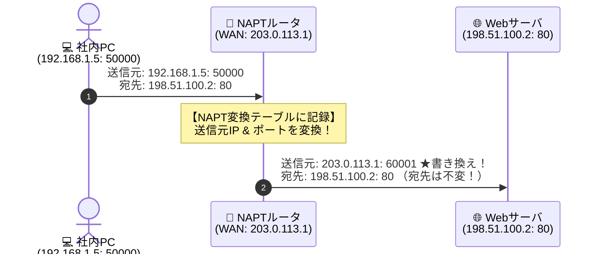

# NAPT書き換え：社内から外へ出るとき「すり替わる」のはどれ？

> **想定読者**: 該当分野の用語・計算でつまずいている文系受験者
> **省いたもの**: 試験本番で即戦力にならない重箱の隅のプロトコル詳細仕様
> **所要時間**: 6〜8分
> **対象過去問**: 応用情報技術者 令和3年秋期 問33

---

## 【対象過去問】令和3年秋期 問33

**【問題】**  
PCが，NAPT機能をもつルータを経由してインターネット上のWebサーバにアクセスしている。このとき，Webサーバ宛てに送出されるIPパケットのヘッダにおいて，PCを出たときからルータを出るときで値が変わるものの組合せはどれか。

- **ア**: 宛先のポート番号と宛先IPアドレス
- **イ**: 宛先のポート番号と送信元IPアドレス
- **ウ**: 送信元のポート番号と宛先IPアドレス
- **エ**: 送信元のポート番号と送信元IPアドレス

▶ 正解を表示する

**正解: エ（送信元のポート番号と送信元IPアドレス）**

---

## 0. 一枚で：『社内PCからWeb閲覧時、ルータが書き換えるのは「送信元IPアドレス」と「送信元ポート番号」！』

### 🧠 脳に刻む合言葉：
> **『 NAPTで変わるのは「送信元のIPとポート」！宛先は変えない！ 』**

---

## 1. なぜそうなるのか？（日常のたとえ話：会社の外線電話（社員の内線番号からかけると、相手には会社の代表番号＋割り当てポートで通知される））

プライベートIPアドレス（192.168.x.x）のままでは、インターネット上を通信できません。返信の届け先が存在しないからです。

そこで、家庭や会社のルータに搭載されている **NAPT（IPマスカレード）** が仲介します。
PCからインターネット上のWebサーバへパケットが通り抜ける瞬間：
1. **送信元IP**: PCのプライベートIP ➔ ルータの **グローバルIP** に書き換え！
2. **送信元ポート番号**: PCのポート ➔ ルータが管理する **空きポート番号** に書き換え！

**宛先（相手のWebサーバ）の情報は絶対に変えてはいけません。**  
宛先を変えてしまったら、目的地（Webサーバの80番ポート）に手紙が届かなくなってしまいます！

---

## 2. 選択肢のひっかけポイント ＆ 判定理由

- **宛先IPや宛先ポートを変えたらどうなる？**  
  → 宛先を変えたらWebサーバに届かなくなるので、ア・イ・ウは論理的に即座に消去できます！
- 変わるのは **「自分の身元情報（送信元IP ＋ 送信元ポート番号）」** だけ。したがって **「エ」** が確実な正解です。

---

## 3. 午後試験 記述対策チェックリスト（※該当する場合）

- [ ] **Q. NAPTルータが送信元IPアドレスだけでなく送信元ポート番号も変換する理由を説明せよ。**  
  → **「1つのグローバルIPアドレスを複数のクライアント端末で同時に共有して通信するため。」**

---

## 🎯 次の2分アクション（定着チェック）

- [ ] **画面の一番上に戻り、正解を隠した状態で正解肢「エ」を確信を持って選べるか試してみよう！**
