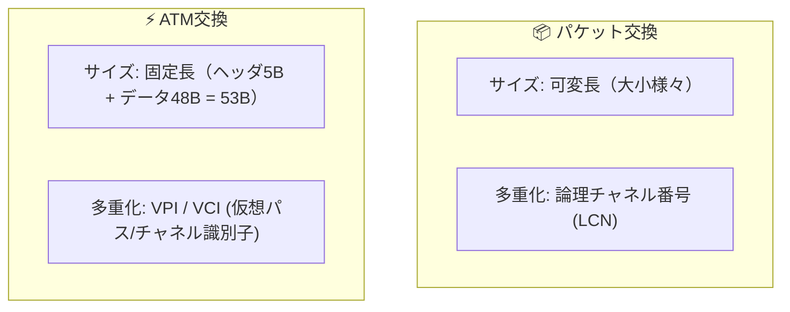

# パケット交換 vs ATM交換：自由な荷物サイズ vs 53バイト均一コンテナ

> **想定読者**: 該当分野の用語・計算でつまずいている文系受験者
> **省いたもの**: 試験本番で即戦力にならない重箱の隅のプロトコル詳細仕様
> **所要時間**: 6〜8分
> **対象過去問**: 応用情報技術者 平成17年春期 問56

---

## 【対象過去問】平成17年春期 問56

**【問題】**  
パケット交換とATM交換におけるパケットサイズ，及び多重化パラメータの適切な組合せはどれか。

- **ア**: パケット交換: [パケットサイズ] 可変長, [多重化パラメータ] 論理チャネル番号 ／ ATM交換: [パケットサイズ] 固定長, [多重化パラメータ] VPI/VCI
- **イ**: パケット交換: [パケットサイズ] 可変長, [多重化パラメータ] VPI/VCI ／ ATM交換: [パケットサイズ] 固定長, [多重化パラメータ] 論理チャネル番号
- **ウ**: パケット交換: [パケットサイズ] 固定長, [多重化パラメータ] 論理チャネル番号 ／ ATM交換: [パケットサイズ] 可変長, [多重化パラメータ] VPI/VCI
- **エ**: パケット交換: [パケットサイズ] 固定長, [多重化パラメータ] VPI/VCI ／ ATM交換: [パケットサイズ] 可変長, [多重化パラメータ] 論理チャネル番号

▶ 正解を表示する

**正解: ア（パケット交換: 可変長 / 論理チャネル番号, ATM交換: 固定長 / VPI/VCI）**

---

## 0. 一枚で：『パケット交換は「可変長・論理チャネル番号」、ATM交換は「固定長・VPI/VCI」！』

### 🧠 脳に刻む合言葉：
> **『 パケットは可変長で論理チャネル！ATMは固定長でVPI/VCI！ 』**

---

## 1. なぜそうなるのか？（日常のたとえ話：郵便局の小包（大きさ自由・伝票番号） vs 工場の専用コンテナ（53B固定・バーコード））

ネットワークでデータを細切れにして送る技術の歴史比較です。

- **パケット交換（X.25など）**:
  データに応じて大きさを変えられる **「可変長」** です。1本の回線に複数の通信を相乗り（多重化）させるため、**「論理チャネル番号（Logical Channel Number）」** で誰宛てのパケットかを識別します。
- **ATM交換（Asynchronous Transfer Mode）**:
  遅延を極限まで減らしてハードウェアで超高速処理するために、**「53バイトの固定長（セル）」** に統一しました。多重化の識別子には **「VPI（仮想パス識別子） / VCI（仮想チャネル識別子）」** を使います。

---

## 2. 選択肢のひっかけポイント ＆ 判定理由

- **ATMのサイズは絶対に「固定長（53バイト）」！**  
  → これを知っていれば、ウ・エは一瞬で消去できます。
- **ATMの多重化パラメータは「VPI/VCI」！**  
  → パケット交換がVPI/VCIになっているイは誤り。
- したがって **「ア」** が完全な正解です。

---

## 3. 午後試験 記述対策チェックリスト（※該当する場合）

- [ ] **Q. ATM交換方式において、セルサイズを53バイトの固定長にした技術的な目的を説明せよ。**  
  → **「ハードウェアによる交換処理を高速化し、網内遅延や音声通信のジッタを最小化するため。」**

---

## 🎯 次の2分アクション（定着チェック）

- [ ] **画面の一番上に戻り、正解を隠した状態で正解肢「ア」を確信を持って選べるか試してみよう！**
