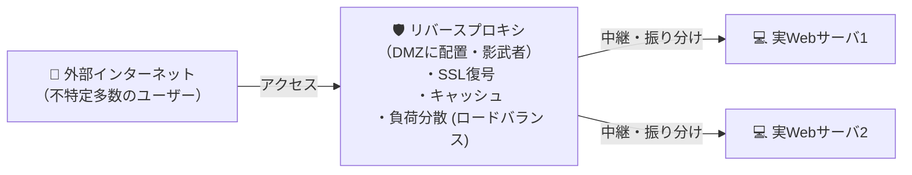

# リバースプロキシ：Webサーバ軍団を守る「専属の影武者・門番」

> **想定読者**: 該当分野の用語・計算でつまずいている文系受験者
> **省いたもの**: 試験本番で即戦力にならない重箱の隅のプロトコル詳細仕様
> **所要時間**: 6〜8分
> **対象過去問**: 応用情報技術者 令和7年秋期 問31

---

## 【対象過去問】令和7年秋期 問31

**【問題】**  
リバースプロキシの説明として，適切なものはどれか。

- **ア**: インターネットなどの外部ネットワークからの，公開Webサーバに対するアクセスを中継するために利用される。
- **イ**: 社内ネットワークからインターネットへのアクセスを代理し，アクセスログを記録するために利用される。
- **ウ**: 電子メールを受信して，宛先アドレスに基づいて適切なメールボックスへ振り分けるために利用される。
- **エ**: ドメイン名とIPアドレスの対応関係を管理し，名前解決要求に応答するために利用される。

▶ 正解を表示する

**正解: ア（インターネットなどの外部ネットワークからの，公開Webサーバに対するアクセスを中継するために利用される。）**

---

## 0. 一枚で：『外部インターネットからのWebサーバへのアクセスを中継・保護するのがリバースプロキシ！』

### 🧠 脳に刻む合言葉：
> **『 外から来る客の相手をする影武者＝リバースプロキシ！ 』**

---

## 1. なぜそうなるのか？（日常のたとえ話：高級ホテルのコンシェルジュ（客を奥の金庫や厨房に通さず、すべて窓口で代行処理する））

「プロキシ（Proxy）」とは英語で「代理人」のことです。向きによって2種類あります。

1. **フォワードプロキシ（通常のプロキシ）**:
   - **クライアント（社内PC）の代理人**。社内からインターネットへ出るときに中継し、有害サイトの遮断やキャッシュを行う。
2. **リバースプロキシ（逆プロキシ）**:
   - **サーバ（公開Webサーバ）の代理人**。インターネットからのアクセスを一番手前で受け止め、本物のWebサーバを背後に隠して守る。
   - メリット：本物サーバへの直接攻撃を防ぐ、SSL暗号化/復号の肩代わり、静的コンテンツのキャッシュ、複数サーバへの負荷分散。

---

## 2. 選択肢のひっかけポイント ＆ 判定理由

- **イ: 社内からインターネットへのアクセスを代理**  
  → **【最大の罠！】** これは「フォワードプロキシ（通常のプロキシ）」の説明です！「リバース（逆）」だから矢印の向きが逆になります。
- **ウ: メール受信・振り分け** → MTA（Mail Transfer Agent）の説明です。
- **エ: ドメイン名とIPの名前解決** → DNSサーバの説明です。

---

## 3. 午後試験 記述対策チェックリスト（※該当する場合）

- [ ] **Q. Webシステムにおいてリバースプロキシを導入することで得られるセキュリティ上の利点を1つ挙げよ。**  
  → **「背後にあるWebサーバのIPアドレスや構成を外部から隠蔽し、直接のサイバー攻撃を防ぐ。」**

---

## 🎯 次の2分アクション（定着チェック）

- [ ] **画面の一番上に戻り、正解を隠した状態で正解肢「ア」を確信を持って選べるか試してみよう！**
