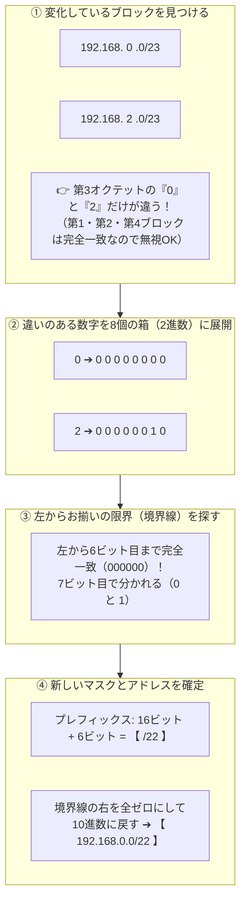

# ルート集約（CIDR）：32個の箱パズルで解くネットワーク合体法

> **想定読者**: 「/23」や「集約」と聞いただけでアレルギーが出る文系受験者
> **省いたもの**: ルーティングプロトコル（BGP/OSPF）のパケット詳細フォーマット
> **所要時間**: 6〜8分
> **対象過去問**: 応用情報技術者 平成30年春期 問35

---

## 【対象過去問】平成30年春期 問35

**【問題】**  
二つのIPv4ネットワーク 192.168.0.0/23 と 192.168.2.0/23 を集約したネットワークはどれか。

- **ア**: 192.168.0.0/22
- **イ**: 192.168.1.0/22
- **ウ**: 192.168.1.0/23
- **エ**: 192.168.3.0/23

<details>
<summary>▶ 正解を表示する</summary>

**正解: ア（192.168.0.0/22）**

</details>

---

## 0. 一枚で：『ルート集約は「共通ビットの限界探しパズル」！』



### 🧠 脳に刻む合言葉：
> **『 変わる場所だけ2進数！お揃いの限界に線を引く！右側ゼロリセットで即完成！ 』**

---

## 1. なぜそうなるのか？（日常のたとえ話：市区町村の合併と郵便番号）

### 📮 日常のイメージ：郵便配達の「仕分けルール集約」
郵便局で配達地域をまとめるときをイメージしてください。
- 1班の担当：「東京都〇〇区1丁目1番〜2番」
- 2班の担当：「東京都〇〇区1丁目3番〜4番」

この2つを「1人の配達員にまとめて任せよう（集約）」とするとき、案内板にはどう書きますか？  
いちいち「1番、2番、3番、4番」と並べるのではなく、**共通する上位の住所「東京都〇〇区1丁目全域」** と書きますよね。

ネットワークの「ルート集約」も全く同じです。  
バラバラにある複数のネットワークを、**「共通している部分の看板」を1つ掲げるだけで、まるごと内包（カバー）できるようにまとめる技術** です。

---

## 2. ゼロからわかる！IPアドレスの「32個の箱」パズル

コンピュータにとって、IPアドレスは単なる **「32個の 0 と 1 の羅列」** にすぎません。  
人間が読みやすいように、8個ずつ4つのブロック（オクテット）に分けてドットで区切っています。

```
[第1ブロック] . [第2ブロック] . [第3ブロック] . [第4ブロック]
  8ビット    .   8ビット    .   8ビット    .   8ビット   ＝ 合計 32ビット
```

### 📦 1ブロック（8ビット）の中にある「8つの重み箱」
右から順に、以下の「倍々ゲーム」の数字が書かれた8つの箱が並んでいます。

| 128の箱 | 64の箱 | 32の箱 | 16の箱 | 8の箱 | 4の箱 | 2の箱 | 1の箱 |
| :---: | :---: | :---: | :---: | :---: | :---: | :---: | :---: |
| $2^7$ | $2^6$ | $2^5$ | $2^4$ | $2^3$ | $2^2$ | $2^1$ | $2^0$ |

作りたい数字になるように、**使う箱には「1」、使わない箱には「0」** を入れるだけです！

---

## 3. 本番で絶対に迷わない「6ステップ完全解法」

今回の問題 `192.168.0.0/23` と `192.168.2.0/23` を例に、一切省略せずにステップ順で解いてみましょう。

### ステップ①：数字を2進数（0と1）に翻訳する
- **192 の作り方**: `128 + 64 = 192` ➔ 左の2つの箱を使う ➔ **`11000000`**
- **168 の作り方**: `128 + 32 + 8 = 168` ➔ その3つの箱を使う ➔ **`10101000`**
- **0 の作り方**: どの箱も使わない ➔ **`00000000`**
- **2 の作り方**: 2の箱だけ使う ➔ **`00000010`**

これを4ブロック並べると、2つのアドレスの「真の姿」が見えます。

```
192.168.0.0 ➔ 11000000 . 10101000 . 00000000 . 00000000
192.168.2.0 ➔ 11000000 . 10101000 . 00000010 . 00000000
```

### ステップ②：「/23」の意味を確認して境界線を引く
「/23」はサブネットマスクであり、**「左から23個目までがグループの共通の看板（ネットワーク部）ですよ」** という意味です。  
1ブロックは8個なので、第1(8)＋第2(8)＝16。第3ブロックの7個目が「23個目」です。

```
192.168.0.0/23 : 11000000 . 10101000 . 0000000 | 0 . 00000000
192.168.2.0/23 : 11000000 . 10101000 . 0000001 | 0 . 00000000
                                                ↑
                                            ここが23ビット目
```

### ステップ③：左から見て「お揃いの限界」を探す（集約の神髄！）
2つのアドレスを上から見比べて、左から何文字目まで完全に一致しているか探します。

```
192.168.0.0 : 11000000 . 10101000 . 0 0 0 0 0 0 [0] 0 . 00000000
192.168.2.0 : 11000000 . 10101000 . 0 0 0 0 0 0 [1] 0 . 00000000
                                    └────┬─────┘  │
                           左から22個目まで一致！  23個目は「0」と「1」で不一致！
```

- 23個目の数字は「0」と「1」で食い違っています。
- しかし、その直前である **「左から22個目」までは完全に一致** しています！
- したがって、2つを1つにまとめる新しい境界線は **「 /22 」** に決定します！

### ステップ④：境界線の右側を全ゼロにリセットする
集約後の代表ネットワークアドレスを作るときは、**「境界線の右側（ホスト部）をすべて 0 にリセットする」** という絶対ルールがあります。

```
【左から22個目まで（お揃い部分）】 : 11000000 . 10101000 . 000000
【残り10個（すべて 0 にリセット）】 :                         00 . 00000000
────────────────────────────────────────────────────────────────────────────
【集約後のビット列】               : 11000000 . 10101000 . 00000000 . 00000000
```

### ステップ⑤：10進数に戻す
8個ずつ区切って、普段の数字に戻します。

- 1番目: `11000000` ➔ 128 + 64 ＝ **192**
- 2番目: `10101000` ➔ 128 + 32 + 8 ＝ **168**
- 3番目: `00000000` ➔ どの箱もゼロ ＝ **0**
- 4番目: `00000000` ➔ どの箱もゼロ ＝ **0**

これをつなげると **`192.168.0.0`**。  
新しく決めたマスク「/22」を後ろにつけて、**`192.168.0.0/22`** の完成です！

---

## ⚡ 試験本番で「15秒」で解く時短テクニック！

本番試験では32ビットすべてを書いている時間はありません。以下の**3ステップのメモ書き**だけで即答できます。

```
【本番の用紙の余白に書くメモ】
1. 共通部分は無視: 「192.168.」と「.0」は無視！見るのは第3オクテットの「0」と「2」だけ。
2. 2進数展開:
   0 ➔ 0 0 0 0 0 0 0 0
   2 ➔ 0 0 0 0 0 0 1 0
                 ↑
   左から6ビット目まで一致！
3. プレフィックス足し算:
   第1(8) + 第2(8) + 6ビット = 22 ➔ 【 /22 】
   右側を0にしたら 0 ➔ 【 192.168.0.0/22 】➔ 選択肢「ア」即マーク！
```

---

## 4. 選択肢のひっかけポイント ＆ 判定理由

- **ア: 192.168.0.0/22 【正解！】**  
  共通ビット22個をプレフィックスとし、以降を0リセットした正しい集約アドレスです。
- **イ: 192.168.1.0/22**  
  「192.168.0.0 と 192.168.2.0 の真ん中をとって 1.0 かな？」という **文系受験者の直感心理を狙った最大の罠** です！集約アドレスのホスト部は必ず全ビット0でなければならないため、第3オクテットが「1（末尾が1）」になることは構造上あり得ません。
- **ウ: 192.168.1.0/23**  
  集約前のマスク「/23」のまま真ん中のアドレスにしたもの。集約するとネットワークの範囲は広がる（プレフィックスの数字は小さくなる）はずなので、/23のままでは集約になりません。
- **エ: 192.168.3.0/23**  
  こちらもマスクが /23 のままであり誤りです。

---

## 5. 午後試験 記述対策チェックリスト（※該当する場合）

- [ ] **Q. ルート集約（経路集約）を行う技術的なメリットは何か？（35字以内）**  
  → **「ルータのルーティングテーブルの登録行数を削減し、メモリ負荷を下げる。」**

---

## 🎯 次の2分アクション（定着チェック）

- [ ] **問題文に戻り、紙とペンで「0」と「2」の2進数だけをサッと書いて、15秒で「ア（/22）」を選べるか試してみよう！**
