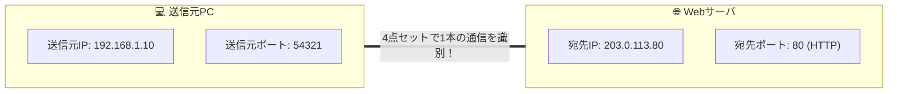

# TCPコネクション識別：混ざらないための「4点セット情報」

> **想定読者**: 該当分野の用語・計算でつまずいている文系受験者
> **省いたもの**: 試験本番で即戦力にならない重箱の隅のプロトコル詳細仕様
> **所要時間**: 6〜8分
> **対象過去問**: 応用情報技術者 平成17年秋期 問51

---

## 【対象過去問】平成17年秋期 問51

**【問題】**  
TCP/IPで使用されるアドレスやポート番号のうち，TCPのコネクションを識別するために必要なものの組合せはどれか。

- **ア**: 宛先IPアドレス，宛先TCPポート番号，送信元MACアドレス，送信元TCPポート番号
- **イ**: 宛先IPアドレス，宛先TCPポート番号，送信元IPアドレス，送信元TCPポート番号
- **ウ**: 宛先MACアドレス，宛先TCPポート番号，送信元IPアドレス，送信元TCPポート番号
- **エ**: 宛先TCPポート番号，送信元IPアドレス，送信元MACアドレス，送信元TCPポート番号

▶ 正解を表示する

**正解: イ（宛先IPアドレス，宛先TCPポート番号，送信元IPアドレス，送信元TCPポート番号）**

---

## 0. 一枚で：『TCPコネクションを一意に識別するのは「送信元/宛先IP＋送信元/宛先ポート」の4つ！』

### 🧠 脳に刻む合言葉：
> **『 コネクション識別は4点セット！送信元・宛先の「IP＋ポート」！ 』**

---

## 1. なぜそうなるのか？（日常のたとえ話：会社の代表電話と内線番号（どちらの会社の誰から、どちらの会社の誰宛てか特定する））

パソコンで複数のブラウザタブを開き、同じWebサーバ（例：YahooやGoogle）に同時にアクセスしても、なぜ画面の表示が混ざらないのでしょうか？

それは、OSがすべての通信を **「4つの情報の組み合わせ（4-tuple）」** で完全に識別しているからです。

1. **送信元IPアドレス**: 自分のPCの住所
2. **送信元TCPポート番号**: 自分のブラウザのタブごとに振られた一時ポート（例: 51234）
3. **宛先IPアドレス**: 相手サーバの住所
4. **宛先TCPポート番号**: 相手サーバの窓口番号（例: Webなら80や443）

この4つが1つでも違えば、別の通信（別のコネクション）として正しく仕分けされます。MACアドレスはLAN内の隣の機器（ルータ）に渡るたびに書き換わってしまうため、エンドツーエンドのコネクション識別には使えません。

---

## 2. 選択肢のひっかけポイント ＆ 判定理由

- **ア・ウ・エ: MACアドレスが含まれている**  
  → **【即消去！】** MACアドレス（データリンク層/L2）はルータを超えるたびに次のホップのものに書き換わります。相手サーバと結ぶ「TCPコネクション」の識別には一切関与しません！
- **イ: 宛先IP，宛先ポート，送信元IP，送信元ポート 【正解！】**  
  → ネットワーク層のIPとトランスポート層のポート番号、両者の送信元・宛先の計4点セットが正解です。

---

## 3. 午後試験 記述対策チェックリスト（※該当する場合）

- [ ] **Q. 同一クライアントから同一Webサーバに対して複数のTCP接続を並行して確立できる理由を、ポート番号に着目して説明せよ。**  
  → **「クライアント側で接続ごとに異なるエフェメラル（一時）ポート番号を割り当てるため。」**

---

## 🎯 次の2分アクション（定着チェック）

- [ ] **画面の一番上に戻り、正解を隠した状態で正解肢「イ」を確信を持って選べるか試してみよう！**
