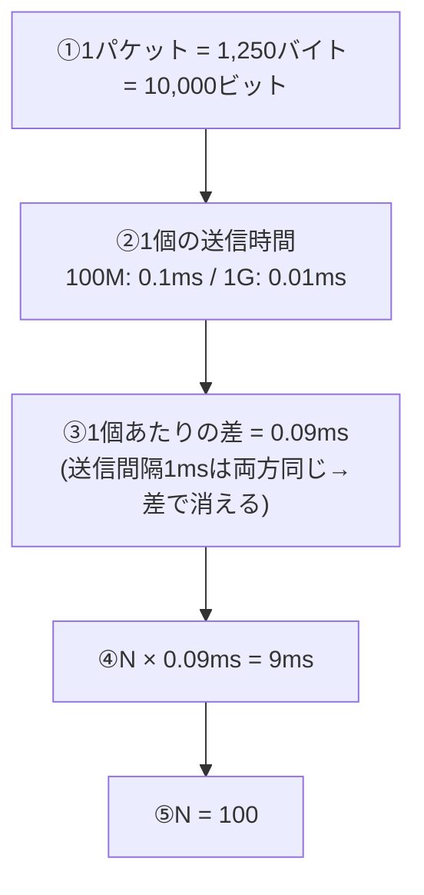

# LAN送信時間の差からパケット数を逆算：宅配トラックの速度差と「毎回の休憩」は相殺される！

> **想定読者**: 「送信時間＝データ量÷速度」は知っているが、単位換算（M・G・バイト・ビット）で手が止まる文系受験者  
> **省いたもの**: プロトコルごとのヘッダー構造やCSMA/CDの詳細  
> **所要時間**: 6〜8分  
> **対象過去問**: 応用情報技術者 令和5年春期 午前問32  

---

## 【対象過去問】令和5年春期 問32

**【問題】**  
100Mビット／秒のLANと1Gビット／秒のLANがある。ヘッダーを含めて1,250バイトのパケットをN個送付するときに，100Mビット／秒のLANの送信時間が1Gビット／秒のLANより9ミリ秒多く掛かった。Nは幾らか。ここで，いずれのLANにおいても，パケットの送信間隔(パケットの送信が完了してから次のパケットを送信開始するまでの時間)は1ミリ秒であり，パケット送信間隔も送信時間に含める。

- **ア**: 10
- **イ**: 80
- **ウ**: 100
- **エ**: 800

▶ 正解を表示する

**正解: ウ（100）**

---

## 0. 一枚で：『差を取れば「休憩（送信間隔）」は消える。残るのは速度差だけ！』

### 🧠 脳に刻む合言葉：
> **『 両方に同じ分だけ足されるものは、差を取れば消える！バイトは×8でビットへ！ 』**

---

## 1. なぜそうなるのか？（日常のたとえ話：トラックで荷物を運ぶ）

同じ荷物を、時速100のトラックと時速1,000のトラックで運ぶとします。どちらも荷物1個運ぶたびに「1分間の休憩」を取るルールです。**休憩は両方に同じだけ入る**ので、「どちらがどれだけ遅いか」の差を考えるときには休憩時間は関係ありません。差を生むのは**走る速さだけ**です。

公式解説も「転送データ量、パケットの送信間隔は両方とも同じなので、9ミリ秒の差は単純に通信速度の違いのみによって生まれた」と述べています。

### 途中計算（公式解説の方程式）
転送データ量をA（ビット）とすると、

- 100Mビット/秒の送信時間: A ÷ 100Mビット
- 1Gビット/秒の送信時間: A ÷ 1Gビット
- 差が9ミリ秒（0.009秒）なので A÷100M ＝ A÷1G ＋ 0.009

両辺に1G（＝1,000M）を掛けると
1. 10A ＝ A ＋ 9,000,000
2. 9A ＝ 9,000,000
3. A ＝ 1,000,000ビット ＝ 125,000バイト（÷8）
4. N ＝ 125,000バイト ÷ 1,250バイト ＝ **100個**

### 検算（1パケットずつ）
- 1,250バイト × 8 ＝ 10,000ビット
- 100M: 10,000 ÷ 100,000,000 ＝ 0.0001秒 ＝ 0.1ms（＋間隔1ms＝1.1ms）
- 1G: 10,000 ÷ 1,000,000,000 ＝ 0.00001秒 ＝ 0.01ms（＋間隔1ms＝1.01ms）
- 1個あたりの差 ＝ 1.1 − 1.01 ＝ 0.09ms → 9 ÷ 0.09 ＝ **100個** ✔

---

## 2. 選択肢のひっかけポイント ＆ 判定理由

- **ア（10）: ✗**  
  → 差を「0.9ms/個」と桁を取り違えると9÷0.9＝10になる。ビット換算か秒換算で1桁ずれたときの値。
- **イ（80）: ✗**  
  → バイトとビットの混同（×8、÷8の取り違え）で出やすい値。正しい計算では80にならない。
- **ウ（100）: ○**  
  → 1個あたりの差0.09ms、9ms÷0.09ms＝100。公式解説の方程式の解とも一致。
- **エ（800）: ✗**  
  → ビット（10,000）とバイト（1,250）の混同、つまり8倍ずれた値。バイトのまま計算するなど単位が混ざると出る。

> ⚠️ ワナは2つ。①**バイト→ビットの×8を忘れる**、②**送信間隔1msを引き算に入れてしまう**（差を取ると両方から消える）。

---

## 3. 午後試験 記述対策チェックリスト（※該当する場合）

- [ ] **Q. 送信時間を求める式と、送信間隔の扱いを述べよ。**  
  → **「送信時間＝転送データ量÷回線速度。送信間隔は全体の時間に加算する。」**

---

## 🎯 次の2分アクション（定着チェック）

- [ ] **画面の一番上に戻り、正解を隠した状態で正解肢を確信を持って選べるか試してみよう！**
