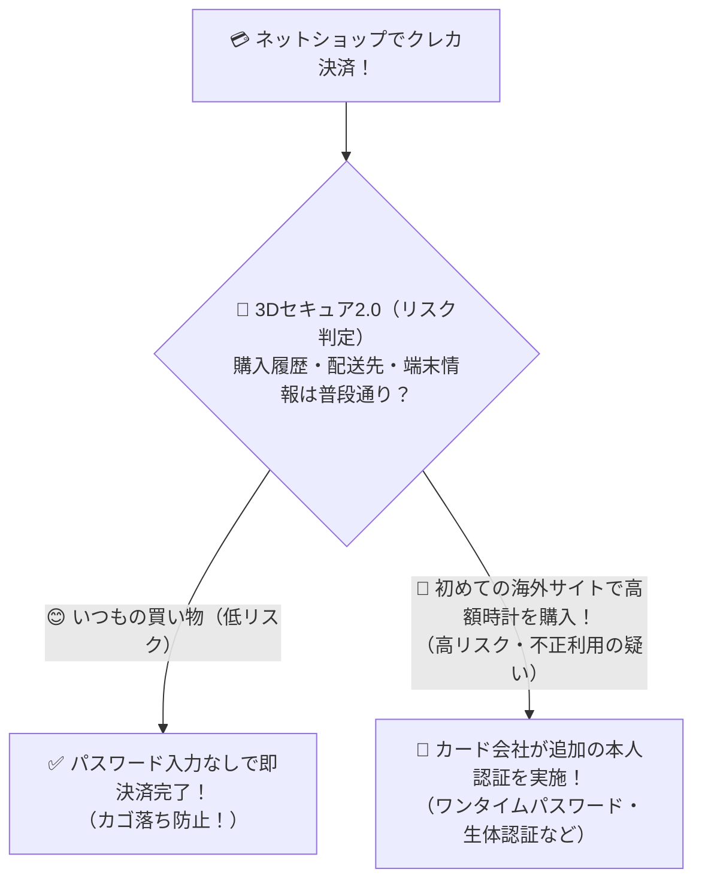

# 3Dセキュア2.0：怪しいクレカ決済のときだけ追加認証する「ネット買い物のボディガード」！

> **想定読者**: 従来の3Dセキュア1.0（毎回パスワード入力）と最新の3Dセキュア2.0の違いを知らない文系受験者
> **省いたもの**: ACS（Access Control Server）と3DSサーバ間のEMVCoメッセージフォーマット詳細
> **所要時間**: 6〜8分
> **対象過去問**: 応用情報技術者 令和6年春期 問35

---

## 【対象過去問】令和6年春期 問35

**【問題】**
3Dセキュア2.0(EMV 3-Dセキュア)は，オンラインショッピングにおけるクレジットカード決済時に，不正取引を防止するための本人認証サービスである。3Dセキュア2.0で利用される本人認証の特徴はどれか。

- **ア**: 利用者がカード会社による本人認証に用いるパスワードを忘れた場合でも，安全にパスワードを再発行することができる。
- **イ**: 利用者の過去の取引履歴や決済に用いているデバイスの情報から不正利用や高リスクと判断される場合に，カード会社が追加の本人認証を行う。
- **ウ**: 利用者の過去の取引履歴や決済に用いているデバイスの情報にかかわらず，カード会社がパスワードと生体認証を併用した本人認証を行う。
- **エ**: 利用者の過去の取引履歴や決済に用いているデバイスの情報に加えて，操作しているのが人間であることを確認した上で，カード会社が追加の本人認証を行う。

▶ 正解を表示する

**正解: イ（利用者の過去の取引履歴や決済に用いているデバイスの情報から不正利用や高リスクと判断される場合に，カード会社が追加の本人認証を行う。）**

---

## 0. 一枚で：『過去の取引履歴やデバイス情報から高リスクと判断される場合に、追加の本人認証を行う！』

### 🧠 脳に刻む合言葉：
> **『 3Dセキュア2.0の中身は「リスクベース認証」！怪しい取引（高リスク）の時だけ追加認証を発動！ 』**

---

## 1. なぜそうなるのか？（日常のたとえ話：百貨店の外商カード。常連客が普段通りハンカチを買うときはサイン不要で通し、いきなり換金性の高い金塊を1000万円分買おうとしたときだけ本人確認の電話を入れる！）

ネット通販でクレジットカードを使うとき、昔の「3Dセキュア1.0」は、買い物するたびに毎回「カード会社の専用パスワード」を入力させられていました。パスワードを忘れて買い物を諦める人（カゴ落ち）が続出して不評だったのです。

そこで進化したのが **3Dセキュア2.0（EMV 3-Dセキュア）** です！
最大の特徴は、先ほども登場した **「リスクベース認証」** を取り入れたことです！

決済するときに、裏側で「普段使っているスマホか？」「過去の取引履歴や配送先と同じか？」など数十種類の情報をカード会社が瞬時に採点します。
- **9割以上の普通の買い物（低リスク）**: 追加パスワードなしで一瞬で決済完了！
- **不正利用の疑いがある高リスクな取引**: このときだけ、ワンタイムパスワードや生体認証などの **「追加の本人認証」** を行って泥棒をブロックします！

---

## 2. 選択肢のひっかけポイント ＆ 判定理由

- **ア: パスワードを忘れた場合でも安全に再発行…** → パスワード再発行サービスではありません（×）。
- **イ: 過去の取引履歴やデバイスの情報から不正利用や高リスクと判断される場合に，カード会社が追加の本人認証を行う 【正解！】** → 3Dセキュア2.0の中核であるリスクベース認証の正確な説明です（◯）。
- **ウ: 情報にかかわらず，常にパスワードと生体認証を併用…** → 低リスク時は追加認証を省略するのが2.0の特徴です（×）。
- **エ: 操作しているのが人間であることを確認した上で…** → CAPTCHA（ボット対策）の説明が混ざった引っかけです（×）。

---

## 3. 午後試験 記述対策チェックリスト（※該当する場合）

- [ ] **Q. 従来の3Dセキュア1.0と比較して、3Dセキュア2.0がリスクベース認証を導入したことでECサイト事業者にをもたらすビジネス上の利点は何か？**  
  → **「低リスク決済時のパスワード入力手間が省けるため、利用者が決済途中で購入を断念する「カゴ落ち」を防止できる。」**

---

## 🎯 次の2分アクション（定着チェック）

- [ ] **画面の一番上に戻り、正解を隠した状態で正解肢「イ」を確信を持って選べるか試してみよう！**
