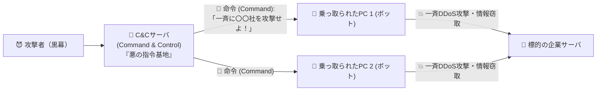

# ボットネットとC&Cサーバ：感染PC軍団（ゾンビ）を裏で操る「悪の司令塔」！

> **想定読者**: ボット、ボットネット、C&Cサーバの関係性がイメージできない文系受験者
> **省いたもの**: Fast FluxやDomain Generation Algorithm (DGA) によるC&Cサーバ隠蔽技術
> **所要時間**: 6〜8分
> **対象過去問**: 応用情報技術者 令和2年秋期 問43

---

## 【対象過去問】令和2年秋期 問43

**【問題】**
ボットネットにおけるC&Cサーバの役割として，適切なものはどれか。

- **ア**: Webサイトのコンテンツをキャッシュし，本来のサーバに代わってコンテンツを利用者に配信することによって，ネットワークやサーバの負荷を軽減する。
- **イ**: 外部からインターネットを経由して社内ネットワークにアクセスする際に，CHAPなどのプロトコルを中継することによって，利用者認証時のパスワードの盗聴を防止する。
- **ウ**: 外部からインターネットを経由して社内ネットワークにアクセスする際に，時刻同期方式を採用したワンタイムパスワードを発行することによって，利用者認証時のパスワードの盗聴を防止する。
- **エ**: 侵入して乗っ取ったコンピュータに対して，他のコンピュータへの攻撃などの不正な操作をするよう，外部から命令を出したり応答を受け取ったりする。

▶ 正解を表示する

**正解: エ（侵入して乗っ取ったコンピュータに対して，他のコンピュータへの攻撃などの不正な操作をするよう，外部から命令を出したり応答を受け取ったりする。）**

---

## 0. 一枚で：『C&Cサーバ（Command & Control）は、乗っ取ったPCに外部から攻撃命令を出し応答を受け取る！』

### 🧠 脳に刻む合言葉：
> **『 C&C ＝ Command & Control（命令と制御）！ゾンビPC軍団に「攻撃せよ！」と指令を出す基地！ 』**

---

## 1. なぜそうなるのか？（日常のたとえ話：映画の悪の組織の司令室。洗脳したロボット兵（ボット）に無線機（C&Cサーバ）で「総攻撃せよ！」と命令を送る！）

ウイルスに感染して、悪魔（攻撃者）の言いなりになってしまったパソコンのことを **「ボット（Bot＝ロボット）」** と呼びます。
そして、世界中で何千台・何万台も感染させて作ったゾンビPC軍団のネットワークを **「ボットネット」** と呼びます。

では、黒幕の攻撃者はどうやってこの何万台ものゾンビPCに「明日の昼12時に、〇〇銀行のサイトを一斉に攻撃しろ！」と指示を出すのでしょうか？
そのために使われる指令基地が **C&Cサーバ（Command and Control サーバ：命令・制御サーバ）** です！

乗っ取られたPC（ボット）は、定期的にC&Cサーバへ「ご主人様、次の命令は何ですか？」と問い合わせに行き、C&Cサーバからの命令に従って一斉攻撃（DDoS）やスパムメール送信を行います。

---

## 2. 選択肢のひっかけポイント ＆ 判定理由

- **ア: コンテンツをキャッシュし負荷を軽減する** → CDNやキャッシュサーバ（プロキシ）の説明です（×）。
- **イ: CHAPなどのプロトコルを中継し盗聴を防止…** → 認証サーバ（RADIUS等）の説明です（×）。
- **ウ: ワンタイムパスワードを発行…** → トークンサーバ（OTPサーバ）の説明です（×）。
- **エ: 侵入して乗っ取ったコンピュータに対して，外部から命令を出したり応答を受け取ったりする 【正解！】** → Command & Control（命令と制御）を行うC&Cサーバの役割そのものです（◯）。

---

## 3. 午後試験 記述対策チェックリスト（※該当する場合）

- [ ] **Q. 社内PCがマルウェアに感染しボット化した際、外部のC&Cサーバとの通信を遮断するためにネットワーク境界で導入される対策機器・仕組みは何か？**  
  → **「プロキシサーバや次世代ファイアウォールによる不正通信先（ブラックリスト/レピュテーション）のURL・IPフィルタリング。」**

---

## 🎯 次の2分アクション（定着チェック）

- [ ] **画面の一番上に戻り、正解を隠した状態で正解肢「エ」を確信を持って選べるか試してみよう！**
