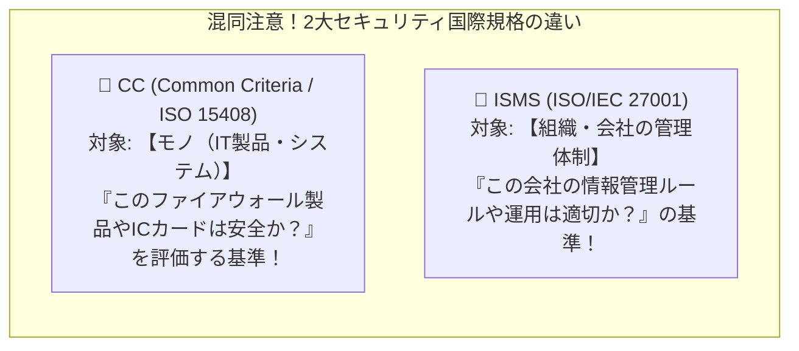

# CC（Common Criteria / ISO 15408）：IT製品のセキュリティ性能を測る「世界共通の通知表」！

> **想定読者**: CC（ISO/IEC 15408）とISMS（ISO/IEC 27001）の違いが区別できない文系受験者
> **省いたもの**: PP（プロテクションプロファイル）、ST（セキュリティターゲット）、EAL（評価保証レベル1〜7）の策定手順
> **所要時間**: 6〜8分
> **対象過去問**: 応用情報技術者 平成18年秋期 問79

---

## 【対象過去問】平成18年秋期 問79

**【問題】**
米国で運用されたTCSECや欧州政府調達用のITSECを統合して，標準化が進められたCC(Common Criteria)の内容はどれか。

- **ア**: 暗号アルゴリズムの標準
- **イ**: 情報技術に関するセキュリティの評価基準
- **ウ**: 情報セキュリティ管理の実施基準
- **エ**: セキュリティ管理のプロトコルの標準

▶ 正解を表示する

**正解: イ（情報技術に関するセキュリティの評価基準）**

---

## 0. 一枚で：『CC（Common Criteria）は、情報技術（IT製品）に関するセキュリティの評価基準！』

### 🧠 脳に刻む合言葉：
> **『 「CC（15408）＝ モノ（IT製品）の評価基準」、「ISMS（27000）＝ 会社（組織）の管理基準」！ 』**

---

## 1. なぜそうなるのか？（日常のたとえ話：自動車の「衝突安全性能テスト（★5つ）」がCC。タクシー会社の「安全運行管理マニュアル」がISMS！）

役所や銀行が「新しいファイアウォール機器」や「マイナンバーカード用のICチップ」を買うとき、営業マンが口先だけで「うちの製品は絶対安全ですよ！」と言っても信用できませんよね。

そこで、アメリカ（TCSEC）やヨーロッパ（ITSEC）の基準を一つにまとめて、**「IT製品やシステムにちゃんとセキュリティ機能が備わっているかを、公平にテスト・評価するための世界共通のモノサシ（評価基準）」** を作りました。
これが **CC（Common Criteria：コモンクライテリア、国際規格名 ISO/IEC 15408）** です！

- **モノ（IT製品・ハード・ソフト）のセキュリティ評価基準** ＝ **CC（ISO/IEC 15408）**
- **会社・組織の情報セキュリティ管理基準** ＝ **ISMS（ISO/IEC 27001 / 27002）**
この2つの対比は超頻出なのでセットで押さえましょう！

---

## 2. 選択肢のひっかけポイント ＆ 判定理由

- **ア: 暗号アルゴリズムの標準** → CRYPTRECやNIST FIPSなどの説明です（×）。
- **イ: 情報技術に関するセキュリティの評価基準 【正解！】** → IT製品やシステムのセキュリティ機能・保証度を評価する国際基準（ISO/IEC 15408）です（◯）。
- **ウ: 情報セキュリティ管理の実施基準** → ISO/IEC 27002（ISMS実践のための規範）の説明です（×）。
- **エ: セキュリティ管理のプロトコルの標準** → プロトコル規格ではありません（×）。

---

## 3. 午後試験 記述対策チェックリスト（※該当する場合）

- [ ] **Q. ISO/IEC 15408（CC）に基づき、日本国内においてIT製品のセキュリティ機能が適切に実装されているかを評価・認証する制度の名称は何か？**  
  → **「JISEC（ITセキュリティ評価及び認証制度）。」**

---

## 🎯 次の2分アクション（定着チェック）

- [ ] **画面の一番上に戻り、正解を隠した状態で正解肢「イ」を確信を持って選べるか試してみよう！**
