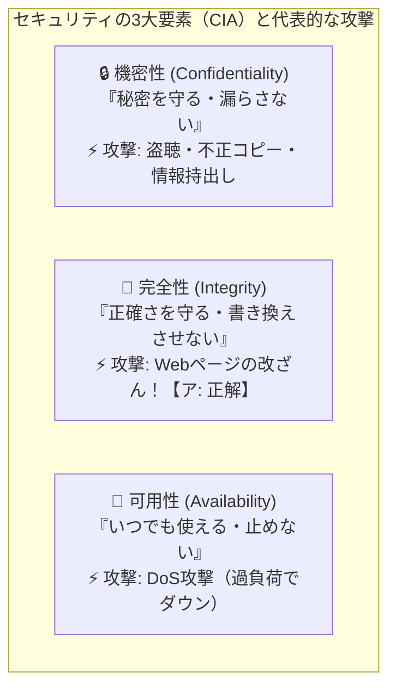

# 情報セキュリティのCIA（完全性）：Webページの改ざんは「完全性」への攻撃！

> **想定読者**: 機密性（C）・完全性（I）・可用性（A）のどれがどの攻撃に対応するのか一瞬迷う文系受験者
> **省いたもの**: 真正性・責任追跡性・否認防止・信頼性を加えたJIS Q 27000の7要素の詳細分類
> **所要時間**: 6〜8分
> **対象過去問**: 応用情報技術者 平成24年秋期 問40

---

## 【対象過去問】平成24年秋期 問40

**【問題】**
完全性を脅かす攻撃はどれか。

- **ア**: Webページの改ざん
- **イ**: システム内に保管されているデータの持出しを目的とした不正コピー
- **ウ**: システムを過負荷状態にするDoS攻撃
- **エ**: 通信内容の盗聴

▶ 正解を表示する

**正解: ア（Webページの改ざん）**

---

## 0. 一枚で：『完全性（Integrity）＝ データが書き換えられておらず正確であること！』

### 🧠 脳に刻む合言葉：
> **『 「盗み見＝機密性(C)」「書き換え（改ざん）＝完全性(I)」「邪魔して止める＝可用性(A)」！ 』**

---

## 1. なぜそうなるのか？（日常のたとえ話：お店のメニュー表。勝手に値段を0円に書き換えられる（改ざん）のが「完全性」の侵害！）

レストランの運営に例えると、セキュリティの3要素（CIA）は一発で区別できます！

1. **機密性（Confidentiality）＝ レシピを盗まれないこと**
   秘伝のタレのレシピをスパイに盗み見（盗聴）されたり、コピーして持ち出されたりしたら「機密性」が破られています。

2. **完全性（Integrity）＝ メニューが勝手に書き換えられないこと**
   いたずら客にメニュー表の「ステーキ 3,000円」を「ステーキ 10円」に書き換えられたら、正しい商売ができませんよね！
   このように「データが正確で、改ざん・破壊されていないこと」を **完全性** と呼びます。したがって、**「Webページの改ざん」は完全性を脅かす攻撃** です！

3. **可用性（Availability）＝ お店がいつでも営業していること**
   イタズラ電話を1万件かけられて電話回線がパンク（DoS攻撃）し、本当のお客さんが予約できなくなったら「可用性」の侵害です。

---

## 2. 選択肢のひっかけポイント ＆ 判定理由

- **ア: Webページの改ざん 【正解！】** → 情報が勝手に書き換えられ正確さが失われるため、「完全性」を脅かす攻撃です（◯）。
- **イ: データの持出しを目的とした不正コピー** → 許可されていない人に情報が漏洩するため、「機密性」を脅かす攻撃です（×）。
- **ウ: システムを過負荷状態にするDoS攻撃** → システムを使えなくするため、「可用性」を脅かす攻撃です（×）。
- **エ: 通信内容の盗聴** → 秘密の通信内容を盗み見られるため、「機密性」を脅かす攻撃です（×）。

---

## 3. 午後試験 記述対策チェックリスト（※該当する場合）

- [ ] **Q. 情報セキュリティの3要素（CIA）のうち、データの改ざんや消去を防ぎ、情報が正確かつ最新の状態に保たれている特性を何と呼ぶか？**  
  → **「完全性（Integrity）。」**

---

## 🎯 次の2分アクション（定着チェック）

- [ ] **画面の一番上に戻り、正解を隠した状態で正解肢「ア」を確信を持って選べるか試してみよう！**
