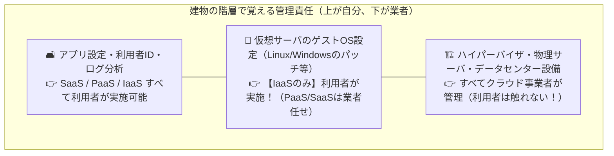

# クラウド責任共有モデル：IaaSは「ゲストOS」まで自分で守る賃貸マンション！

> **想定読者**: IaaS、PaaS、SaaSの境界線（どこまでがクラウド業者でどこからが利用者か）が曖昧な文系受験者
> **省いたもの**: コンテナサービス（CaaS）やFaaS（サーバレス）における細かい責任分界点
> **所要時間**: 6〜8分
> **対象過去問**: 応用情報技術者 平成28年春期 問42

---

## 【対象過去問】平成28年春期 問42

**【問題】**
クラウドのサービスモデルをNISTの定義に従ってIaaS，PaaS，SaaSに分類したとき，パブリッククラウドサービスの利用企業が行うシステム管理作業において，PaaSとSaaSでは実施できないが，IaaSでは実施できるものはどれか。

- **ア**: アプリケーションの利用者ID管理
- **イ**: アプリケーションログの取得と分析
- **ウ**: 仮想サーバのゲストOSに係るセキュリティの設定
- **エ**: ハイパーバイザに係るセキュリティの設定

▶ 正解を表示する

**正解: ウ（仮想サーバのゲストOSに係るセキュリティの設定）**

---

## 0. 一枚で：『PaaS・SaaSではできないが、IaaSなら利用企業が「ゲストOSのセキュリティ設定」を実施できる！』

### 🧠 脳に刻む合言葉：
> **『 IaaSは「空っぽの部屋（インフラだけ借りる）」だから、OS（壁紙や内装）は自分で設定できる！ 』**

---

## 1. なぜそうなるのか？（日常のたとえ話：住宅の借り方。SaaS＝ホテル、PaaS＝家具付きマンスリー、IaaS＝スケルトン賃貸（内装・OSは自分持ち）！）

クラウドの3形態は「部屋の借り方」に例えると絶対に忘れません！

- **SaaS（ホテル）**: 家具もベッドも全部揃っていて、掃除もホテル側がやってくれます。利用者は自分の荷物（データとID管理）だけ管理します。
- **PaaS（家具・家電付きマンション）**: エアコンや冷蔵庫（OSやミドルウェア）までは大家さんが管理してくれます。利用者は自分の料理（自作アプリ）に集中します。
- **IaaS（コンクリ打ちっぱなしの空き部屋）**: 柱と床（仮想マシンと回線）だけ貸してくれます。**「どんなOS（WindowsやLinux）を入れて、どうセキュリティ設定するか」は借りた自分（利用企業）の自由であり責任** です！

※ちなみに一番下の「ハイパーバイザ（建物の基礎・土台）」は、IaaSであっても大家さん（AWSやAzureなどのクラウド業者）が管理するため、利用企業は触れません。

---

## 2. 選択肢のひっかけポイント ＆ 判定理由

- **ア: アプリケーションの利用者ID管理** → SaaSやPaaSでも利用企業側で実施できます（×）。
- **イ: アプリケーションログの取得と分析** → PaaSやSaaSでも機能として実施可能です（×）。
- **ウ: 仮想サーバのゲストOSに係るセキュリティの設定 【正解！】** → PaaS/SaaSではクラウド事業者側で管理され隠蔽されていますが、IaaSでは利用企業が管理者権限を持って実施します（◯）。
- **エ: ハイパーバイザに係るセキュリティの設定** → IaaSであってもクラウド事業者（プロバイダ）の管轄であり、利用企業は実施できません（×）。

---

## 3. 午後試験 記述対策チェックリスト（※該当する場合）

- [ ] **Q. IaaSを利用する企業が、PaaSやSaaSを利用する場合と比較して追加で負うことになる代表的なセキュリティ管理責任は何か？**  
  → **「仮想サーバ上のゲストOSおよびミドルウェアの脆弱性対策（パッチ適用や設定管理）。」**

---

## 🎯 次の2分アクション（定着チェック）

- [ ] **画面の一番上に戻り、正解を隠した状態で正解肢「ウ」を確信を持って選べるか試してみよう！**
