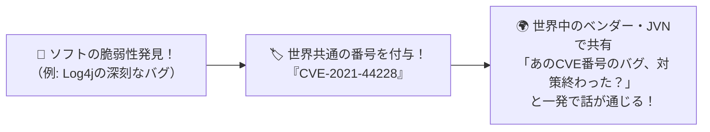

# CVE識別子：世界中のソフトの「弱点（脆弱性）」に付けられた共通マイナンバー！

> **想定読者**: CVE、CCE、CPE、CVSSなどCから始まる脆弱性管理用語が混乱する文系受験者
> **省いたもの**: MITRE社によるCNA（CVE採番機関）の階層構造とJSON 5.0フォーマット仕様
> **所要時間**: 6〜8分
> **対象過去問**: 応用情報技術者 令和6年秋期 問41

---

## 【対象過去問】令和6年秋期 問41

**【問題】**
JVNなどの脆弱性情報サイトで採用されているCVE(Common Vulnerabilities and Exposures)識別子の説明はどれか。

- **ア**: コンピュータで必要なセキュリティ設定項目を識別するための識別子
- **イ**: 脆弱性が悪用されて改ざんされたWebサイトのスクリーンショットを識別するための識別子
- **ウ**: 製品に含まれる脆弱性を識別するための識別子
- **エ**: セキュリティ製品の種別を識別するための識別子

▶ 正解を表示する

**正解: ウ（製品に含まれる脆弱性を識別するための識別子）**

---

## 0. 一枚で：『CVEは製品に含まれる「脆弱性」を世界共通で識別するための番号！』

### 🧠 脳に刻む合言葉：
> **『 CVEのVは「Vulnerability（脆弱性）」！世界中のバグに付ける指名手配ナンバー！ 』**

---

## 1. なぜそうなるのか？（日常のたとえ話：指名手配犯の全国共通手配番号。A警察署でもB警察署でも同じ番号で犯人（脆弱性）を特定できる！）

世界中で毎日たくさんのソフトウェアの弱点（脆弱性）が見つかります。
もしマイクロソフトが「バグA」、日本のIPAが「欠陥105号」のようにバラバラな名前で呼んでいたら、「それって同じバグのこと？」と大混乱してしまいますよね。

そこで、見つかった脆弱性1つ1つに **`CVE-2024-12345`** のような **世界共通のシリアル番号（マイナンバー）** を振るようにしました。これが **CVE（Common Vulnerabilities and Exposures：共通脆弱性識別子）** です！

- **CVE**: 脆弱性の番号（**V**ulnerability ＝ 脆弱性）
- **CCE**: セキュリティ設定項目の番号（**C**onfiguration ＝ 設定）
- **CPE**: 製品名の番号（**P**latform ＝ 製品）
- **CVSS**: 脆弱性の深刻度スコア（**S**coring **S**ystem ＝ 点数）

---

## 2. 選択肢のひっかけポイント ＆ 判定理由

- **ア: セキュリティ設定項目を識別するための識別子** → CCE（Common Configuration Enumeration）の説明です（×）。
- **イ: 改ざんされたWebサイトのスクリーンショットを識別…** → そのような識別子ではありません（×）。
- **ウ: 製品に含まれる脆弱性を識別するための識別子 【正解！】** → CVE（共通脆弱性識別子）の正確な説明です（◯）。
- **エ: セキュリティ製品の種別を識別するための識別子** → CPE（共通プラットフォーム一覧）などに近い引っかけです（×）。

---

## 3. 午後試験 記述対策チェックリスト（※該当する場合）

- [ ] **Q. 複数のセキュリティ機関やベンダー間で脆弱性情報を共有・参照しやすくするために、個々の脆弱性に付与される世界共通の識別子を何と呼ぶか？**  
  → **「CVE（共通脆弱性識別子）。」**

---

## 🎯 次の2分アクション（定着チェック）

- [ ] **画面の一番上に戻り、正解を隠した状態で正解肢「ウ」を確信を持って選べるか試してみよう！**
