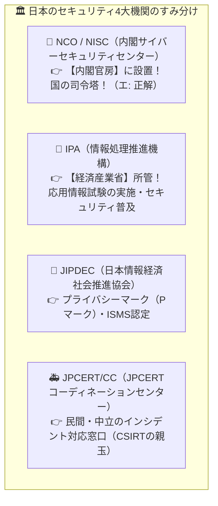

# サイバーセキュリティ基本法：内閣官房に設置された日本の司令塔は「NISC / NCO」！

> **想定読者**: IPA、JIPDEC、JPCERT/CC、NISC(NCO)の所属省庁・役割が区別できない文系受験者
> **省いたもの**: サイバーセキュリティ戦略本部とNISC/NCOの組織改編に関する法改正条文詳細
> **所要時間**: 6〜8分
> **対象過去問**: 応用情報技術者 平成30年秋期 問36

---

## 【対象過去問】平成30年秋期 問36

**【問題】**
サイバーセキュリティ基本法に基づき，内閣官房に設置された機関はどれか。

- **ア**: IPA
- **イ**: JIPDEC
- **ウ**: JPCERT/CC
- **エ**: NCO

▶ 正解を表示する

**正解: エ（NCO）**

---

## 0. 一枚で：『サイバーセキュリティ基本法に基づき、内閣官房に設置された機関は NCO（旧NISC）！』

### 🧠 脳に刻む合言葉：
> **『 「内閣官房」と言ったら **N**ational（国の）**C**ybersecurityの「NCO（旧NISC）」！ 』**

---

## 1. なぜそうなるのか？（日常のたとえ話：国の防衛組織。内閣直属の総合司令部（NCO/NISC）、資格試験や啓発を行う経産省の機関（IPA）、救急救命窓口（JPCERT/CC）！）

日本のセキュリティ関連団体は、この4つだけキャラ付けして覚えれば午前試験は無敵です！

1. **NCO / NISC（内閣サイバーセキュリティセンター）**:
   問題文に **「サイバーセキュリティ基本法に基づき、内閣官房に設置」** と出たら100%これです！日本政府全体のサイバー防衛の総司令塔です。
2. **IPA（情報処理推進機構）**:
   経済産業省の管轄で、いま皆さんが勉強している **「応用情報技術者試験」を実施している団体** です！「情報セキュリティ10大脅威」の発表でも有名です。
3. **JIPDEC（日本情報経済社会推進協会）**:
   **「プライバシーマーク（Pマーク）」** やISMSの認定を行っている団体です。
4. **JPCERT/CC**:
   政府から独立した中立の立場で、国内外のサイバー攻撃の連絡調整（インシデントハンドリング）を行う救急窓口です。

---

## 2. 選択肢のひっかけポイント ＆ 判定理由

- **ア: IPA** → 経済産業省所管の独立行政法人（情報処理推進機構）です（×）。
- **イ: JIPDEC** → プライバシーマーク制度などを運営する一般財団法人です（×）。
- **ウ: JPCERT/CC** → インシデント対応支援を行う一般社団法人です（×）。
- **エ: NCO（旧NISC） 【正解！】** → サイバーセキュリティ基本法に基づき内閣官房に設置された機関です（◯）。

---

## 3. 午後試験 記述対策チェックリスト（※該当する場合）

- [ ] **Q. 企業や組織内でセキュリティインシデントが発生した際、被害拡大防止やJPCERT/CC等の外部機関との連携を担当する専門チームを何と呼ぶか？**  
  → **「CSIRT（Computer Security Incident Response Team）。」**

---

## 🎯 次の2分アクション（定着チェック）

- [ ] **画面の一番上に戻り、正解を隠した状態で正解肢「エ」を確信を持って選べるか試してみよう！**
