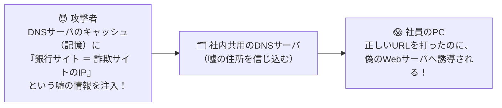

# DNSキャッシュポイズニングの被害：偽の住所録を掴まされて「詐欺サイトへ強制連行」！

> **想定読者**: DNSキャッシュポイズニングが起きた「結果」として何が起きるのかピンとこない文系受験者
> **省いたもの**: トランザクションIDとソースポートランダマイゼーションによる防御の確率計算
> **所要時間**: 6〜8分
> **対象過去問**: 応用情報技術者 令和6年春期 問36

---

## 【対象過去問】令和6年春期 問36

**【問題】**
企業のDMZ上で1台のDNSサーバを，インターネット公開用と，社内のPC及びサーバからの名前解決の問合せに対応する社内用とで共用している。このDNSサーバが，DNSキャッシュポイズニングの被害を受けた結果，直接引き起こされ得る現象はどれか。

- **ア**: DNSサーバのハードディスク上に定義されているDNSサーバ名が書き換わり，インターネットからDNSサーバに接続できなくなる。
- **イ**: DNSサーバのメモリ上にワームが常駐し，DNS参照元に対して不正プログラムを送り込む。
- **ウ**: 社内の利用者が，インターネット上の特定のWebサーバにアクセスしようとすると，本来とは異なるWebサーバに誘導される。
- **エ**: 社内の利用者間の電子メールについて，宛先メールアドレスが書き換えられ，送信ができなくなる。

▶ 正解を表示する

**正解: ウ（社内の利用者が，インターネット上の特定のWebサーバにアクセスしようとすると，本来とは異なるWebサーバに誘導される。）**

---

## 0. 一枚で：『社内PCがWebサイトにアクセスしようとすると、本来とは異なる偽Webサーバに誘導される！』

### 🧠 脳に刻む合言葉：
> **『 DNSに毒（偽のIPアドレス）を盛られたら、正しいURLを入れても「偽サイトに誘導される」（ファーミング）！ 』**

---

## 1. なぜそうなるのか？（日常のたとえ話：カーナビの地図データを書き換えるイタズラ。「東京銀行」を選んだのに、泥棒のアジトへ案内されてしまう！）

DNSサーバは、インターネットの「電話帳（またはカーナビの住所録）」です。
社員がブラウザで `https://www.ginko.co.jp` にアクセスするとき、まず社内のDNSサーバに「`ginko.co.jp` のIPアドレス（番地）はどこ？」と尋ねます。

ここで **DNSキャッシュポイズニング（DNSキャッシュ毒入れ攻撃）** を受けるとどうなるでしょうか？
DNSサーバのメモ帳（キャッシュ）に、「`ginko.co.jp` の番地は、攻撃者が作った偽サイト（66.66.66.66）だよ」という **嘘の住所** が書き込まれてしまいます！

その結果、社員はブラウザに正しいURLを入力しているにもかかわらず、**「本来とは異なる偽のWebサーバに勝手に誘導されてしまう」** という恐ろしい被害（ファーミング）が発生します！

---

## 2. 選択肢のひっかけポイント ＆ 判定理由

- **ア: DNSサーバ名が書き換わり接続できなくなる** → ハードディスク上のホスト定義を破壊する攻撃ではありません（×）。
- **イ: メモリ上にワームが常駐し不正プログラムを送り込む** → DNS応答はIPアドレスを返すだけであり、直接ワームを送り込むものではありません（×）。
- **ウ: インターネット上の特定のWebサーバにアクセスしようとすると，本来とは異なるWebサーバに誘導される 【正解！】** → 偽のIPアドレスが返されることで偽サイトへ誘導されます（◯）。
- **エ: 社内利用者間のメールの宛先メールアドレスが書き換えられる** → メールアドレス文字列そのものを書き換える攻撃ではありません（×）。

---

## 3. 午後試験 記述対策チェックリスト（※該当する場合）

- [ ] **Q. インターネット公開用の権威DNSサーバと、社内PCからの再帰的な問い合わせを受け付けるキャッシュDNSサーバを別々のサーバに分離する理由を述べよ。**  
  → **「キャッシュポイズニング攻撃等により偽の情報が混入し、社内利用者が不正なサイトへ誘導される被害を防ぐため。」**

---

## 🎯 次の2分アクション（定着チェック）

- [ ] **画面の一番上に戻り、正解を隠した状態で正解肢「ウ」を確信を持って選べるか試してみよう！**
