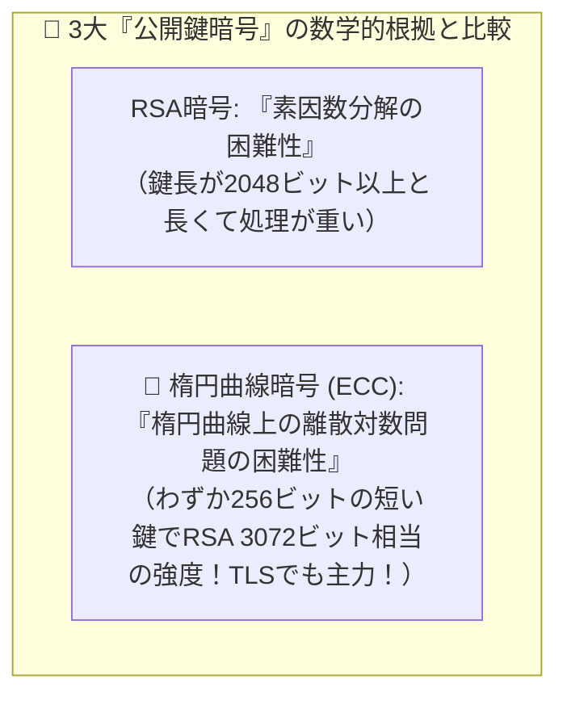

# 楕円曲線暗号（ECC）：短い鍵でRSA並みに超頑丈！TLSでも大活躍の「次世代公開鍵暗号」

> **想定読者**: 楕円曲線暗号が「共通鍵」なのか「公開鍵」なのか、何の問題を利用しているか忘れる文系受験者
> **省いたもの**: ワイエルシュトラス標準形方程式と楕円曲線上の点加算（群演算）の代数幾何学的定義
> **所要時間**: 6〜8分
> **対象過去問**: 応用情報技術者 平成30年秋期 問37

---

## 【対象過去問】平成30年秋期 問37

**【問題】**
楕円曲線暗号に関する記述のうち，適切なものはどれか。

- **ア**: AESに代わる共通鍵暗号方式としてNISTが標準化している。
- **イ**: 共通鍵暗号方式であり，デジタル署名にも利用されている。
- **ウ**: 公開鍵暗号方式であり，TLSにも利用されている。
- **エ**: 素因数分解問題の困難性を利用している。

▶ 正解を表示する

**正解: ウ（公開鍵暗号方式であり，TLSにも利用されている。）**

---

## 0. 一枚で：『楕円曲線暗号は「公開鍵暗号方式」であり、TLSやデジタル署名にも利用されている！』

### 🧠 脳に刻む合言葉：
> **『 楕円曲線暗号は「公開鍵暗号」！短い鍵で超強力だからスマホ時代のTLSに引っ張りだこ！ 』**

---

## 1. なぜそうなるのか？（日常のたとえ話：最新のチタン合金ロック。昔の巨大な鉄の鎖（RSA）と同じ強度を、わずか1/10の軽さ・小ささ（短い鍵長）で実現！）

昔からの公開鍵暗号の王様といえば「RSA暗号（素因数分解の難しさを利用）」でした。
しかし、コンピュータの計算能力が上がるにつれて、RSA暗号を安全に保つには「2048ビット」や「3072ビット」という非常に長い鍵が必要になり、スマホやIoT機器には計算が重くなってきました。

そこで現在、主役の座を奪っているのが **楕円曲線暗号（ECC：Elliptic Curve Cryptography）** です！

押さえるべきポイントは3つだけです：
1. **分類**: AESのような共通鍵ではなく、RSAと同じ **「公開鍵暗号方式」** の仲間です！
2. **メリット**: わずか **256ビット程度の短い鍵長** で、RSAの3072ビットに匹敵する圧倒的な強度を持ち、処理が軽くて高速です。
3. **用途**: Web通信を守る **TLS（HTTPS）** や、ビットコインなどの電子署名に幅広く使われています！

---

## 2. 選択肢のひっかけポイント ＆ 判定理由

- **ア: AESに代わる共通鍵暗号方式として…** → 共通鍵暗号ではなく「公開鍵暗号方式」です（×）。
- **イ: 共通鍵暗号方式であり，デジタル署名にも…** → デジタル署名に使われるのは「公開鍵暗号方式」です（×）。
- **ウ: 公開鍵暗号方式であり，TLSにも利用されている 【正解！】** → 短い鍵長で高い安全性を持つ公開鍵暗号であり、TLS（ECDHEやECDSA）で標準利用されています（◯）。
- **エ: 素因数分解問題の困難性を利用している** → 素因数分解はRSA暗号です。楕円曲線暗号は「楕円曲線上の離散対数問題」の困難性を利用しています（×）。

---

## 3. 午後試験 記述対策チェックリスト（※該当する場合）

- [ ] **Q. 楕円曲線暗号（ECC）が従来のRSA暗号と比較してスマートフォンやIoT機器、TLS通信で好んで採用される理由を鍵長と処理負荷の観点から述べよ。**  
  → **「RSA暗号と同等の安全性をより短い鍵長で実現でき、計算処理負荷や通信データ量を小さく抑えられるため。」**

---

## 🎯 次の2分アクション（定着チェック）

- [ ] **画面の一番上に戻り、正解を隠した状態で正解肢「ウ」を確信を持って選べるか試してみよう！**
