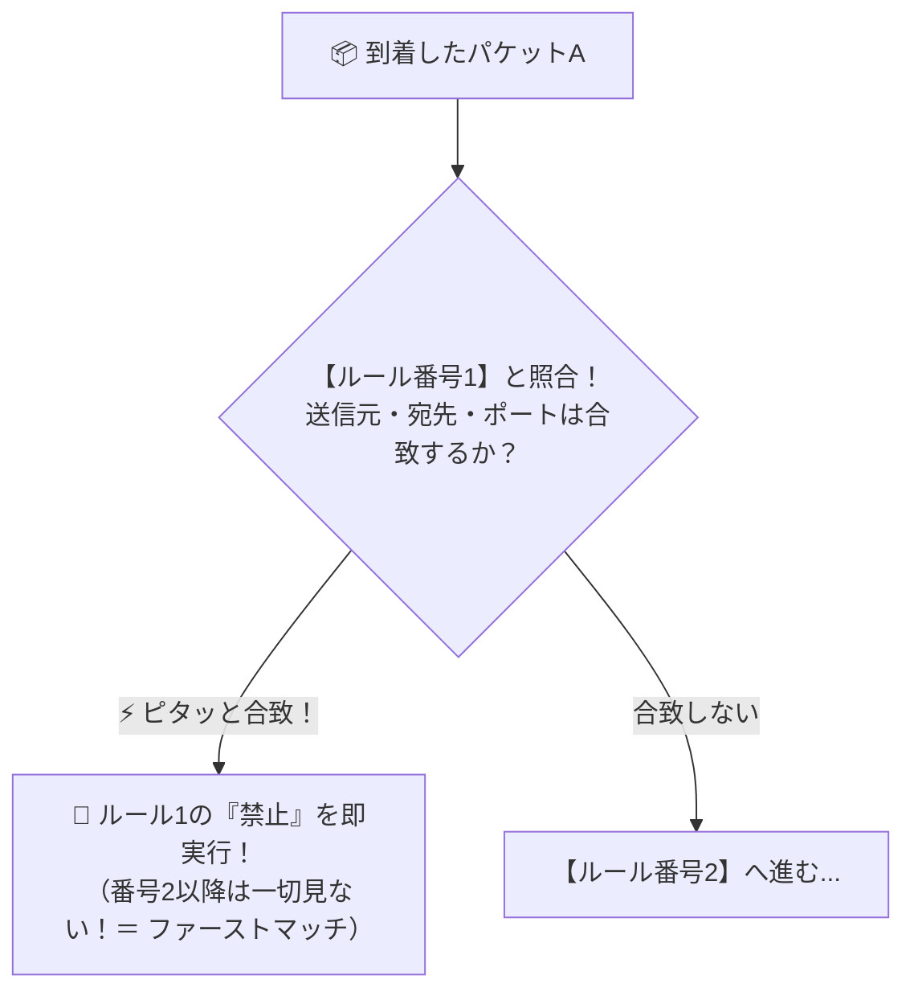

# ファイアウォールのルール判定：「上から順番」に見て最初に合致した1行で即決（ファーストマッチ）！

> **想定読者**: ファイアウォールのルール表が複数行あるとき、どの行が適用されるか迷う文系受験者
> **省いたもの**: ステートフルインスペクションにおける動的セッションテーブルの戻りパケット判定
> **所要時間**: 6〜8分
> **対象過去問**: 応用情報技術者 平成20年春期 問75

---

## 【対象過去問】平成20年春期 問75

**【問題】**
パケットフィルタリング型ファイアウォールがルール一覧に示したアクションに基づいてパケットを制御する場合，パケットAに対する処理はどれか。ここで，ファイアウォールでの処理は，ルール一覧に示す番号の1から順に行い，一つのルールが適用された場合には残りのルールは適用されない。

- **ア**: 番号1によって，通過が禁止される。
- **イ**: 番号2によって，通過が許可される。
- **ウ**: 番号3によって，通過が許可される。
- **エ**: 番号4によって，通過が禁止される。

▶ 正解を表示する

**正解: ア（番号1によって，通過が禁止される。）**

---

## 0. 一枚で：『番号1から順に照合し、条件にすべて合致した最初のルール（番号1）で即座に処理が決まる！』

### 🧠 脳に刻む合言葉：
> **『 ファイアウォールは「上から順番（番号1から）の早い者勝ち」！1行目で引っかかったら即終了！ 』**

---

## 1. なぜそうなるのか？（日常のたとえ話：クラブの入り口のドレスコード審査。1つ目の条件「サンダル履きは入場禁止」に引っかかったら、その下の「VIP会員はOK」を見るまでもなく即門前払い！）

パケットフィルタリング型ファイアウォールの問題が出たら、見るべきルールはたった1つです。

**「上から順番（番号1 → 番号2 → 番号3…）にチェックして、条件にピッタリ当てはまった最初の行の命令を実行し、残りの行は無視する！」**

これを専門用語で **ファーストマッチ（First Match）** と呼びます。
今回の問題では、パケットAの送信元・宛先・ポート番号を「番号1」のルールと照らし合わせると、1行目の条件にそのまま合致してしまいます（`*` は「何でも該当するワイルドカード」の意味）。
2行目や3行目に「許可」と書いてあっても、**1行目で「禁止」に引っかかった瞬間に試合終了（通過禁止）** となります！

---

## 2. 選択肢のひっかけポイント ＆ 判定理由

- **ア: 番号1によって，通過が禁止される 【正解！】** → 上から順に評価し、番号1の条件にすべて一致するため即座に禁止されます（◯）。
- **イ: 番号2によって，通過が許可される** → 番号1で既に一致して処理が終了しているため、番号2は評価されません（×）。
- **ウ: 番号3によって，通過が許可される** → 同様に番号3まで到達しません（×）。
- **エ: 番号4によって，通過が禁止される** → 番号1の時点で禁止が確定します（×）。

---

## 3. 午後試験 記述対策チェックリスト（※該当する場合）

- [ ] **Q. パケットフィルタリング型ファイアウォールにおいて、どの許可ルールにも合致しなかったパケットを最終的にすべて遮断するために、ルール一覧の最下部に設定するルールを何と呼ぶか？**  
  → **「暗黙のDeny（デフォルト拒否ルール）。」**

---

## 🎯 次の2分アクション（定着チェック）

- [ ] **画面の一番上に戻り、正解を隠した状態で正解肢「ア」を確信を持って選べるか試してみよう！**
