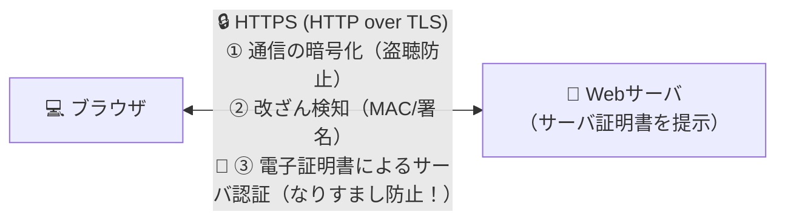

# HTTPSで実現できること：「暗号化」だけじゃない！電子証明書による「本物のサーバ証明」！

> **想定読者**: HTTPS＝暗号化するだけだと思っていて「サーバ認証」を見落とす文系受験者
> **省いたもの**: TLS 1.3におけるECDHE鍵交換と0-RTTハンドシェイクの暗号学的詳細
> **所要時間**: 6〜8分
> **対象過去問**: 応用情報技術者 平成19年春期 問76

---

## 【対象過去問】平成19年春期 問76

**【問題】**
HTTPSを用いて実現できるものはどれか。

- **ア**: Webサーバ上のファイルの改ざん検知
- **イ**: クライアント上のウイルス検査
- **ウ**: クライアントに対する侵入検知
- **エ**: 電子証明書によるサーバ認証

▶ 正解を表示する

**正解: エ（電子証明書によるサーバ認証）**

---

## 0. 一枚で：『HTTPSは「通信の暗号化」と「電子証明書によるサーバ認証」を実現する！』

### 🧠 脳に刻む合言葉：
> **『 HTTPSの3大パワーは「暗号化・改ざん検知・証明書によるサーバ認証」！ウイルス検査はできない！ 』**

---

## 1. なぜそうなるのか？（日常のたとえ話：銀行窓口の身分証提示。声をひそめて話す（暗号化）だけでなく、相手が本物の銀行員か名札（電子証明書）を確かめる！）

「通信が暗号化されていても、そもそも通信相手が詐欺師（偽サイト）だったら意味がない！」と思いませんか？
どんなに厳重な金庫にお金を入れて送っても、送り先が泥棒の家だったらお金は盗まれてしまいます。

だから **HTTPS（HTTP over SSL/TLS）** には、通信を暗号化するだけでなく、最初に必ず **「接続先のWebサーバが本当に本物かどうかを、電子証明書（サーバ証明書）を使って確認する（サーバ認証）」** という超重要な機能が備わっています！

※逆に、HTTPSはあくまで「通信経路（土管の中）」を守る技術なので、Webサーバの中のファイル監視や、パソコンの中のウイルス検査まではしてくれません。

---

## 2. 選択肢のひっかけポイント ＆ 判定理由

- **ア: Webサーバ上のファイルの改ざん検知** → ホスト型IDS（Tripwireなど）の役割であり、通信プロトコルのHTTPSでは実現できません（×）。
- **イ: クライアント上のウイルス検査** → ウイルス対策ソフト（EDR/アンチウイルス）の役割です（×）。
- **ウ: クライアントに対する侵入検知** → パーソナルファイアウォールやIDSの役割です（×）。
- **エ: 電子証明書によるサーバ認証 【正解！】** → SSL/TLSのサーバ証明書を用いて通信先サーバの正当性を確認できます（◯）。

---

## 3. 午後試験 記述対策チェックリスト（※該当する場合）

- [ ] **Q. HTTPS通信において、通信内容の暗号化以外にSSL/TLSサーバ証明書を用いることで防止できる脅威は何か？**  
  → **「悪意ある第三者が正規のWebサーバになりすますフィッシング等の脅威。」**

---

## 🎯 次の2分アクション（定着チェック）

- [ ] **画面の一番上に戻り、正解を隠した状態で正解肢「エ」を確信を持って選べるか試してみよう！**
