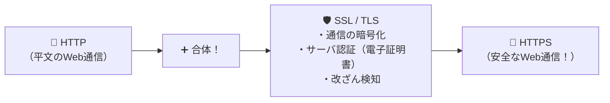

# HTTPSの正体：HTTPに「SSL/TLS」の鎧を着せて、暗号化とサーバ認証を実現！

> **想定読者**: HTTPS、SSL/TLS、S/MIME、Cookieの役割分担が整理できていない文系受験者
> **省いたもの**: TLSレコードプロトコルとハンドシェイクプロトコルのパケットヘッダ構造
> **所要時間**: 6〜8分
> **対象過去問**: 応用情報技術者 平成25年春期 問36

---

## 【対象過去問】平成25年春期 問36

**【問題】**
HTTPS通信において，暗号化とサーバ認証に使用されるものはどれか。

- **ア**: Cookie
- **イ**: S/MIME
- **ウ**: SSL/TLS
- **エ**: ダイジェスト認証

▶ 正解を表示する

**正解: ウ（SSL/TLS）**

---

## 0. 一枚で：『HTTPS通信において、暗号化とサーバ認証に使用されるプロトコルは SSL/TLS！』

### 🧠 脳に刻む合言葉：
> **『 HTTP ＋ SSL/TLS ＝ HTTPS！Webの暗号化とサーバ認証はSSL/TLSの仕事！ 』**

---

## 1. なぜそうなるのか？（日常のたとえ話：現金（HTTP）をそのまま送るのではなく、現金輸送車（SSL/TLS）に乗せて安全に運ぶのがHTTPS！）

WebサイトのURLが `https://...` で始まる **HTTPS** 通信。
最後の **「S」** は Secure（安全）の意味ですが、具体的に裏側で何という技術が働いているのでしょうか？

それが **SSL/TLS（Secure Sockets Layer / Transport Layer Security）** です！
普通のWeb通信（HTTP）の下に、SSL/TLSというセキュリティの土台を挟み込むことで：
1. **暗号化**（盗聴防止）
2. **サーバ認証**（偽サイトへのなりすまし防止）
3. **改ざん検知**（途中の書き換え防止）
の3つをまるごと提供してくれます！

---

## 2. 選択肢のひっかけポイント ＆ 判定理由

- **ア: Cookie** → ブラウザに状態やセッションIDを保存する仕組みであり、暗号化機能はありません（×）。
- **イ: S/MIME** → 「電子メール」を暗号化・電子署名する規格であり、HTTPS（Web）ではありません（×）。
- **ウ: SSL/TLS 【正解！】** → HTTPS通信の暗号化およびサーバ認証を担うプロトコルです（◯）。
- **エ: ダイジェスト認証** → パスワードだけをハッシュ化して送るHTTP認証方式であり、通信全体の暗号化やサーバ証明書の認証は行いません（×）。

---

## 3. 午後試験 記述対策チェックリスト（※該当する場合）

- [ ] **Q. Webサーバとブラウザ間の通信を暗号化するHTTPSが標準で使用するウェルノウンポート番号は何番か？**  
  → **「443番。」**

---

## 🎯 次の2分アクション（定着チェック）

- [ ] **画面の一番上に戻り、正解を隠した状態で正解肢「ウ」を確信を持って選べるか試してみよう！**
